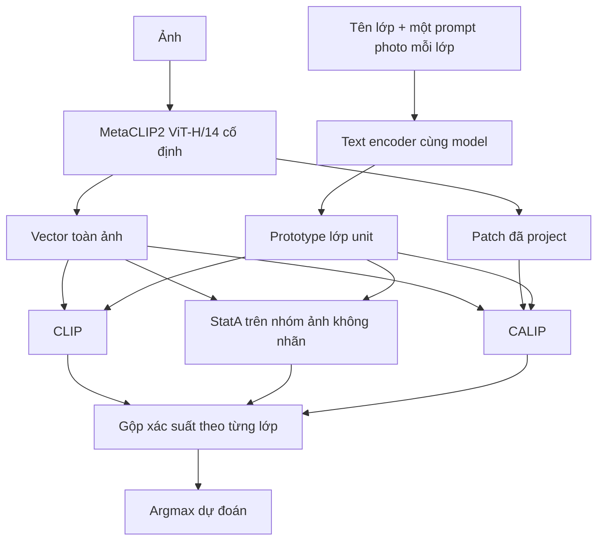

# Chẩn đoán CLIP + StatA + CALIP

Đây là thử nghiệm để xem gộp xác suất có giúp phân loại ảnh nhiều lớp hay không. Chưa chọn nó làm phương pháp cuối và chưa kết luận cải thiện so với paper. Code/cấu hình cũ trước thay đổi nằm ở `backups/before_fusion_diagnostic_689a889d/`; bản legacy trước đó tiếp tục ở `archive/legacy_20261103/`.

## Chạy từ local lên Kaggle

Tại thư mục gốc dự án, dùng tài khoản Kaggle đã đăng nhập và dataset `nguyenhung3105/vlm-public-benchmarks-eval-v1` hiện có:

```sh
venv/bin/python -B scripts/launch_runs.py \
  --launcher-config configs/kaggle_launcher.yaml \
  --job diagnostic_imagenetv2_fusion \
  --use-kaggle true --wait
```

Mặc định **256 ảnh ImageNetV2 và đủ 1.000 lớp ứng viên**. Launcher in limit và quota trước khi gửi, đóng gói code private và dùng lại dataset ảnh. Notebook chạy chẩn đoán đúng một lần, không chạy thêm full 10.000 ảnh hoặc các seed Waffle. Kiểm tra offline trước khi gửi bằng cách thêm `--prepare-only`. Nếu chỉ cần thử luồng, thêm `--max-samples 5`; đây vẫn là subset ngẫu nhiên và có chạy đủ ba nhánh.

Timeout gửi cho Kaggle là 3.600 giây. Local chờ tối đa timeout cộng 900 giây; hết thời gian chờ local không tự hủy job. Thời gian thực tế còn phụ thuộc tải trọng số, khởi động GPU và tốc độ xử lý; chưa đo trên GPU cho job mới này.

Nếu mất kết nối, dùng `--resume-stage` với Stage được in ra để thu đúng version đã gửi, tránh tạo một lượt suy luận mới:

```sh
venv/bin/python -B scripts/launch_runs.py --resume-stage results/_system/launches/final/diagnostic_imagenetv2_fusion_<id>
```

## Luồng tính điểm



Một model **MetaCLIP2 ViT-H/14 worldwide, FP32**, giữ preprocessing, tokenizer và checkpoint đang dùng. Mỗi lớp có đúng prompt `A photo of a {class name}.`. Cùng thứ tự lớp/prototype được truyền cho cả ba nhánh; không mã hóa các bộ mô tả DCLIP/Waffle trong lượt chẩn đoán này.

- **CLIP:** softmax của `100 × cosine(global, prototype)`.
- **StatA:** dùng implementation hiện có trong `adaptation.py`: 10 vòng cập nhật, 5 vòng trong, 3 láng giềng, prior scale 100. Ảnh được chia nhóm ngẫu nhiên tối đa 75 ảnh, grouping seed 0; không dùng nhãn thật. Nhóm cuối có tối đa 3 ảnh giữ prior CLIP vì không đủ láng giềng. Mặc định 256 ảnh tạo các nhóm 75/75/75/31.
- **CALIP:** dùng global và các patch đã qua LayerNorm/projection sang cùng không gian text. Công thức bám [code CALIP tại commit đã lưu](https://github.com/ZiyuGuo99/CALIP/blob/83e21b6b985934dce6e8414c26300671b4825841/run_imagenet.py), attention scale 2, ba hệ số 1 / 1,12 / 0,02, logit scale 100. Hệ số lấy từ implementation ImageNet, chưa tối ưu cho MetaCLIP2. Đây là áp dụng công thức lên backbone mới, không phải tái lập điểm CALIP với backbone gốc.

Extractor lấy global và patch trong một forward ảnh. Batch đầu chạy thêm encoder gốc để kiểm tra global khớp trong dung sai `atol=1e-6, rtol=1e-5`; sai shape, projection, vector hoặc parity sẽ dừng. Patch được xử lý theo batch 8 rồi giải phóng, không giữ toàn bộ patch trong RAM. Tham khảo [OpenCLIP v3.3.0 VisionTransformer](https://github.com/mlfoundations/open_clip/blob/v3.3.0/src/open_clip/transformer.py) cho thứ tự LayerNorm/projection; test bao phủ cả hai chế độ `final_ln_after_pool`.

Ba nhánh cung cấp xác suất trên cùng các lớp. Lưu sáu phép đánh giá đã định trước: `clip`, `stata`, `calip`, `fusion_clip_stata` (1/2 mỗi nhánh), `fusion_clip_calip` (1/2 mỗi nhánh), `fusion_three` (1/3 mỗi nhánh). Không tự chọn trọng số theo accuracy test. Temperature mỗi nhánh là 1, **chưa fit calibration**; softmax không đảm bảo các nhánh có độ tin cậy tương đương. Confidence và entropy giúp nhận diện nhánh quá sắc/lấn át khi gộp.

Thông số ở `configs/fusion_diagnostic.yaml`. Seed chọn ảnh 0 được áp dụng trước khi đọc nhãn; chỉ hash/mở 256 ảnh được chọn, manifest đầy đủ được kiểm tra schema/số dòng. EM và gate phân cấp hai tầng không có trong lượt này. Nhãn chỉ dùng để tính metrics sau khi cả sáu ma trận xác suất đã được tạo.

## Kết quả và cách đọc

Khi chạy xong, launcher tự tải và kiểm checksum tại:

```text
results/final/kaggle/diagnostic_imagenetv2_fusion_<id>/
  metrics_diagnostic_n256_<timestamp>_<id>.zip
  run/
    summary.tsv                 # accuracy, macro-F1, balanced accuracy, top-5 cho 6 cách
    metrics_by_seed.tsv
    predictions.tsv             # dự đoán từng ảnh, từng cách
    sample_top5.tsv              # 5 lớp và xác suất cao nhất mỗi ảnh/cách
    branch_diagnostics.json     # confidence, entropy, NLL, agreement và sửa/hỏng so CLIP
    replay_scores.npz           # global, prototype, logits, 6 posterior, ID/nhãn/lớp/nhóm
    patch_verification.npz      # tối đa 3 ảnh: patch + global + prototype + 3 term CALIP
    extraction.json             # grid, số patch, parity và flag extractor từng batch
    timings.json                # thời gian nạp model, text, ảnh/CALIP, StatA
    cohort.json                 # ID/path/nhãn/hash ảnh thực sự được chọn
    frozen_plan.json            # cấu hình, cohort, source/hash trước inference
    run.json                    # metadata thực tế và checksum artifact
    completed.json
```

File `.npz` dùng `numpy.load(..., allow_pickle=False)`, có thể tính lại metrics và phép gộp mà không tải lại model. Đường dẫn ảnh trong cohort là đường dẫn Input Kaggle; các feature và điểm đủ để kiểm tra dự đoán ở local.

So `fusion_three` với **CLIP trên cùng 256 ảnh** và hai phép gộp cặp; xem `clip_wrong_to_correct` và `clip_correct_to_wrong` để xác định lợi/hại. Với subset nhỏ, nhiều lớp không có ảnh thật: `class_coverage` ghi số lớp có mặt; macro-F1 vẫn tính trên đủ 1.000 lớp nên không so trực tiếp với macro-F1 full. Accuracy/top-5 subset cũng không thay thế kết quả benchmark đầy đủ. Một grouping seed không cho độ lệch chuẩn đáng tin cậy.

Nếu dùng kết quả này để thay đổi phương pháp, phải ghi nhận ImageNetV2 subset đã phục vụ phát triển. Cần giao thức đánh giá độc lập/phần còn lại đã khóa để xác nhận, cùng backbone/prompt khi so phương pháp; không tuyên bố vượt paper bằng cách đối chiếu subset MetaCLIP2 với bảng full OpenAI CLIP. Fakeddit cần đánh giá riêng theo nhiệm vụ/nhãn và modality của nó.
