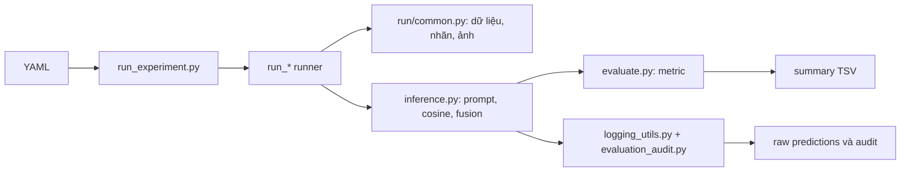

# Bàn giao dự án: phân loại nội dung ảnh và text bằng zero-shot

Tài liệu này tóm lược trạng thái tại ngày 10-10-2026 để người tiếp quản có thể
hiểu cấu trúc, chạy đúng thử nghiệm và biết các kết luận nào hiện chưa được xác
minh. Lệnh test/prepare đã chạy bằng dữ liệu tổng hợp; trong phiên này không đọc
dataraw/ hoặc các bảng dữ liệu thật, không tải checkpoint và không chạy inference
trên dataset thật.

**Cập nhật ngày 11-10-2026:** phiên “Nghiên cứu zeroshot” đã tiếp quản và chạy
thử checkpoint thật trên 5 mẫu cho cả năm tác vụ, đối chiếu scoring humanitarian,
sửa tổng hợp metric theo seed và bổ sung thiết bị thực thi vào log. Đọc
[báo cáo tiếp tục](zeroshot_smoke_20261011.md) trước khi làm bước tiếp theo.
Các mục dưới đây giữ trạng thái bàn giao ngày 10-10; thông tin “chưa chạy
checkpoint/dữ liệu thật” đã được cập nhật bởi báo cáo mới. Đánh giá quy mô lớn,
nhiều seed và so với model chính vẫn còn dang dở.

## 1. Mục tiêu và thiết kế hiện tại

Dự án chấm phân loại ba bộ dữ liệu bằng đầu vào ảnh và text. Pipeline chính dùng
embedding của một model đã huấn luyện; không fine-tune. Mỗi modality được mã hóa
riêng, so với prompt của lớp, rồi kết hợp ở tầng điểm/xác suất.

| Dataset | Tác vụ | Số lớp | Kiểu dự đoán |
|---|---|---:|---|
| Fakeddit | `2way`, `6way` | 2 hoặc 6 | Một nhãn |
| CrisisMMD | `informativeness`, `humanitarian` | 2 hoặc 8 | Một nhãn |
| MM-IMDb | `genres` | 23 | Nhiều nhãn độc lập |

Các khóa nhãn code chính dùng để đối chiếu với log:

- Fakeddit 2way: `0=fake`, `1=real`.
- Fakeddit 6way: `0=True`, `1=Satire/Parody`, `2=False Connection`,
  `3=Imposter Content`, `4=Manipulated Content`, `5=Misleading Content`.
- CrisisMMD informativeness: `informative`, `not_informative`.
- CrisisMMD humanitarian: `not_humanitarian`, `other_relevant_information`,
  `rescue_volunteering_or_donation_effort`, `infrastructure_and_utility_damage`,
  `affected_individuals`, `vehicle_damage`, `injured_or_dead_people`,
  `missing_or_found_people`.
- MM-IMDb: `Action`, `Adventure`, `Animation`, `Biography`, `Comedy`, `Crime`,
  `Documentary`, `Drama`, `Family`, `Fantasy`, `Film-Noir`, `History`, `Horror`,
  `Music`, `Musical`, `Mystery`, `Short`, `Romance`, `Sci-Fi`, `Sport`,
  `Thriller`, `War`, `Western`.

Các file/cột cụ thể hiện được trỏ trong YAML chính: Fakeddit dùng
`data/processed/pro_fakeddit/fakeddit_sample.tsv`, `id`, `clean_title`,
`2_way_label`/`6_way_label`; CrisisMMD dùng
`data/processed/pro_crisismmd/pre_crisismmd.tsv`, `tweet_id`, `clean_text`,
`label_informative`/`label_humanitarian`; MM-IMDb dùng
`data/processed/pro_mmimdb/mmimdb_sample.tsv`, `id`, `plot`, `genres`. Đây là cấu
hình, không phải xác nhận lại nội dung các tệp dữ liệu thật.

Model có sẵn trong code chính là MetaCLIP2 ViT-H/14, DFN ViT-H/14 và SigLIP2
SO400M. Model mặc định chọn trong `configs/experiment_config.yaml`. Các runner
không học từ nhãn test/validation để fit tham số; người dùng có thể cấu hình
prompt, image weight, scale, chunking và quy tắc quyết định.

Đã có hai nhánh nghiên cứu riêng:

1. `run_adapted_methods.py`: thay prompt ảnh trong code chính, giữ model hiện có
   và nhánh text của dự án.
2. `run_upstream.py`: dùng OpenAI CLIP ViT-B/32 cùng các hàm lấy từ repo WaffleCLIP
   và DCLIP; áp dụng loader, nhãn và metric của dự án. Có cả kết quả ảnh gốc và
   phần mở rộng fusion ảnh + text.

Nhánh thứ hai chưa có kết quả trên ảnh, text hoặc checkpoint thật. Hiện có code,
cấu hình và kiểm thử tổng hợp; chưa thể nói nó tăng điểm.

## 2. Cây mã nguồn

```text
src/
├── run_experiment.py             vòng lặp model × dataset của pipeline chính
├── demo.py                       chạy số mẫu nhỏ và vẽ ảnh
├── config.py                     nạp, kiểm tra cấu hình YAML
├── run/
│   ├── common.py                 reader giới hạn, ánh xạ nhãn, ảnh, summary
│   ├── run_fakeddit.py           các tác vụ 2way/6way
│   ├── run_crisismmd.py          informativeness/humanitarian
│   └── run_mmimdb.py             task nhiều nhãn genres
├── inference.py                  prompt embedding, nhánh điểm và fusion
├── text_scale.py                 scale logit riêng cho text
├── text_chunking.py              chia plot dài, mean embedding/max similarity
├── evaluate.py                   metric single-label và multi-label
├── evaluation_audit.py           metric theo nhánh, truncation và cohort
├── logging_utils.py              log dự đoán từng mẫu, manifest, lỗi
├── models/model_registry.py      model đang dùng trong pipeline chính
├── prompts/                      prompt/nhãn code chính
├── research/
│   ├── adapted_methods.py        adapter cho model chính
│   ├── run_adapted_methods.py    runner adapter
│   ├── upstream.py               cầu nối tới hàm gốc và OpenAI CLIP
│   └── run_upstream.py           runner repo gốc + data/metric dự án
└── preprocessing/                script tạo/kiểm tra dữ liệu; không tự gọi

configs/
├── experiment_config.yaml        cấu hình code chính
├── prompts/                      prompt biến thể Fakeddit
└── research/
    ├── adapted.yaml              thí nghiệm với model chính
    ├── upstream.yaml             repo, checkpoint, task, seed, output
    ├── sources.json              URL và commit của ba repo
    └── descriptors/              descriptor cố định đủ cho cả năm task

tests/                             test tự động bằng dữ liệu giả
docs/                              README chi tiết và tài liệu bàn giao này
third_party/                       checkout nghiên cứu, Git bỏ qua
results/<method>/<dataset>/<task>/samples_N/<model>/<task>_<lượt>/  kết quả theo cấu trúc mới
results1/                          kết quả lịch sử nằm ngoài lần sắp xếp này
backup/20261010_cleanup/           bản sao trước đợt dọn gần nhất
```

Runner chính và `demo.py` gọi cùng các hàm `run_*`; logic đọc, lọc, ánh xạ nhãn,
metric và log tập trung ở module dùng chung. Thư mục `tests/` chỉ có test, không
được runner nhập như mã production. Các script tiền xử lý là tiện ích riêng; không
có bước nào tự chạy chúng khi gọi model.

## 3. Pipeline chính: từ đầu vào tới đầu ra

1. `src/run_experiment.py` đọc và kiểm tra YAML qua `src/config.py`.
2. Registry tải model đã chọn một lần, sau đó vòng qua từng dataset bật `enabled`.
3. Runner đọc bảng có giới hạn, lọc text nếu task yêu cầu, ánh xạ nhãn về khóa
   prompt, tìm ảnh và loại ảnh mở không được. Số mẫu tối đa tính trước bước loại ảnh;
   runner không thay ảnh lỗi bằng dòng tiếp theo.
4. Inference mã hóa prompt lớp và mỗi nhánh input. Mỗi ảnh/text được so bằng cosine.
5. Fakeddit/CrisisMMD: scale/bias, softmax mỗi nhánh, fusion tuyến tính theo
   `image_weight`, rồi argmax. Text rỗng dùng ảnh làm fallback.
6. MM-IMDb: mặc định chuẩn hóa cosine qua các lớp riêng từng mẫu (`relative_z`),
   fuse hai nhánh rồi chọn các lớp trên ngưỡng z. Nếu không lớp nào đạt, `fallback_top1`
   chọn lớp cao nhất. Đây là score tương đối, không phải xác suất; `threshold: 0.22`
   chỉ có tác dụng ở chế độ `fixed_threshold`.
7. `evaluate.py` tính metric; `evaluation_audit.py` ghi kết quả theo nhánh, độ dài
   token, split khai báo/cohort; `logging_utils.py` lưu TSV theo từng mẫu và manifest.
8. Summary và log chi tiết của lượt mới nằm cùng `results/<method>/<dataset>/<task>/samples_N/<model>/<task>_<lượt>/`.



Mục thường chỉnh nằm theo từng dataset ở `configs/experiment_config.yaml`:

- `task`, `enabled`, `max_samples` và cột ID/text/label.
- `inference.image_weight`: 1 chỉ ảnh, 0 chỉ text, giá trị giữa trộn hai nhánh.
- `inference.text_logit_scale`: số dương đặt scale; `null` dùng scale của model.
- `prompt_aggregation`: `mean_embed` hoặc `mean_sim`.
- MM-IMDb: `chunk_long_text`, `chunk_aggregation`, `decision_mode` và ngưỡng.
- `evaluation.sample_lock_mode: "off"` không tự khóa cohort; người dùng có thể
  bật verify bằng config nếu cần đối chiếu cùng mẫu.

`mean_embed` lấy trung bình vector prompt rồi chuẩn hóa L2 lại. `mean_sim` chuẩn
hóa từng vector prompt rồi lấy trung bình cosine, tương đương dot với vector trung
bình chưa chuẩn hóa. Với multi-label, mỗi hàng được biến đổi riêng theo lớp của
cùng mẫu; ngưỡng z hiện dùng phép so sánh nghiêm ngặt `>` và fallback chọn argmax.

Fakeddit mặc định lọc `min_text_length: 20`. `max_samples` chỉ tính sau lọc text,
trước kiểm tra ảnh. Split trong YAML là tên do người dùng khai báo, không được mã
nguồn xác minh. Người dùng đã thử nhiều lần trên validation; vì vậy không mô tả
đây là đánh giá test độc lập.

Metric nhìn chính: Fakeddit/CrisisMMD xem Macro-F1 và balanced accuracy; accuracy
và micro-F1 bổ sung. MM-IMDb xem Macro-F1, Micro-F1 và samples-F1. Hamming accuracy
không phải metric quyết định chính vì các nhãn âm chiếm nhiều ô.

## 4. Thí nghiệm dùng code/repo của tác giả

Repo đã clone và khóa trong `configs/research/sources.json`:

| Repo | Commit | Thành phần dùng |
|---|---|---|
| OpenAI CLIP | `d05afc436d78f1c48dc0dbf8e5980a9d471f35f6` | checkpoint ViT-B/32 mặc định, tokenizer, tiền xử lý ảnh |
| WaffleCLIP | `7a1b8ee48e31285f62ecd839fecb6b89cbef81f1` | bộ sinh prompt từ/cụm từ + ký tự, mã hóa mô tả, mean similarity |
| DCLIP | `d1a3d8920af89bd0d6a692ed3afeb277df46e082` | template descriptor/tên lớp, mã hóa, mean similarity |

Thân hàm của repo tác giả được lấy trực tiếp từ checkout đã khóa, không import
script main đầy đủ vì script đó khởi tạo các loader dữ liệu riêng của paper. Code
cầu nối đổi đầu vào/đầu ra sang schema dự án, đặt device và cung cấp prompt cố định.
Waffle dùng từ điển chính thức đi cùng repo. Checkpoint chỉ được nạp ở lệnh chạy
thật, sau khi prompt/config đã được ghi vào `frozen_plan.json`.

`configs/research/upstream.yaml` hiện chạy mặc định:

- Backbone: `ViT-B/32` OpenAI CLIP (khác backbone MetaCLIP2/SigLIP2/DFN ở code chính).
- Methods: `clip`, `waffle`, `dclip_labels`, `dclip`. Chỉ `waffle` lặp qua danh sách
  `seeds`; hiện mặc định `[0]` là smoke run.
- Số mẫu: chỉ `crisismmd/humanitarian` bật và giới hạn 5; Fakeddit và MM-IMDb tắt.
- Outputs: `original_image` và `multimodal`.
- Files descriptor được khóa trước khi mở bộ dữ liệu, có provenance và hash.

`device: auto` ưu tiên CUDA, rồi Apple MPS, rồi CPU. Đặt `device: mps` hoặc `cuda`
nếu muốn cố định thiết bị. Cấu hình thực tế và backend model được lưu vào plan/log.

Lệnh từ thư mục gốc:

```sh
python3 src/research/run_upstream.py --prepare-only
python3 src/research/run_upstream.py
```

Lệnh đầu xác minh repo/commit và sinh prompt/plan, không đọc data hoặc tải model.
Lệnh hai chạy task đang bật. Có thể cài phụ thuộc ngoài pipeline chính bằng
`pip install -r requirements/research.txt`. Hãy thử 5 mẫu trước khi tăng giới hạn.
Khi tăng lên 1000, số đó đi qua cùng text filter, nhưng ảnh lỗi vẫn bị bỏ và không
được backfill. Thử nghiệm nhiều seed tốn thêm mã hóa descriptor cho từng seed.

`original_image` dùng argmax cosine theo phương pháp ảnh paper. `multimodal` dùng
text prompt của pipeline chính, cố định chung cho tất cả methods; fusion và metric
lấy cấu hình/code dự án. Vì vậy, phần multimodal là adapter mới. MM-IMDb nhiều nhãn
cũng là adapter; nếu chạy, cần diễn giải cột `classification_scope`.

Các descriptor trong `configs/research/descriptors/` được tạo từ mô tả taxonomy
và đóng băng trước thí nghiệm. Chúng không phải GPT-3 descriptor chính thức trong
paper. Riêng Fakeddit, ảnh không thể tự xác thực tính đúng/sai của claim; phân lớp
ảnh có thể cho một đối chứng hạn chế.

Kết quả được ghi vào một thư mục duy nhất dưới `results/upstream_<method>/<dataset>/<task>/samples_N/<model>/<task>_<lượt>/` (hoặc `upstream_suite` nếu chạy nhiều phương pháp) với
`frozen_plan.json`, `summary.tsv`, `seed_summary.tsv`, `raw_predictions/`, và
`failure.json` nếu có lỗi. Dòng method/seed/output ghi rõ model/backbone/metric;
snapshot từng mẫu có cùng cohort hash. Lỗi giữ lại plan/log đã ghi và không tạo
seed summary cho lượt chạy chưa hoàn tất. Các lượt chạy không ghi đè thư mục cũ.

Đây chưa phải toàn bộ thí nghiệm trong các bài báo. Các repo đã được clone nguyên
commit, nhưng runner chỉ gọi đường tạo prompt, mã hóa mô tả và tổng hợp similarity
cốt lõi rồi nối vào 3 taxonomy/reader/metric của dự án. Runner không chạy các
benchmark ImageNet/bird riêng của họ, không dùng chuỗi GPT-3 gốc do paper tạo,
không chạy mọi biến thể/ablation hoặc báo cáo lại bảng số của paper. Mục tiêu ở
đây là áp dụng phép phân loại zero-shot của tác giả lên dữ liệu hiện có và đối
chiếu, không tuyên bố tái lập toàn bộ bài báo.

Fakeddit 6-way và các nhãn thông tin CrisisMMD có yếu tố ngữ cảnh từ text. Kết quả
`original_image` đo đúng nhánh ảnh nhưng không thể thay thế phân loại multimodal
của hệ thống. Khi đối chiếu với model chính, cả model lẫn backbone đều khác; muốn
quy chênh lệch chỉ cho phương pháp thì phải so các method trên cùng backbone,
cùng ID mẫu, prompt text, image weight, preprocessing và metric.

## 5. Phần hoàn tất và phần cần làm tiếp

**Đã làm:** dọn vị trí module, kiểm tra cấu hình YAML, thống nhất main/demo/runner;
giữ cấu hình thí nghiệm cũ; lưu backup; đặt tài liệu cấu trúc vào README; clone và
ghim ba repo; xây runner original và multimodal extension; chuẩn bị descriptor đủ
nhãn; thêm kiểm thử giả cho hai runner và cả năm task.

**Chưa làm/chưa xác minh:** không có lượt inference nào dùng checkpoint OpenAI CLIP
thật hoặc dữ liệu thật; chưa đo metric thật cho từng task/model; chưa xác nhận thời
gian/bộ nhớ trên cohort 1000; chưa so kết quả raw từng mẫu với output source paper;
chưa kiểm định thống kê hoặc kết luận model/phương pháp tốt hơn; descriptor mới chưa
được xác nhận là tốt; chưa chạy sweep bảy seed. DCLIP/OpenAI source được giữ nguyên,
không cài môi trường thí nghiệm upstream cũ.

## 6. Việc người tiếp quản nên làm

1. Trước hết chạy `git status --short` để nhận diện các sửa đổi đang có; không reset,
   checkout hoặc xóa các file chưa hiểu. Không commit/push nếu chưa có yêu cầu.
2. Đọc `AGENTS.md`. Không mở `dataraw/`; nếu cần kiểm tra `data_process/`, chỉ đọc
   schema và tối đa năm dòng đầu mỗi file. Không nạp cả file rồi mới lấy vài dòng.
3. Kiểm tra Python phụ thuộc bằng `pip install -r requirements.txt` và
   `pip install -r requirements/research.txt`. Bảo đảm ba thư mục `third_party/`
   đúng commit và sạch; `run_upstream.py` tự xác minh.
4. Giữ chỉ một dataset bật trong `configs/research/upstream.yaml`, đổi task đúng tên,
   chạy `--prepare-only`, xem descriptor/order trong plan, rồi chạy năm mẫu.
5. Kiểm tra `summary.tsv`, `seed_summary.tsv`, từng `raw_predictions.tsv`, manifest,
   `diagnostics.tsv` và `evaluation_snapshot.json`. Đặc biệt so cohort ID, lớp có
   mặt, số ảnh bị bỏ, tỷ lệ text trống/truncated và trạng thái MM-IMDb decision mode.
6. Khi smoke test đạt, dùng cùng cohort/filters cho model và method cần so; tăng mẫu
   và seed, sau đó ghi nhận thời gian/bộ nhớ và so với kết quả code chính trên đúng
   các ID. Chênh giữa ViT-B/32 và MetaCLIP2/SigLIP2 còn chứa ảnh hưởng backbone.
7. Không sửa prompt/descriptor theo chính các lỗi validation rồi gọi kết quả sau đó
   là đánh giá độc lập. Nếu muốn chọn prompt/scale/ngưỡng bằng nhãn, phải ghi rõ đã
   hiệu chỉnh trên validation và giữ test cho lần đánh giá khóa riêng.

Nếu chỉ muốn đánh giá một dataset bằng pipeline chính, có thể tắt
`enabled: false` cho hai dataset còn lại trong YAML rồi chạy `python3 src/run_experiment.py`.
Ba lệnh `python3 src/run/run_fakeddit.py`,
`python3 src/run/run_crisismmd.py`, `python3 src/run/run_mmimdb.py` đọc cùng YAML
nhưng chỉ chạy runner tương ứng.

## 7. Trạng thái workspace lúc bàn giao

Các file mã/config/docs/tests có nhiều thay đổi cục bộ, một phần được kế thừa từ
trước lượt dọn; chưa commit hoặc push. Backup dọn dự án ở `backup/20261010_cleanup/`.
kết quả lịch sử trong `results/` đã được chuyển theo [cấu trúc mới](experiments/results_layout.md), có bảng đường dẫn cũ → mới; `results1/` giữ nguyên. Các lượt
`results/upstream_suite/...` có thể được tạo từ bước `--prepare-only`. File thống
kê nhãn đã bỏ khỏi code đang dùng có bản sao trong backup. Không có thay đổi thật
trên dataset trong lượt triển khai này.
