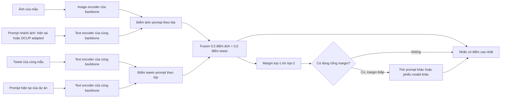
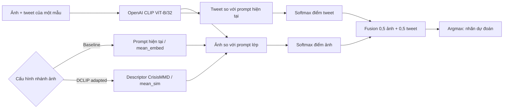

# Tổng hợp phương pháp và kết quả thử nghiệm CrisisMMD

Tài liệu này lưu **cách hoạt động, cấu hình và kết quả của từng phương pháp** được thử trên hai task CrisisMMD: `informativeness` (2 nhãn) và `humanitarian` (8 nhãn). Mỗi nhóm phương pháp sẽ có phần riêng; chỉ thêm kết quả sau khi kiểm tra log, cấu hình và bộ mẫu. Không gộp điểm của các task hoặc các giao thức đầu vào khác nhau vào một phép so sánh.

Phân tích chuyên sâu ngày 22/10/2026: [WaffleCLIP — mục đích nghiên cứu, cơ chế và hướng thích nghi](../research/waffleclip_phan_tich_va_huong_thich_nghi.md). Tài liệu đó tách kết luận của tác giả, hành vi code và giả thuyết cho dự án; chưa bổ sung số liệu thí nghiệm mới.

**Thứ tự đối chứng:** Phần A tách nhánh ảnh của model hiện tại để so với WaffleCLIP/DCLIP gốc, vì các nghiên cứu đó phân loại ảnh bằng prompt lớp. Phần B dùng **ảnh + tweet** trong fusion baseline của dự án trên cùng mẫu. Phần C/D thay prompt ở nhánh ảnh bằng DCLIP/Waffle adapted; phần E thử thêm tín hiệu ảnh–tweet; phần F thử trọng số fusion theo độ phân tán điểm của từng mẫu; phần G kiểm tra hai quy tắc margin đã chạy Kaggle. Phần H nối kết quả của C và G để thử bỏ phiếu khi **cả ba model dùng DCLIP**. Phần I thay backbone bằng OpenAI CLIP trong pipeline ảnh + tweet của dự án và khảo sát OpenAI CLIP làm phiếu phụ. Tài liệu không đặt đối chứng chỉ dùng tweet riêng.

Để trình bày hướng xử lý phân vân, đọc theo đường **B → C → G → H → I**: baseline ảnh + tweet → thay prompt nhánh ảnh bằng DCLIP → thử cổng margin → dùng ba model DCLIP bỏ phiếu có điều kiện → kiểm tra thêm backbone OpenAI CLIP. Đây là các **cấu hình được so sánh**, không phải phép cộng dồn điểm: cổng đổi prompt ở G bắt đầu từ baseline, còn H/I khi bỏ phiếu bắt đầu từ Meta+DCLIP. D và E–F là các nhánh đối chứng khác. Mỗi cấu hình được so trên cùng 1.000 mẫu của từng task; trạng thái Kaggle/offline ghi ngay tại phần tương ứng.

## Luồng chung của phép thử ảnh + tweet (phần B–I)



Sơ đồ thể hiện **các lựa chọn**, không phải tất cả đều chạy trong một job: baseline và DCLIP toàn bộ mẫu đi thẳng đến nhãn; phần G–H và các phân tích offline ở I mới xét cổng margin. Với DCLIP adapted, **chỉ prompt nhánh ảnh đổi**; tweet và prompt nhánh tweet được giữ nguyên. Các điểm của từng nhánh được softmax thành phân phối lớp trước khi fusion. “0,5/0,5” là trọng số trong từng backbone, **không** phải trung bình điểm giữa các backbone. Không dùng nhãn thật trong bước dự đoán; nhãn thật chỉ dùng để tính metric sau lượt chạy.

## Bảng đọc nhanh

Mỗi ô là **Accuracy / Macro-F1** trên 1.000 mẫu của **từng task riêng**. Các hàng chỉ ảnh và ảnh + tweet là hai giao thức khác nhau; các hàng “offline” được tái tính từ raw prediction của lượt Kaggle, chưa có job chạy trực tiếp quy tắc.

| Cấu hình | `informativeness` | `humanitarian` | Nguồn |
|---|---:|---:|---|
| MetaCLIP2, chỉ ảnh, prompt hiện tại | 0,788 / 0,788 | 0,703 / 0,430 | Kaggle; A |
| MetaCLIP2, ảnh + tweet, prompt hiện tại | 0,806 / 0,806 | 0,731 / 0,456 | Kaggle; B |
| MetaCLIP2, ảnh + tweet, DCLIP adapted | 0,834 / 0,833 | 0,733 / 0,465 | Kaggle; C |
| OpenAI CLIP, ảnh + tweet, DCLIP adapted | 0,806 / 0,797 | 0,740 / 0,529 | Kaggle; I |
| Meta+DCLIP và DFN5B+DCLIP, SigLIP2+DCLIP bỏ phiếu khi margin thấp | 0,829 / 0,828 | 0,748 / 0,509 | Offline; H |
| Meta+DCLIP và OpenAI+DCLIP, SigLIP2+DCLIP bỏ phiếu khi margin thấp | 0,838 / 0,837 | 0,746 / 0,512 | Offline; I |

Các trị số nổi bật ở mỗi task phụ thuộc tiêu chí: `informativeness` có Meta+DCLIP **0,834/0,833** trong các lượt Kaggle đơn model; `humanitarian` có OpenAI+DCLIP **Macro-F1 0,529**, trong khi quy tắc H offline có **Accuracy 0,748**. Không chọn cấu hình cuối cùng chỉ từ các trị số thăm dò này; số mẫu lớp hiếm rất ít và split chưa được xác minh.

## Danh mục phương pháp

| Phần | Tên phương pháp | Đầu vào và model | Phần thay đổi so với baseline | Nguồn phương pháp |
|---|---|---|---|---|
| A | Baseline chỉ ảnh | Ảnh → MetaCLIP2 ViT-H/14 | Prompt lớp CrisisMMD của dự án; tweet của mẫu không tham gia | Dự án |
| A | CLIP tên lớp | Ảnh → OpenAI CLIP ViT-B/32 | Một prompt `A photo of a {class}.` cho mỗi lớp | Đối chứng trong WaffleCLIP; đổi nhãn sang CrisisMMD |
| A | WaffleCLIP upstream | Ảnh → OpenAI CLIP ViT-B/32 | Tạo prompt nhiễu từ/chuỗi ký tự theo seed, gộp điểm prompt | Hàm WaffleCLIP; đổi nhãn sang CrisisMMD |
| A | DCLIP-labels | Ảnh → OpenAI CLIP ViT-B/32 | Chỉ dùng tên lớp làm prompt | Đối chứng tên lớp trong DCLIP; đổi nhãn sang CrisisMMD |
| A | DCLIP descriptor upstream | Ảnh → OpenAI CLIP ViT-B/32 | Tên lớp + descriptor rồi gộp điểm prompt | Hàm DCLIP; descriptor CrisisMMD do dự án chuẩn bị, không phải GPT-3 gốc |
| B | Baseline fusion cố định | Ảnh + tweet → MetaCLIP2 ViT-H/14 | Gộp điểm ảnh–prompt và tweet–prompt theo tỷ trọng `0,5/0,5` | Dự án; mốc đối chứng cho C–F |
| C | DCLIP adapted + fusion | Ảnh + tweet → MetaCLIP2, DFN5B hoặc SigLIP2 | Thay prompt nhánh ảnh bằng descriptor DCLIP cố định; nhánh tweet và tỷ trọng giữ như baseline cùng model | Phương pháp prompt DCLIP thích nghi cho dự án |
| D | Waffle adapted + fusion | Ảnh + tweet → MetaCLIP2 ViT-H/14 | Thay prompt nhánh ảnh bằng prompt Waffle theo seed; nhánh tweet và tỷ trọng giữ như B | Phương pháp prompt Waffle thích nghi cho dự án |
| E | Agreement fusion | Ảnh + tweet → MetaCLIP2 ViT-H/14 | Cosine ảnh–tweet điều tiết mức đồng thuận giữa hai nhánh | Heuristic thử nghiệm của dự án |
| E | Direct-pair fusion | Ảnh + tweet → MetaCLIP2 ViT-H/14 | Tạo phân phối điểm lớp từ cặp ảnh–tweet, trộn 25% vào fusion B | Heuristic thử nghiệm của dự án |
| F | **Fusion trọng số động theo entropy** | Ảnh + tweet → MetaCLIP2 ViT-H/14 | Mỗi mẫu tự tính trọng số ảnh/tweet từ độ tập trung điểm của hai nhánh; không học từ nhãn thật | **Heuristic thử nghiệm mới của dự án**, không phải Waffle/DCLIP |
| G | Bỏ phiếu đa số 2/3 khi Meta có margin thấp | Ảnh + tweet → MetaCLIP2, DFN5B, SigLIP2 | Chỉ ở mẫu margin `<=0,10`, chọn nhãn có ít nhất hai phiếu; đã chạy Kaggle hai task | Heuristic của dự án |
| G | Chuyển sang prompt DCLIP adapted khi Meta có margin thấp | Ảnh + tweet → MetaCLIP2 ViT-H/14 | Chỉ ở mẫu margin `<=0,10`, dùng dự đoán từ prompt DCLIP adapted; Kaggle đã chạy cả hai task | Heuristic của dự án dùng prompt adapted |
| H | Bỏ phiếu 2/3 khi Meta+DCLIP phân vân | Ảnh + tweet → MetaCLIP2, DFN5B, SigLIP2; cả ba dùng DCLIP adapted | Chỉ ở mẫu có margin Meta+DCLIP `<=0,10`, chọn phiếu đa số; mới tái tính offline | Heuristic kết hợp của dự án |
| I | OpenAI CLIP trong fusion của dự án | Ảnh + tweet → OpenAI CLIP ViT-B/32 | So prompt hiện tại với DCLIP adapted trên cùng backbone, cùng mẫu, fusion `0,5/0,5` | Đối chứng backbone và prompt adapted của dự án |
| I | OpenAI CLIP là phiếu phụ khi margin thấp | MetaCLIP2 + DCLIP là nhánh chính; OpenAI CLIP + DCLIP thay DFN5B hoặc SigLIP2 | Chỉ tái tính offline bỏ phiếu 2/3 từ raw prediction đã chạy | Heuristic của dự án, chưa có job Kaggle riêng |

Mỗi hàng chỉ dùng kết quả của giao thức đầu vào nêu trong bảng. **Các chỉ số A–G và bốn lượt backbone OpenAI CLIP ở I lấy từ lượt Kaggle có `run_receipt.json`, `run_artifacts.zip` và `summary.tsv`**; phần H và phép thay phiếu ở I được đánh dấu riêng là phép tính offline từ raw prediction của những lượt Kaggle đó. Kết quả offline không thay thế một job Kaggle chạy quy tắc bỏ phiếu. Tên “upstream” ở phần A chỉ nói đến hàm nghiên cứu được áp dụng lên CrisisMMD, không có nghĩa chạy nguyên bộ benchmark tác giả.

## Phần A — Đối chứng chỉ nhánh ảnh

### A.1. Đầu vào và sơ đồ xử lý

Khi **chỉ dùng ảnh**, mô hình nhận ảnh của mẫu và các prompt cố định cho từng lớp. Text/tweet đi kèm mẫu không được dùng để quyết định nhãn. Prompt lớp vẫn là văn bản cần được text encoder của CLIP mã hóa; “chỉ ảnh” không có nghĩa bỏ text encoder.

```text
Ảnh CrisisMMD ────────────────→ image encoder ───────┐
Tên lớp + prompt/descriptor ──→ text encoder ────────┴→ cosine ảnh–prompt → gộp theo lớp → argmax → nhãn
Tweet/caption của mẫu ────────×  không mã hóa, không tham gia điểm image-only
```

Baseline của dự án dùng **MetaCLIP2 ViT-H/14 + prompt CrisisMMD của dự án**. Nhóm upstream dùng **OpenAI CLIP ViT-B/32 + hàm sinh/mã hóa/tổng hợp của WaffleCLIP hoặc DCLIP**. Do backbone khác nhau, so baseline với upstream là so **hai hệ thống hoàn chỉnh**. Trong nhóm upstream, CLIP/Waffle/DCLIP dùng cùng backbone và cùng mẫu nên phép so này tập trung hơn vào cách tạo prompt và gộp điểm, dù descriptor DCLIP là phần thích nghi của dự án.

Tập prompt lớp của baseline chứa cả những câu dạng `a tweet ...` và `a photo ...`; ở chế độ này chúng chỉ là **mô tả cố định của lớp** để so với ảnh. Tweet cụ thể của từng mẫu vẫn không được mã hóa hay đưa vào điểm dự đoán.

### A.2. Nguyên mẫu nghiên cứu và bản chuyển sang CrisisMMD

| Nguyên mẫu trong repo/paper tác giả | Bản đang chạy trên CrisisMMD của dự án |
|---|---|
| **Dataset và nhãn.** WaffleCLIP/DCLIP xử lý bài toán phân loại ảnh của những benchmark mà repo hỗ trợ, như ImageNet/CUB; tên lớp lấy từ benchmark. | **Thay loader và taxonomy.** `run_upstream.py` đọc ảnh CrisisMMD, chọn task, chuẩn hóa thứ tự nhãn, loại ảnh lỗi và đánh giá theo nhãn CrisisMMD. `informativeness` có `Informative`/`Not Informative`; `humanitarian` có 8 nhãn. |
| **Model.** Mã tác giả dùng OpenAI CLIP để mã hóa ảnh và mô tả lớp. | **Giữ OpenAI CLIP.** Các lượt upstream trong bảng kết quả dùng checkpoint `ViT-B/32`, tokenizer và preprocess của OpenAI CLIP. Baseline của dự án là MetaCLIP2, nằm ngoài nhóm upstream. |
| **CLIP tên lớp của WaffleCLIP.** `load_gpt_descriptions(..., mode="clip")` ghép lớp vào mẫu `A photo of a {class}.`; mỗi lớp có một prompt. | **Giữ mẫu, thay tên lớp.** Prompt đã lưu trong lượt chạy: `A photo of a Informative.` và `A photo of a Not Informative.`. `dclip_labels` là đối chứng riêng của DCLIP: prompt chỉ là `Informative` hoặc `Not Informative`, nên không đồng nhất với CLIP baseline của WaffleCLIP. |
| **WaffleCLIP.** `load_gpt_descriptions(..., mode="waffle")` tạo từ/chuỗi ký tự ngẫu nhiên; `waffle_count=15` cho 15 cặp, tức 30 prompt/lớp. Repo tác giả minh họa phép thử 7 seed và báo trung bình/độ lệch chuẩn. | **Giữ hàm, dùng nhãn mới, mới có seed 0.** Prompt thật: `A photo of a Informative, which has wheelbase very.` và `A photo of a Informative, which has iccuwgcnmhla.`. Đây là nhiễu ngẫu nhiên, không phải mô tả ảnh. Hàm tác giả lấy một phần bảng ký tự từ descriptor JSON; thay JSON cho CrisisMMD cũng thay nguồn ký tự này. |
| **DCLIP.** Descriptor cho từng lớp được mô hình ngôn ngữ tạo **trước inference** rồi lưu trong JSON. Ví dụ file gốc cho lớp `tench` có `a freshwater fish`; theo template tác giả, prompt tương ứng là `tench, which is a freshwater fish`. | **Giữ hàm ghép/mã hóa/gộp; thay nguồn descriptor.** JSON CrisisMMD do assistant chuẩn bị từ định nghĩa lớp và cố định trước khi chạy, không phải descriptor GPT-3 gốc. Prompt thật: `Informative, which is a view showing the effects of a disaster or an ongoing emergency`. Không có bước sinh descriptor từ ảnh hay tweet đang được phân loại. |
| **Vòng chạy của repo tác giả.** Mỗi repo có loader, benchmark, tập descriptor và thiết lập thí nghiệm riêng. | **Runner riêng của dự án.** Lấy các định nghĩa hàm cần dùng từ checkout tác giả ở commit cố định, rồi dùng loader, nhãn, log và metric của dự án. Đây là **áp dụng phương pháp lên task mới**, không phải chạy nguyên toàn bộ chương trình/benchmark paper. |

Các hàm gốc được nạp từ checkout tác giả trong [`src/research/upstream.py`](../../src/research/upstream.py):

- **WaffleCLIP:** `load_json`, `wordify`, `make_descriptor_sentence`, `modify_descriptor`, `load_gpt_descriptions`, `compute_description_encodings`, `aggregate_similarity` từ `waffle_tools.py`.
- **DCLIP:** năm hàm hỗ trợ tương ứng từ `loading_helpers.py`, cùng `compute_description_encodings`, `compute_label_encodings`, `aggregate_similarity` từ `load.py`.
- **OpenAI CLIP:** `clip.load`, `clip.tokenize` và các encoder ảnh/text của checkpoint; wrapper `image_scores` tính cosine ảnh với prompt rồi gọi `aggregate_similarity(..., "mean")` của tác giả. Nhãn cuối là lớp có điểm cao nhất.

`verify_sources()` kiểm commit và trạng thái sạch của ba checkout theo [`configs/research/sources.json`](../../configs/research/sources.json). Repo gốc không bị sửa; runner dùng `load_functions()` để nạp định nghĩa hàm mà không chạy loader benchmark ở top-level. Các prompt đã sinh và seed được khóa trong `frozen_plan.json` của từng archive. Descriptor CrisisMMD và nguồn của nó nằm ở [`configs/research/descriptors/`](../../configs/research/descriptors/).

**Tên gọi kỹ thuật:** áp dụng WaffleCLIP/DCLIP từ hàm tác giả lên ảnh CrisisMMD với OpenAI CLIP; thay loader, bộ nhãn và descriptor DCLIP cho task mới. Đây không phải tái lập nguyên xi điểm số trong paper. Nguồn phương pháp: [repo WaffleCLIP](https://github.com/ExplainableML/WaffleCLIP), [repo DCLIP](https://github.com/sachit-menon/classify_by_description_release), [paper DCLIP](https://arxiv.org/abs/2210.07183).

### A.3. Bộ mẫu, cấu hình và cách đọc metric

- Mỗi task dùng **cùng dãy 1.000 bản ghi `(id, text, image_path, y_true)`** giữa baseline và bốn phương pháp upstream. Kiểm tra bằng toàn bộ dãy bản ghi trong `raw_predictions.tsv`; không ghép chỉ theo `id` vì CrisisMMD có ID trùng.
- Hai task được báo cáo **riêng**; không cộng chung Accuracy hay Macro-F1 của chúng. Baseline mới có `image_weight=1.0`, quan hệ ảnh–text tắt và `_text_encoded=False` ở 1.000/1.000 mẫu; upstream ghi `output_variant=original_image`, `image_weight=1.0` và quan hệ tắt.
- `Accuracy` là số dự đoán đúng chia 1.000. `Precision` và `Recall` được tính từng lớp; `Macro-F1` là trung bình F1 của các lớp, mỗi lớp có trọng số ngang nhau:

  $$
  F1_c = \frac{2P_cR_c}{P_c+R_c}, \qquad
  \mathrm{Macro\text{-}F1} = \frac{1}{C}\sum_{c=1}^{C}F1_c
  $$

- Zero-shot **không dùng nhãn CrisisMMD để train model** và không đòi hỏi chia train/dev/test để thực hiện các lượt so sánh trên cùng 1.000 mẫu. Manifest ghi `split=val` nhưng `split_verified=false`; `val` chỉ là tên cấu hình, nên đây là **đánh giá thăm dò trên 1.000 mẫu**, không xác nhận đây là điểm test chính thức và không so trực tiếp với điểm benchmark trong paper.

### A.4. Kết quả đã chạy: informativeness, 2 nhãn

| Hệ thống chỉ ảnh | Backbone | Accuracy | Macro-F1 | Vai trò |
|---|---|---:|---:|---|
| Baseline dự án | MetaCLIP2 ViT-H/14 | **0,788** | **0,788** | Prompt CrisisMMD của dự án, `mean_embed` |
| CLIP tên lớp upstream | OpenAI CLIP ViT-B/32 | 0,501 | 0,490 | Đối chứng tên lớp của WaffleCLIP |
| WaffleCLIP upstream, seed 0 | OpenAI CLIP ViT-B/32 | 0,557 | 0,514 | Prompt nhiễu, 30 prompt/lớp |
| DCLIP tên lớp | OpenAI CLIP ViT-B/32 | 0,389 | 0,335 | Đối chứng tên lớp của DCLIP |
| DCLIP + descriptor CrisisMMD | OpenAI CLIP ViT-B/32 | 0,775 | 0,768 | Descriptor cố định của dự án |

Phân bố nhãn thật: **537 `informative`, 463 `not_informative`**. F1 hai lớp của baseline là **0,789 / 0,787**, khá cân bằng. DCLIP + descriptor đạt **0,808 / 0,728**: nhận lớp `informative` tốt hơn, nhưng lớp `not_informative` kém hơn baseline. Waffle dự đoán `informative` cho **760/1.000** mẫu; Recall của `not_informative` chỉ **0,281**. Do đó Waffle nhỉnh hơn CLIP tên lớp về Accuracy/Macro-F1 trên lượt seed 0, nhưng có lệch lớp rõ rệt.

Archive đối chiếu: [baseline](../../results/image_only_baseline/crisismmd/informativeness/samples_1000/metaclip2_vith14/informativeness_8e06df113731/summary.tsv), [CLIP](../../results/image_only_upstream_clip/crisismmd/informativeness/samples_1000/openai_clip_vit_b_32/informativeness_5c06beff2492/summary.tsv), [Waffle](../../results/image_only_upstream_waffle/crisismmd/informativeness/samples_1000/openai_clip_vit_b_32/informativeness_61fa6fcc913c/summary.tsv), [DCLIP labels](../../results/image_only_upstream_dclip_labels/crisismmd/informativeness/samples_1000/openai_clip_vit_b_32/informativeness_ea2e52baee6c/summary.tsv), [DCLIP](../../results/image_only_upstream_dclip/crisismmd/informativeness/samples_1000/openai_clip_vit_b_32/informativeness_f59288d1c77e/summary.tsv). Raw prediction và `frozen_plan.json` nằm trong `run_artifacts.zip` cùng thư mục mỗi summary.

### A.5. Kết quả đã chạy: humanitarian, 8 nhãn

| Hệ thống chỉ ảnh | Backbone | Accuracy | Macro-F1 | Vai trò |
|---|---|---:|---:|---|
| Baseline dự án | MetaCLIP2 ViT-H/14 | **0,703** | **0,430** | Prompt humanitarian của dự án, `mean_embed` |
| CLIP tên lớp upstream | OpenAI CLIP ViT-B/32 | 0,424 | 0,278 | Đối chứng tên lớp của WaffleCLIP |
| WaffleCLIP upstream, seed 0 | OpenAI CLIP ViT-B/32 | 0,474 | 0,301 | Prompt nhiễu, 30 prompt/lớp |
| DCLIP tên lớp | OpenAI CLIP ViT-B/32 | 0,322 | 0,211 | Đối chứng tên lớp của DCLIP |
| DCLIP + descriptor CrisisMMD | OpenAI CLIP ViT-B/32 | 0,458 | 0,336 | Descriptor cố định của dự án |

Accuracy **0,703** của baseline không có nghĩa cả tám lớp đều được nhận tốt. Bốn lớp phổ biến có **984/1.000** mẫu; bốn lớp hiếm chỉ có **16 mẫu**. Macro-F1 bị ảnh hưởng mạnh bởi vài quyết định ở lớp hiếm:

| Nhãn thật | Số mẫu | F1 baseline | F1 DCLIP + descriptor |
|---|---:|---:|---:|
| `not_humanitarian` | 463 | 0,757 | 0,369 |
| `other_relevant_information` | 198 | 0,770 | 0,713 |
| `rescue_volunteering_or_donation_effort` | 178 | 0,738 | 0,529 |
| `infrastructure_and_utility_damage` | 145 | 0,535 | 0,626 |
| `affected_individuals` | 9 | 0,350 | 0,113 |
| `vehicle_damage` | 4 | 0,195 | 0,190 |
| `injured_or_dead_people` | 2 | 0,000 | 0,133 |
| `missing_or_found_people` | 1 | 0,091 | 0,013 |

Baseline vượt DCLIP ở Accuracy và Macro-F1 tổng thể, nhưng DCLIP tốt hơn ở `infrastructure_and_utility_damage` trên chính tập này. Không rút kết luận chắc cho lớp có 1–9 mẫu. Archive đối chiếu: [baseline](../../results/image_only_baseline/crisismmd/humanitarian/samples_1000/metaclip2_vith14/humanitarian_1738457d3ca5/summary.tsv) và [suite upstream](../../results/image_only_upstream_suite/crisismmd/humanitarian/samples_1000/openai_clip_vit_b_32/humanitarian_9cebbce1f45d/summary.tsv). Suite có bốn dòng `original_image` và raw prediction riêng cho từng method.

### A.6. Trạng thái phép thử chỉ ảnh

| Phép thử | Trạng thái | Ý nghĩa/bước tiếp theo |
|---|---|---|
| Baseline MetaCLIP2 image-only và upstream CLIP/Waffle/DCLIP/DCLIP-labels, 1.000 mẫu, cả hai task | **Đã chạy và có raw prediction** | Đủ cho đối chứng chỉ ảnh ở quy mô 1.000 mẫu; không chạy lại chỉ để lấp bảng. |
| So cùng 1.000 mẫu, kiểm ảnh hợp lệ và caption không tham gia image-only | **Đã kiểm trên archive** | Giữ chứng cứ cùng mẫu và cấu hình cho các lần đối chiếu sau. |
| Nhánh ảnh của `adapted_waffle`/`adapted_dclip` MetaCLIP2 ở informativeness; nhánh ảnh Waffle của suite humanitarian | Informativeness có lượt fusion Kaggle; humanitarian suite cũ chưa có receipt/archive | Không trộn điểm nhánh của lượt fusion vào bảng image-only upstream; chạy lượt Kaggle riêng nếu cần đối chiếu. |
| WaffleCLIP upstream nhiều seed trên cả hai task | **Chưa chạy**, hiện chỉ seed 0 | Phép thử bổ sung riêng cho phần A nếu muốn báo trung bình ± độ lệch chuẩn. Chạy riêng từng seed `1`–`6` trên cùng bộ mẫu; không chọn seed có điểm cao nhất. |
| Xác minh split nguồn và cố định manifest đánh giá | **Chưa xác minh** (`split_verified=false`) | **Ưu tiên trước khi gọi kết quả là đánh giá chính thức**; cần kiểm tra nguồn và tính độc lập của split, không cần chạy GPU để kiểm tra. |
| So prompt của dự án và phương pháp tác giả trên **cùng một backbone** | **Chưa có kết quả Kaggle** | Đã thêm OpenAI CLIP ViT-B/32 vào pipeline dự án; cần chạy đối chứng image-only với prompt dự án rồi ghép cùng mẫu với lượt upstream. Hai đường nạp checkpoint dùng OpenCLIP và API OpenAI gốc nên phải kiểm tra preprocessing/scoring trước khi quy chênh lệch riêng cho prompt. |
| DCLIP với descriptor do quy trình mô hình ngôn ngữ gốc sinh riêng cho CrisisMMD | **Chưa chạy** | Cần tạo, thẩm định và đóng băng descriptor trước inference; khi đó mới gần hơn với thiết lập DCLIP gốc. Các lượt hiện tại dùng descriptor do dự án chuẩn bị. |
| Tăng lên 3.000 mẫu hoặc tập test độc lập sau khi chốt giao thức | **Mới có nhánh ảnh của lượt fusion** ở informativeness: baseline MetaCLIP2 **0,806**, DCLIP adapted MetaCLIP2 **0,817** `image_macro_f1`; **chưa có** bộ image-only đầy đủ 2 task × upstream | Chỉ đối chiếu các lượt có cùng mẫu và cùng cỡ mẫu; không so trực tiếp 3.000 với 1.000 mẫu. |

**Lệnh cho phép thử Waffle nhiều seed**, chạy từng lệnh một, chờ lượt trước hoàn tất. Ví dụ seed `1`:

```bash
venv/bin/python -B scripts/launch_runs.py --job upstream_crisismmd_info_image_only --backbone ViT-B/32 --method waffle --output original_image --seed 1 --max-samples 1000 --use-kaggle true
venv/bin/python -B scripts/launch_runs.py --job upstream_crisismmd_humanitarian_image_only --backbone ViT-B/32 --method waffle --output original_image --seed 1 --max-samples 1000 --use-kaggle true
```

Sau đó thay `--seed 1` lần lượt bằng `2`, `3`, `4`, `5`, `6`; seed `0` đã có. Trước khi bổ sung số mới vào bảng, kiểm tra mỗi lượt hoàn tất, có đúng 1.000 dự đoán và trùng dãy mẫu đã khóa. Nếu cần đối chứng cùng backbone hay descriptor mới, phải chốt giao thức và bổ sung code/cấu hình trước, không dùng lệnh hiện tại rồi gọi đó là bản gốc.

## Phần B — Fusion ảnh + tweet của baseline dự án

Phần này giữ MetaCLIP2 ViT-H/14, cùng bộ prompt lớp và cùng 1.000 mẫu mỗi task như baseline ở phần A. Ảnh và tweet của **cùng mẫu** được mã hóa riêng, so với prompt lớp, rồi trộn điểm xác suất với trọng số cố định `image_weight=0.5`; quan hệ ảnh–text tắt. Nhãn cuối là lớp có điểm fusion cao nhất:

$$
P_{\mathrm{fusion}}(c\mid x) = 0.5P_{\mathrm{image}}(c\mid x) + 0.5P_{\mathrm{text}}(c\mid x)
$$

| Task, 1.000 mẫu | Chỉ ảnh: Accuracy / Macro-F1 | Ảnh + tweet: Accuracy / Macro-F1 | Mẫu sai → đúng / đúng → sai khi thêm tweet |
|---|---:|---:|---:|
| `informativeness` | 0,788 / 0,788 | **0,806 / 0,806** | 102 / 84 |
| `humanitarian` | 0,703 / 0,430 | **0,731 / 0,456** | 108 / 80 |

Ở `informativeness`, ảnh + tweet tăng Accuracy **1,8 điểm phần trăm** và làm **84** mẫu vốn đúng ở nhánh ảnh chuyển thành sai. Ở `humanitarian`, Accuracy tăng **2,8 điểm phần trăm** nhưng **80** mẫu vốn đúng ở nhánh ảnh chuyển thành sai. Đây là fusion của **dự án**, không phải output nguyên mẫu của WaffleCLIP/DCLIP.

Số liệu có trong [baseline informativeness](../../results/baseline/crisismmd/informativeness/samples_1000/multi_model/informativeness_e595fbb7f79a/summary.tsv) và [baseline humanitarian](../../results/baseline/crisismmd/humanitarian/samples_1000/metaclip2_vith14/humanitarian_e20dbf10ac1f/summary.tsv); cả hai có receipt và raw prediction Kaggle. Lượt humanitarian baseline mới khớp `sample_set_id` và toàn bộ dãy mẫu với DCLIP/direct-pair humanitarian.

Khi thử quan hệ ảnh–text ở bước sau, không được mặc định ảnh và tweet phải có cùng nội dung hoặc cùng nhãn: [nhóm phát hành CrisisMMD](https://crisisnlp.qcri.org/crisismmd.html) ghi nhận hai modality có thể mang nhãn khác nhau.

## Phần C — DCLIP adapted ở nhánh ảnh, fusion ảnh + tweet

Đối chứng đầu tiên giữ **MetaCLIP2 ViT-H/14**, nhánh tweet và tỷ trọng fusion `0,5/0,5` của phần B; chỉ thay prompt ở nhánh ảnh bằng descriptor CrisisMMD cố định rồi lấy `mean_sim` của các prompt trong từng lớp. Phần mở rộng bên dưới áp dụng cùng cách đó cho DFN5B và SigLIP2, so với baseline riêng của từng model. Descriptor do dự án chuẩn bị từ định nghĩa nhãn, không phải GPT-3 sinh theo quy trình gốc của DCLIP. Quan hệ ảnh–tweet tắt. Với lớp $c$:

$$
P_{\mathrm{DCLIP\ adapted}}(c\mid x) = 0.5P_{\mathrm{image,descriptor}}(c\mid x) + 0.5P_{\mathrm{tweet,current}}(c\mid x)
$$

| Task, 1.000 mẫu | Baseline ảnh + tweet: Accuracy / Macro-F1 | DCLIP adapted: Accuracy / Macro-F1 | Sai → đúng / đúng → sai |
|---|---:|---:|---:|
| `informativeness` | 0,806 / 0,806 | **0,834 / 0,833** | 65 / 37 |
| `humanitarian` | 0,731 / 0,456 | **0,733 / 0,465** | 49 / 47 |

Đã kiểm cùng 1.000 mẫu và điểm nhánh tweet trùng trong từng cặp lượt. Ở `informativeness`, DCLIP adapted tăng 2,8 điểm phần trăm Accuracy và 2,66 điểm Macro-F1 trên MetaCLIP2. Ở `humanitarian`, mức tăng là 0,2 điểm Accuracy và khoảng 0,9 điểm Macro-F1. Bootstrap ghép cặp 5.000 lần cho chênh Macro-F1 ở informativeness là **[+0,0074; +0,0464]** (khoảng phân vị 95%, seed 20261016). Đây là phân tích thăm dò trên cùng cohort, không phải xác nhận trên test độc lập.

Ở `informativeness`, F1 của `informative` **0,811 → 0,848** và `not_informative` **0,801 → 0,817**. [Kết quả DCLIP informativeness](../../results/adapted_dclip/crisismmd/informativeness/samples_1000/metaclip2_vith14/informativeness_2ff98e4f0871/summary.tsv) và [humanitarian](../../results/adapted_dclip/crisismmd/humanitarian/samples_1000/metaclip2_vith14/humanitarian_8688b1c0c9cf/summary.tsv) đều có raw prediction trong `run_artifacts.zip` cùng thư mục.

Đã mở rộng phép thử DCLIP adapted sang hai backbone khác, mỗi lượt Kaggle chạy riêng và ghép đúng 1.000 mẫu với baseline của **cùng model**. Nhánh tweet giữ nguyên, fusion vẫn `0,5/0,5`:

| Model; task | Baseline Accuracy / Macro-F1 | DCLIP adapted Accuracy / Macro-F1 | Sai → đúng / đúng → sai |
|---|---:|---:|---:|
| [DFN5B; `informativeness`](../../results/adapted_dclip/crisismmd/informativeness/samples_1000/dfn5b_vith14/informativeness_b2fdb7cd9028/summary.tsv) | 0,631 / 0,602 | **0,651 / 0,636** | 93 / 73 |
| [SigLIP2; `informativeness`](../../results/adapted_dclip/crisismmd/informativeness/samples_1000/siglip2_so400m/informativeness_db8dd4cf5e59/summary.tsv) | **0,704 / 0,695** | 0,679 / 0,670 | 64 / 89 |
| [DFN5B; `humanitarian`](../../results/adapted_dclip/crisismmd/humanitarian/samples_1000/dfn5b_vith14/humanitarian_6be9bfd1eace/summary.tsv) | 0,707 / **0,501** | **0,716** / 0,475 | 59 / 50 |
| [SigLIP2; `humanitarian`](../../results/adapted_dclip/crisismmd/humanitarian/samples_1000/siglip2_so400m/humanitarian_2e7bd2f5d771/summary.tsv) | 0,686 / 0,453 | **0,704 / 0,509** | 83 / 65 |

Nguồn baseline của hai model phụ: [margin-majority informativeness](../../results/margin_majority/crisismmd/informativeness/samples_1000/multi_model/informativeness_19271b05a511/summary.tsv) và [margin-majority humanitarian](../../results/margin_majority/crisismmd/humanitarian/samples_1000/multi_model/humanitarian_093e75429270/summary.tsv), gồm raw prediction từng model. Mỗi cặp khớp đủ `(id, text, image_path, y_true)`, thứ tự nhãn và điểm nhánh tweet; một số `sample_set_id` khác nhau dù toàn bộ dòng khớp. DCLIP có tác dụng khác nhau theo backbone và task, nên không thể suy ra lợi ích chung từ riêng MetaCLIP2. Phép bỏ phiếu có cổng khi **cả ba model dùng DCLIP** được tái tính offline và ghi tách biệt trong [ghi chú dự đoán phân vân](crisismmd_uncertainty_methods.md).

## Phần D — Waffle adapted ở nhánh ảnh, fusion ảnh + tweet

Waffle adapted giữ MetaCLIP2, nhánh tweet và tỷ trọng fusion như phần B; nhánh ảnh dùng prompt từ tên lớp với 15 cặp từ/ký tự ngẫu nhiên cho mỗi seed, gộp bằng `mean_sim`. Đây là bản **adapted của dự án**, không phải lượt upstream OpenAI CLIP trong phần A. Quan hệ ảnh–tweet tắt.

| Task, 1.000 mẫu | Baseline fusion: Accuracy / Macro-F1 | Waffle adapted: Accuracy / Macro-F1 | Trạng thái |
|---|---:|---:|---|
| `informativeness` | 0,806 / 0,806 | 0,729 / 0,729 | Seed 0; raw prediction cùng mẫu và điểm tweet trùng baseline; 52 sai → đúng, 129 đúng → sai. |
| `humanitarian` | 0,731 / 0,456 | 0,723 / 0,480 | Seed 0; đủ 1.000 mẫu; 78 sai → đúng, 86 đúng → sai, 21 sai → sai khác. |

Waffle adapted giảm rõ ở `informativeness` trên seed 0. Ở `humanitarian`, Accuracy giảm nhưng Macro-F1 tăng trên đúng cohort baseline; không coi một seed là hiệu ứng ổn định. Không chọn seed có điểm cao nhất làm kết quả đại diện. [Kết quả Waffle informativeness](../../results/adapted_waffle/crisismmd/informativeness/samples_1000/metaclip2_vith14/informativeness_9595e1f70593/summary.tsv), [humanitarian](../../results/adapted_waffle/crisismmd/humanitarian/samples_1000/metaclip2_vith14/humanitarian_614cbd932fba/summary.tsv).

## Phần E — Thử thêm tín hiệu ảnh–tweet vào fusion baseline

Hai heuristic này vẫn dùng MetaCLIP2, cùng prompt và điểm ảnh/tweet của phần B; $B_c$ là fusion `0,5/0,5`, $Q_c$ là phân phối đồng thuận từ tích điểm hai nhánh, $r$ là cosine ảnh–tweet, $J$ là độ bất đồng Jensen–Shannon, $R$ là độ tin cậy từ entropy, $C$ là số lớp. Với trọng số cố định `0,25`:

$$
Q_c = \frac{P_{\mathrm{image}}(c)P_{\mathrm{tweet}}(c)}{\sum_k P_{\mathrm{image}}(k)P_{\mathrm{tweet}}(k)}, \quad
\gamma = 0.25\max(0,r)(1-J)R, \quad
P_{\mathrm{agreement}}(c) = (1-\gamma)B_c + \gamma Q_c
$$

$$
m = \frac{1+r}{2}, \quad
P_{\mathrm{pair}}(c) = \frac{1-m}{C} + mQ_c, \quad
P_{\mathrm{direct}}(c) = 0.75B_c + 0.25P_{\mathrm{pair}}(c)
$$

| Task, 1.000 mẫu | Baseline: Accuracy / Macro-F1 | Agreement: Accuracy / Macro-F1 | Direct-pair: Accuracy / Macro-F1 |
|---|---:|---:|---:|
| `informativeness` | 0,806 / 0,806 | 0,806 / 0,806; **0** nhãn đổi | 0,806 / 0,806; **0** nhãn đổi |
| `humanitarian` | 0,731 / 0,456 | 0,733 / 0,462; 2 sai → đúng, 0 đúng → sai | 0,736 / 0,444; 18 nhãn đổi: 10 sai → đúng, 5 đúng → sai, 3 sai → sai |

Cả bốn ô đều là lượt Kaggle có raw prediction cùng 1.000 mẫu với baseline tương ứng. Direct-pair `informativeness` đổi điểm nhưng không thể đổi nhãn trong thiết lập hai lớp này; agreement `humanitarian` sửa 2/1.000 mẫu, mức tăng còn rất nhỏ và chưa được xác nhận trên tập độc lập. Chi tiết và nguồn: [phép thử ba tín hiệu](crisismmd_agreement_fusion.md), [agreement informativeness](../../results/agreement_fusion/crisismmd/informativeness/samples_1000/metaclip2_vith14/informativeness_8d71e3c908af/summary.tsv), [direct-pair informativeness](../../results/direct_pair_fusion/crisismmd/informativeness/samples_1000/metaclip2_vith14/informativeness_14c6482fe446/summary.tsv), [agreement humanitarian](../../results/agreement_fusion/crisismmd/humanitarian/samples_1000/metaclip2_vith14/humanitarian_947b3970c150/summary.tsv), [direct-pair humanitarian](../../results/direct_pair_fusion/crisismmd/humanitarian/samples_1000/metaclip2_vith14/humanitarian_45948c7b7aa6/summary.tsv).

## Phần F — Fusion trọng số động theo entropy, không dùng nhãn thật

**Tên phương pháp:** *Entropy-weighted late fusion* (fusion trọng số động theo entropy). Đây là **heuristic thử nghiệm của dự án**, khác DCLIP/Waffle. Flag `fusion_mode: entropy_weighted` thay bước gộp điểm hai nhánh của phần B/C: dùng điểm ảnh–prompt và tweet–prompt đã có, không thêm model, không so khớp trực tiếp ảnh–tweet và không fit trọng số từ `y_true`. Cả bốn cấu hình ở bảng dưới đã có lượt Kaggle riêng.

Với phân phối lớp của nhánh ảnh/tweet $P_b$ và $C$ lớp, tính entropy chuẩn hóa $H_b$ và độ tập trung $c_b$; nhánh có phân phối tập trung hơn nhận trọng số lớn hơn theo từng mẫu:

$$
H_b = -\frac{\sum_{k=1}^{C}P_b(k)\log P_b(k)}{\log C}, \quad
c_b = 1-H_b, \quad
w_{\mathrm{ảnh}} = \frac{c_{\mathrm{ảnh}}}{c_{\mathrm{ảnh}}+c_{\mathrm{tweet}}}
$$

$$
P_{\mathrm{entropy}}(k) = w_{\mathrm{ảnh}}P_{\mathrm{ảnh}}(k)
  + (1-w_{\mathrm{ảnh}})P_{\mathrm{tweet}}(k)
$$

Nếu cả hai $c_b$ gần 0, dùng lại `0,5/0,5`; nếu tweet rỗng, chỉ dùng ảnh. Dùng nguyên công thức cho baseline và DCLIP adapted MetaCLIP2, trên cả hai task, không quét hệ số hay ngưỡng. Đây không phải công thức nguyên mẫu từ Waffle/DCLIP. Entropy của softmax chỉ là **đại diện cho độ tập trung**, không phải xác suất nhánh đúng; nghiên cứu về [hiệu chuẩn zero-shot CLIP](https://arxiv.org/abs/2303.12748) cho thấy điểm zero-shot có thể chưa được hiệu chuẩn.

Ví dụ, nếu $c_{\mathrm{ảnh}}=0,8$ và $c_{\mathrm{tweet}}=0,2$ thì $w_{\mathrm{ảnh}}=0,8$: điểm cuối dùng `0,8 × điểm ảnh + 0,2 × điểm tweet` cho **mẫu đó**. Mẫu khác có thể nhận trọng số khác; dự đoán cuối vẫn là lớp có điểm tổng cao nhất.

| Prompt ở nhánh ảnh | Task | Mốc cùng prompt: Accuracy / Macro-F1 | Entropy fusion: Accuracy / Macro-F1 | Nhãn đổi; sai → đúng / đúng → sai / sai → sai khác |
|---|---|---:|---:|---:|
| Prompt hiện tại | `informativeness` | 0,806 / 0,806 | **0,806 / 0,806** | 0; 0 / 0 / 0 |
| DCLIP adapted | `informativeness` | 0,834 / 0,833 | **0,834 / 0,833** | 0; 0 / 0 / 0 |
| Prompt hiện tại | `humanitarian` | 0,731 / 0,456 | **0,727 / 0,463** | 23; 7 / 11 / 5 |
| DCLIP adapted | `humanitarian` | 0,733 / 0,465 | **0,728 / 0,470** | 18; 5 / 10 / 3 |

Đã kiểm `run_receipt.json`, `run_artifacts.zip`, 1.000 dự đoán/lượt và đối chiếu toàn bộ `(id, text, image_path, y_true)` với mốc cùng prompt. Một số `sample_set_id` khác nhau dù từng dòng khớp. Ở `informativeness`, entropy thay điểm nhưng **không đổi nhãn hoặc F1 từng lớp**. Ở `humanitarian`, Macro-F1 tăng nhẹ trong khi Accuracy giảm; số làm sai vượt số sửa đúng. F1 từng lớp trên cùng 1.000 mẫu:

| Nhãn humanitarian (số mẫu) | Baseline | Baseline + entropy | DCLIP adapted | DCLIP + entropy |
|---|---:|---:|---:|---:|
| `not_humanitarian` (463) | 0,786 | 0,784 | 0,779 | 0,773 |
| `other_relevant_information` (198) | 0,726 | 0,725 | 0,713 | 0,710 |
| `rescue_volunteering_or_donation_effort` (178) | 0,811 | 0,798 | 0,828 | 0,824 |
| `infrastructure_and_utility_damage` (145) | 0,396 | 0,378 | 0,492 | 0,485 |
| `affected_individuals` (9) | 0,375 | 0,471 | 0,375 | 0,444 |
| `vehicle_damage` (4) | 0,375 | 0,353 | 0,400 | 0,400 |
| `injured_or_dead_people` (2) | 0,000 | 0,000 | 0,000 | 0,000 |
| `missing_or_found_people` (1) | 0,182 | 0,200 | 0,133 | 0,125 |

Lớp chỉ có 1–9 mẫu có F1 biến động lớn, nên chưa xem mức tăng Macro-F1 là cải thiện ổn định. Script [so sánh offline](../../experiments/uncertainty/compare_crisismmd_entropy_fusion.py) là công cụ kiểm công thức; bảng này lấy từ **bốn lượt Kaggle đã chạy**: [baseline + entropy info](../../results/entropy_weighted_fusion/crisismmd/informativeness/samples_1000/metaclip2_vith14/informativeness_7fb93fda9c9e/summary.tsv), [DCLIP + entropy info](../../results/adapted_dclip_entropy_weighted_fusion/crisismmd/informativeness/samples_1000/metaclip2_vith14/informativeness_4c87d329b76b/summary.tsv), [baseline + entropy humanitarian](../../results/entropy_weighted_fusion/crisismmd/humanitarian/samples_1000/metaclip2_vith14/humanitarian_fa7109bf2568/summary.tsv), [DCLIP + entropy humanitarian](../../results/adapted_dclip_entropy_weighted_fusion/crisismmd/humanitarian/samples_1000/metaclip2_vith14/humanitarian_d587d9ce4300/summary.tsv).

## Phần G — Phân vân và chọn lại nhãn có điều kiện

Hai quy tắc đã được tái tính offline rồi chạy job Kaggle riêng. Cả bốn job có đủ receipt, archive và raw prediction 1.000 mẫu, ghép đúng từng dòng với baseline.

| Quy tắc; task | Meta prompt hiện tại: Accuracy / Macro-F1 | Kết quả có cổng: Accuracy / Macro-F1 | Nhãn đổi; sai → đúng / đúng → sai / sai → sai khác |
|---|---:|---:|---:|
| Bỏ phiếu 2/3; `informativeness` | 0,806 / 0,806 | 0,800 / 0,800 | 48; 21 / 27 / 0 |
| Bỏ phiếu 2/3; `humanitarian` | 0,731 / 0,456 | 0,731 / 0,482 | 42; 18 / 18 / 6 |
| Prompt DCLIP khi margin thấp; `informativeness` | 0,806 / 0,806 | 0,818 / 0,818 | 42; 27 / 15 / 0 |
| Prompt DCLIP khi margin thấp; `humanitarian` | 0,731 / 0,456 | **0,742 / 0,471** | 53; 28 / 17 / 8 |

Ở `humanitarian`, bỏ phiếu dùng prompt hiện tại không tăng Accuracy; mức tăng Macro-F1 chủ yếu liên quan lớp rất hiếm (`affected_individuals` có 9 mẫu, `vehicle_damage` 4, `missing_or_found_people` 1), nên chưa xem là cải thiện ổn định. Prompt gate `humanitarian` tăng từ 0,731 lên 0,742 Accuracy và từ 0,456 lên 0,471 Macro-F1 trên cohort này. Ở `informativeness`, prompt gate tăng so baseline nhưng Meta+DCLIP trên **toàn bộ** 1.000 mẫu vẫn cao hơn (0,834 / 0,833). Nguồn Kaggle: [majority informativeness](../../results/margin_majority/crisismmd/informativeness/samples_1000/multi_model/informativeness_19271b05a511/summary.tsv), [majority humanitarian](../../results/margin_majority/crisismmd/humanitarian/samples_1000/multi_model/humanitarian_093e75429270/summary.tsv), [prompt gate informativeness](../../results/prompt_margin_gate/crisismmd/informativeness/samples_1000/metaclip2_vith14/informativeness_980d956edb4a/summary.tsv), [prompt gate humanitarian](../../results/prompt_margin_gate/crisismmd/humanitarian/samples_1000/metaclip2_vith14/humanitarian_2beb8e4f6241/summary.tsv). [Ghi chú chi tiết](crisismmd_uncertainty_methods.md) phân biệt kết quả Kaggle với các phép tái tính offline trước đó.

## Phần H — Kết hợp DCLIP và bỏ phiếu khi Meta+DCLIP phân vân

Phần C cho thấy DCLIP adapted cải thiện MetaCLIP2 ở hai task nhưng tác dụng khác nhau trên DFN5B/SigLIP2. Phần G cho thấy cổng margin và phiếu từ ba model dùng **prompt hiện tại** chưa cải thiện đồng đều. Vì vậy, phép thử H dùng **MetaCLIP2 + DCLIP làm nhánh chính**, còn DFN5B + DCLIP và SigLIP2 + DCLIP chỉ có quyền đổi nhãn khi Meta+DCLIP có margin top-1 trừ top-2 `<=0,10`. Ở nhóm đó, chọn nhãn được ít nhất 2/3 model dự đoán; nếu ba phiếu khác nhau, giữ Meta+DCLIP. Các mẫu ngoài cổng giữ nguyên Meta+DCLIP. Phiếu dựa trên nhãn dự đoán, không trộn xác suất của SigLIP2 với hai CLIP.

Với $s_{(1)}^D,s_{(2)}^D$ là hai điểm fusion cao nhất của Meta+DCLIP và $m_D(x)=s_{(1)}^D-s_{(2)}^D$, quy tắc là:

$$
\hat y_H(x)=\begin{cases}
\operatorname{majority}(\hat y_{\mathrm{Meta}}^D,\hat y_{\mathrm{DFN}}^D,\hat y_{\mathrm{Sig}}^D), & m_D(x)\le 0{,}10\ \text{và có đa số},\\
\hat y_{\mathrm{Meta}}^D, & \text{các trường hợp còn lại.}
\end{cases}
$$

| Task, 1.000 mẫu | Baseline Meta | Meta+DCLIP toàn bộ (C) | Cổng đổi prompt (G) | Ba model+DCLIP bỏ phiếu có cổng (H, offline) |
|---|---:|---:|---:|---:|
| `informativeness`: Accuracy / Macro-F1 | 0,806 / 0,806 | **0,834 / 0,833** | 0,818 / 0,818 | 0,829 / 0,828 |
| `humanitarian`: Accuracy / Macro-F1 | 0,731 / 0,456 | 0,733 / 0,465 | 0,742 / 0,471 | **0,748 / 0,509** |

Kết quả H được **tái tính offline từ raw prediction của các lượt Kaggle ở phần C**, không phải job Kaggle mới chạy quy tắc bỏ phiếu. Ở `informativeness`, 115 mẫu vào cổng, 41 nhãn đổi: 18 sai → đúng và 23 đúng → sai, nên H thấp hơn Meta+DCLIP. Ở `humanitarian`, 150 mẫu vào cổng, 46 nhãn đổi: 27 sai → đúng, 12 đúng → sai, 7 sai → sai khác; 10 trường hợp ba model chọn ba nhãn khác nhau được giữ theo Meta. So với Meta+DCLIP trên cùng mẫu, H tăng **1,5 điểm phần trăm Accuracy** và **4,4 điểm Macro-F1**; so với cổng đổi prompt ở G, mức tăng lần lượt là **0,6** và **3,8 điểm**. Vì thế H là **ứng viên cải thiện cho `humanitarian` trên cohort hiện tại**, chưa phải kết luận tăng hiệu quả trên dữ liệu mới. Quy tắc cần được cố định trước khi đánh giá trên tập độc lập có split được xác minh.

Nguồn để tái tính: [Meta+DCLIP informativeness](../../results/adapted_dclip/crisismmd/informativeness/samples_1000/metaclip2_vith14/informativeness_2ff98e4f0871/summary.tsv), [Meta+DCLIP humanitarian](../../results/adapted_dclip/crisismmd/humanitarian/samples_1000/metaclip2_vith14/humanitarian_8688b1c0c9cf/summary.tsv) và bốn archive DFN5B/SigLIP2 liên kết ở phần C. [Ghi chú phương pháp chi tiết](crisismmd_uncertainty_methods.md) lưu bảng đối chiếu từng model và bảng lật nhãn.

## Phần I — OpenAI CLIP trong pipeline ảnh + tweet của dự án

### I.1. Câu hỏi và giao thức

Ở phần A, OpenAI CLIP ViT-B/32 nhận **chỉ ảnh** và prompt của WaffleCLIP/DCLIP upstream đã được chuyển nhãn sang CrisisMMD. Phần này là phép thử **khác**: cùng OpenAI CLIP ViT-B/32 nhưng chạy qua pipeline của dự án, nhận **ảnh + tweet** và dùng cùng prompt CrisisMMD như MetaCLIP2. Hai lượt baseline sử dụng prompt hiện tại ở cả hai nhánh; hai lượt DCLIP adapted chỉ thay prompt nhánh ảnh bằng descriptor CrisisMMD cố định. Cả bốn lượt dùng OpenCLIP wrapper với checkpoint `ViT-B-32`/`openai`, 1.000 mẫu/task, fusion xác suất `0,5/0,5`, `relation_enabled=false` và không học từ nhãn CrisisMMD.



Đây **không phải DCLIP upstream nguyên mẫu**: descriptor được chuẩn bị từ định nghĩa nhãn CrisisMMD, không phải GPT-3 gốc, và có thêm nhánh tweet/fusion của dự án. So hai hàng OpenAI trong cùng task giúp tách tác dụng của prompt nhánh ảnh khi backbone, tweet và trọng số fusion giữ nguyên. So OpenAI với MetaCLIP2 là so **hai backbone hoàn chỉnh**, không quy mọi chênh lệch cho prompt.

### I.2. Kết quả Kaggle trên cùng 1.000 mẫu/task

| Task | MetaCLIP2 + prompt hiện tại (B) | OpenAI CLIP + prompt hiện tại | OpenAI CLIP + DCLIP adapted | MetaCLIP2 + DCLIP adapted (C) |
|---|---:|---:|---:|---:|
| `informativeness`: Accuracy / Macro-F1 | 0,806 / 0,806 | 0,788 / 0,775 | **0,806 / 0,797** | **0,834 / 0,833** |
| `humanitarian`: Accuracy / Macro-F1 | 0,731 / 0,456 | 0,693 / 0,452 | **0,740 / 0,529** | 0,733 / 0,465 |

Mỗi cặp OpenAI baseline → DCLIP có đủ receipt, archive và **1.000 raw prediction**. Dãy `(id, text, image_path, y_true)` khớp từng dòng với nhau và với Meta+DCLIP của cùng task; cả 1.000 mẫu đều mã hóa được ảnh và tweet. Các `sample_set_id` trong manifest có thể khác dù dãy mẫu khớp, vì vậy đối chiếu dựa trên bản ghi thực. Điểm `score_text_*` giữa OpenAI baseline và OpenAI+DCLIP trùng từng mẫu; `descriptor_sha256` của OpenAI+DCLIP cũng trùng với các backbone DCLIP khác trong cùng task. Cả bốn manifest ghi `split_verified=false`.

| Đổi prompt nhánh ảnh trong cùng OpenAI CLIP | Chênh Accuracy | Chênh Macro-F1 | Nhãn đổi | Sai → đúng | Đúng → sai | Sai → sai khác |
|---|---:|---:|---:|---:|---:|---:|
| `informativeness`: baseline → DCLIP | +0,018 | +0,022 | 92 | 55 | 37 | 0 |
| `humanitarian`: baseline → DCLIP | +0,047 | +0,077 | 173 | 96 | 49 | 28 |

Ở `informativeness`, DCLIP cải thiện OpenAI CLIP nhưng **Meta+DCLIP vẫn cao hơn**: 0,834/0,833 so với 0,806/0,797. Ở `humanitarian`, OpenAI+DCLIP đạt **Macro-F1 0,529**, cao hơn Meta+DCLIP 0,465 và quy tắc bỏ phiếu H 0,509 trên cohort này; Accuracy của OpenAI+DCLIP là 0,740, thấp hơn H 0,748. Lớp `infrastructure_and_utility_damage` có 145 mẫu, F1 của OpenAI tăng **0,507 → 0,721** khi đổi prompt; đây là một đóng góp rõ cho mức tăng Macro-F1. Các lớp còn lại có thể đổi theo hướng khác, và bốn lớp hiếm chỉ có 1–9 mẫu/lớp, nên chưa thể kết luận OpenAI+DCLIP tốt hơn ổn định trên task humanitarian.

Nguồn Kaggle: [OpenAI baseline informativeness](../../results/baseline/crisismmd/informativeness/samples_1000/openai_clip_vit_b_32/informativeness_fae99166facb/summary.tsv), [OpenAI+DCLIP informativeness](../../results/adapted_dclip/crisismmd/informativeness/samples_1000/openai_clip_vit_b_32/informativeness_edf63ebf9005/summary.tsv), [OpenAI baseline humanitarian](../../results/baseline/crisismmd/humanitarian/samples_1000/openai_clip_vit_b_32/humanitarian_1d77398fde58/summary.tsv), [OpenAI+DCLIP humanitarian](../../results/adapted_dclip/crisismmd/humanitarian/samples_1000/openai_clip_vit_b_32/humanitarian_8af695404a55/summary.tsv). Raw prediction và manifest nằm trong `run_artifacts.zip` cùng thư mục mỗi summary.

### I.3. Phân tích offline: OpenAI CLIP là phiếu phụ khi Meta+DCLIP phân vân

Dùng **Meta+DCLIP** làm phiếu chính. Chỉ với mẫu có margin từ điểm fusion Meta+DCLIP `<=0,10`, lấy thêm hai phiếu DCLIP adapted; có ít nhất 2/3 model chọn cùng nhãn thì dùng nhãn đó, nếu cả ba khác nhau thì giữ Meta. Bảng này tái tính từ **bốn archive DCLIP mỗi task đã chạy Kaggle**, không phải job Kaggle mới và không trộn xác suất giữa các model. Bộ ba đầu là đối chứng H; hai bộ ba còn lại thay một phiếu phụ bằng OpenAI CLIP.

| Task | Meta+DCLIP, không bỏ phiếu | Meta + DFN5B + SigLIP2 | Meta + OpenAI + SigLIP2 | Meta + DFN5B + OpenAI |
|---|---:|---:|---:|---:|
| `informativeness`: Accuracy / Macro-F1 | 0,834 / 0,833 | 0,829 / 0,828 | **0,838 / 0,837** | 0,837 / 0,836 |
| `humanitarian`: Accuracy / Macro-F1 | 0,733 / 0,465 | **0,748 / 0,509** | 0,746 / **0,512** | 0,746 / 0,494 |

| Phiếu phụ; task | Mẫu vào cổng | Nhãn đổi | Sai → đúng | Đúng → sai | Sai → sai khác | Ba phiếu khác nhau, giữ Meta |
|---|---:|---:|---:|---:|---:|---:|
| OpenAI + SigLIP2; `informativeness` | 115 | 20 | 12 | 8 | 0 | 0 |
| DFN5B + OpenAI; `informativeness` | 115 | 23 | 13 | 10 | 0 | 0 |
| OpenAI + SigLIP2; `humanitarian` | 150 | 31 | 21 | 8 | 2 | 16 |
| DFN5B + OpenAI; `humanitarian` | 150 | 27 | 19 | 6 | 2 | 19 |

OpenAI làm phiếu phụ cho kết quả khác nhau theo bộ ba và task. Chênh lệch nhỏ như **0,838 so với 0,834** ở `informativeness` chỉ là kết quả thăm dò trên 1.000 mẫu đã được dùng khảo sát nhiều biến thể; không chọn bộ ba theo bảng này rồi gọi đó là cải thiện xác nhận. Riêng `humanitarian`, OpenAI+DCLIP **đơn lẻ** có Macro-F1 0,529, cao hơn cả ba bộ bỏ phiếu có cổng; thêm bỏ phiếu chưa chứng minh được lợi ích so với chính OpenAI+DCLIP. Phép thử cùng backbone **chỉ ảnh** với prompt dự án chưa có job OpenAI riêng và không được suy ra từ bảng fusion này.

## Trạng thái và phép thử kế tiếp

Các phần A–G và bốn lượt OpenAI CLIP fusion ở I đã có kết quả Kaggle cho các ô đang báo cáo; bốn lượt DCLIP adapted mở rộng sang DFN5B/SigLIP2 cũng đã hoàn tất. Không còn lệnh Kaggle bắt buộc cho **ma trận fusion hiện tại** ở quy mô 1.000 mẫu. Waffle upstream của phần A mới có seed 0; seed thêm ở A.6 là phép mở rộng tùy chọn. Phần H và phép thay phiếu ở I mới được tái tính offline từ các lượt đã chạy, chưa có job Kaggle riêng. Các phép đã chọn sau khi xem điểm trên 1.000 mẫu này cần tập độc lập để xác nhận.

Phân tích riêng về mẫu dự đoán phân vân, cổng đồng thuận ba model và mức ổn định khi đổi prompt nằm ở [nghiên cứu dự đoán phân vân](nghien_cuu_du_doan_phan_van.md). [Ghi chú chỉ riêng CrisisMMD](crisismmd_uncertainty_methods.md) lưu kết quả offline và Kaggle riêng biệt cho hai quy tắc margin.

### Tình trạng lượt Kaggle và việc còn lại

Tám lượt E–F trước đó đã có receipt, archive và đúng 1.000 dự đoán/lượt: baseline `humanitarian` **hai lần** (`e20dbf10ac1f`, `546bed3c0f81`, cùng Accuracy/Macro-F1 0,731/0,456), agreement `humanitarian` (`947b3970c150`), direct-pair `informativeness` (`14c6482fe446`), entropy prompt hiện tại ở hai task (`7fb93fda9c9e`, `fa7109bf2568`) và entropy DCLIP adapted ở hai task (`4c87d329b76b`, `d587d9ce4300`). Sau đó Waffle adapted `humanitarian` (`614cbd932fba`), bốn job G (`19271b05a511`, `093e75429270`, `980d956edb4a`, `2beb8e4f6241`), bốn lượt DCLIP DFN5B/SigLIP2 (`b2fdb7cd9028`, `db8dd4cf5e59`, `6be9bfd1eace`, `2e7bd2f5d771`) và bốn lượt OpenAI CLIP fusion ở I cũng hoàn tất. Mỗi lượt OpenAI có `run_receipt.json`, `run_artifacts.zip`, `summary.tsv` và đúng 1.000 raw prediction; không cần chạy lại.

Lượt Waffle upstream seed 1–6 ở phần A.6 là **tùy chọn**, không phải ô còn thiếu của bảng chính. Đối chứng cùng backbone và descriptor GPT-3 gốc ở phần A.6 chưa có job phù hợp, nên không gọi chúng là “đã chạy”. Phép xác nhận tiếp theo cần dùng cohort độc lập sau khi cố định quy tắc và kiểm tra split chính thức.

**Giới hạn khi đối chiếu với benchmark:** header của `data/processed/pro_crisismmd/pre_crisismmd.tsv` chỉ có `tweet_id`, `image_id`, text, ảnh, hai nhãn và `event`, **không có cột split**. Script tiền xử lý hiện tại chỉ kiểm tra bản TSV đã có; `evaluation.split: val` là tên do cấu hình đặt và `split_verified` luôn `false` trong audit. [Nguồn phát hành CrisisMMD](https://crisisnlp.qcri.org/crisismmd) có annotation split v2.0 cho cả bản đầy đủ và bản chỉ giữ cặp có nhãn ảnh/tweet đồng thuận. Nếu cần báo điểm trên split chính thức, phải đối chiếu nguồn nhãn và `tweet_id`/`image_id` với annotation đó. Việc xem kết quả rồi chọn prompt, phương pháp hoặc seed theo nhãn của chính 1.000 mẫu này cũng khiến các mẫu ấy không còn là phép xác nhận độc lập; các thử nghiệm tiếp theo trên cùng mẫu vẫn có thể báo cáo rõ là thăm dò.

Chi tiết kỹ thuật và lệnh chạy của riêng phần A: [`crisismmd_image_only_comparison.md`](crisismmd_image_only_comparison.md).
