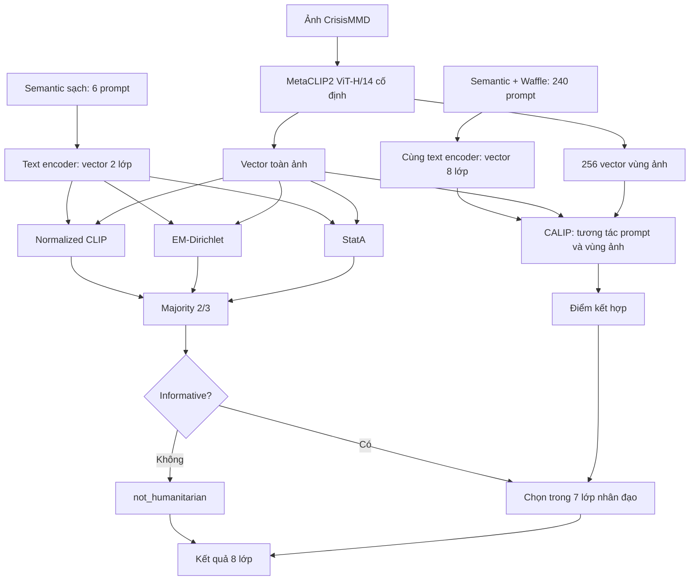

**WAFFLECLIP VÀ ỨNG DỤNG CẢI THIỆN PHÂN LOẠI CRISISMMD**

**1. Nghiên cứu WaffleCLIP**

WaffleCLIP đặt câu hỏi: **CLIP tốt hơn khi thêm mô tả từ AI vì có thêm kiến thức, hay vì được tổng hợp nhiều cách diễn đạt?** DCLIP dùng LLM tạo đặc điểm từng lớp; WaffleCLIP kiểm tra bằng cách thay các mô tả đó bằng từ và ký tự ngẫu nhiên, trong khi vẫn giữ tên lớp. [WaffleCLIP, ICCV 2023](https://arxiv.org/abs/2306.07282), [DCLIP, ICLR 2023](https://arxiv.org/abs/2210.07183).

**Dữ liệu và mô hình:** nghiên cứu dùng CLIP ViT-B/32, ViT-L/14 và ResNet-50; đánh giá trên 11 benchmark chuẩn, gồm ImageNet, ImageNetV2, CUB200, EuroSAT, Places365, Food101, Oxford Pets, DTD, Flowers102, FGVC-Aircraft và Stanford Cars. Có thêm ba bộ dịch chuyển phân phối: ImageNet-A, ImageNet-R, ImageNet-Sketch. Đây là dữ liệu đánh giá, không phải dữ liệu dùng để huấn luyện lại CLIP trong phương pháp Waffle.

**Cách hoạt động:**

```text
Tên lớp + hậu tố từ/ký tự ngẫu nhiên
                  ↓
          30 prompt cho mỗi lớp
                  ↓
       CLIP mã hóa ảnh và các prompt
                  ↓
     Trung bình cosine theo từng lớp
                  ↓
          Chọn lớp có điểm cao nhất
```

Ví dụ minh họa cấu trúc:

```text
Prompt thường: A photo of a damaged car.
Waffle:        A photo of a damaged car, which has <random words>.
```

Waffle tạo 15 cặp word/character, tổng 30 prompt/lớp. Từ được lấy từ `word_list.pkl`; file này chứa từ điển, không chứa sẵn các câu prompt. Bộ hậu tố được chia sẻ giữa các lớp trong cùng seed. Prompt có thể tạo trước và dùng chung cho mọi ảnh. [Code chính thức](https://github.com/ExplainableML/WaffleCLIP/blob/7a1b8ee48e31285f62ecd839fecb6b89cbef81f1/waffle_tools.py).

**Vì sao có thể tốt hơn?** Một prompt duy nhất có thể biểu diễn lớp chưa phù hợp. Tổng hợp nhiều ngữ cảnh giúp giảm phụ thuộc vào một câu cụ thể. Nhiễu không bổ sung kiến thức về lớp; lợi ích cần kiểm tra nằm ở việc tổng hợp biểu diễn. Nhánh mở rộng của paper còn bổ sung concept cấp cao để giảm nhập nhằng tên lớp.

Kết quả gốc, Accuracy trung bình trên tám benchmark chính với ViT-B/32:

| Phương pháp | Accuracy |
|---|---:|
| CLIP | 57,34% |
| DCLIP | 58,56% |
| WaffleCLIP | 58,57% |
| WaffleCLIP + concept | 59,47% |

**Kết luận:** nhiều biến thể prompt có thể đem lại mức tăng tương đương mô tả LLM trong các thiết lập đã đo. Điều này không có nghĩa nhiễu luôn tốt hơn mô tả đúng. [Paper, Bảng 2](https://arxiv.org/html/2306.07282v2#S4).

**2. Áp dụng phần nào vào CrisisMMD?**

Bài toán là phân loại ảnh khủng hoảng thành tám nhóm: không liên quan nhân đạo, thông tin liên quan khác, cứu trợ, hư hại hạ tầng, người bị ảnh hưởng, hư hại phương tiện, người bị thương/tử vong và người mất tích/được tìm thấy.

Dự án giữ **MetaCLIP2 ViT-H/14** làm backbone, không huấn luyện lại trọng số. Đầu vào hiện tại là **ảnh**; text encoder mã hóa prompt lớp, không nhận tweet của từng mẫu. Có 3.000 ảnh phát triển và 2.219 ảnh dev để so sánh các cấu hình.

Tên lớp khủng hoảng khá trừu tượng, nên dự án dùng **semantic anchor: mô tả lớp cụ thể**, rồi mới thêm Waffle. Đây là vận dụng cơ chế prompt ensembling, không nhận là một thuật toán Waffle mới.

Ví dụ prompt thật của lớp cứu trợ:

```text
Semantic:
Rescue/Volunteering/Donation: rescue workers helping people reach safety.

Semantic + Waffle:
Rescue/Volunteering/Donation: rescue workers helping people reach safety,
which has meter's fluke.
```

`meter's fluke` là nhiễu. Mỗi lớp có ba mô tả semantic; ở tầng chi tiết, mỗi mô tả nhận 10 prompt Waffle, tổng **30 prompt/lớp × 8 lớp = 240 prompt**. Các vector prompt được lấy trung bình rồi chuẩn hóa thành vector đại diện lớp. [Bộ prompt đang dùng](prompt_majority_calip.json).

**3. Hệ thống tốt nhất hiện tại: hai tầng + majority + CALIP**

“Tốt nhất” ở đây là **Macro-F1 cao nhất trên dev trong các cấu hình MetaCLIP2 đã đối chiếu**, chưa phải kết luận trên test độc lập.

**Hai tầng — tách quyết định tổng quát và chi tiết**

```text
Ảnh → có thông tin hữu ích không?
  ├─ Không → not_humanitarian
  └─ Có → chọn một trong 7 lớp nhân đạo
```

Tầng 1 dùng **semantic sạch: ba prompt/lớp, tổng sáu prompt**. Tầng 2 dùng semantic + Waffle. Thiết kế này giúp lớp không liên quan không phải cạnh tranh trực tiếp với bảy lớp chi tiết ngay từ đầu. Hai task vẫn có nhãn thật riêng; đây là quy tắc định tuyến của hệ thống.

**Majority — ba cách suy luận cùng bỏ phiếu ở tầng 1**

| Thành phần | Cách hoạt động | Vai trò cần kiểm tra |
|---|---|---|
| Normalized CLIP | So cosine giữa vector ảnh và vector lớp đã chuẩn hóa; chọn điểm cao nhất | Cung cấp dự đoán trực tiếp từ CLIP |
| EM-Dirichlet | Từ mean cosine tạo vector xác suất bằng softmax; ước lượng phân phối Dirichlet trên nhóm ảnh không nhãn, cập nhật mức gán cụm rồi ghép cụm với lớp | Bổ sung thông tin phân phối của nhóm thay vì xét từng ảnh riêng |
| StatA | Dùng embedding ảnh để ước lượng phân phối Gaussian, có prior và điểm neo từ prototype text để hạn chế trôi khi ít dữ liệu | Thích nghi theo dữ liệu ảnh nhưng giữ liên hệ với kiến thức CLIP |

EM và StatA dùng cùng các nhóm tối đa 75 ảnh, chia theo seed, không dùng nhãn thật. Mỗi ảnh vẫn có nhãn riêng. Nguồn: [EM-Dirichlet, CVPR 2024](https://arxiv.org/abs/2405.18437), [StatA, CVPR 2025](https://arxiv.org/abs/2501.03729).

**Quy tắc majority:** ít nhất hai trong ba nhánh chọn informative thì ảnh đi tiếp. Ba nhánh chia sẻ vector ảnh, không cần mã hóa ảnh ba lần. Đây là ensemble ba cách suy luận dùng chung backbone, không phải ba model ảnh được huấn luyện riêng.

Ví dụ minh họa:

```text
Ảnh một nhóm người nhận hàng cứu trợ:
Normalized CLIP → not_informative
EM-Dirichlet    → informative
StatA           → informative
                     ↓
               Majority: 2/3
                     ↓
             Chuyển sang tầng chi tiết
```

Lợi ích kỳ vọng là giảm tác động của một nhánh sai khi hai nhánh còn lại nhất trí. Hiệu quả phải được xác nhận bằng kết quả, vì các nhánh vẫn có thể cùng sai.

**CALIP — dùng cả toàn ảnh và các vùng ảnh ở tầng 2**

CLIP cơ bản so một vector toàn ảnh với các lớp. CALIP bổ sung **attention hai chiều giữa đặc trưng vùng ảnh và vector prompt**. [CALIP, AAAI 2023](https://arxiv.org/abs/2209.14169).

Trong bản MetaCLIP2:

- Một forward tạo vector toàn ảnh và **256 vector vùng ảnh**.
- Mỗi prototype lớp tổng hợp bằng chứng từ các vùng để tạo text feature thích nghi theo ảnh.
- Các vùng cũng nhận thông tin từ prototype để tạo visual feature thích nghi theo text.
- Kết hợp ba nguồn điểm: điểm CLIP gốc và hai điểm từ feature đã tương tác.

```text
L = L_global + 1.12 × L_text_adapted + 0.02 × L_visual_adapted
```

Các hệ số được khóa trước khi đo; không chọn bằng nhãn dev. CALIP không thêm trọng số attention được học.

Ví dụ minh họa: một ảnh có nhiều người chưa đủ phân biệt “người bị ảnh hưởng” với “cứu trợ”. Các vùng có cảnh trao nhu yếu phẩm có thể bổ sung bằng chứng cho lớp cứu trợ. Đây là giải thích giả thuyết về cơ chế; chưa chứng minh attention định vị đúng vùng trên mọi ảnh.

CALIP chấm đủ tám lớp; nếu cổng informative cho qua, quyết định cuối chỉ chọn trong bảy lớp nhân đạo. Nhờ vậy cổng và tầng chi tiết đảm nhiệm hai việc khác nhau.

**4. Sơ đồ tổng thể**



Các ví dụ trên minh họa cách hoạt động, không phải dự đoán đã đo trên một mẫu cụ thể. Prompt được tạo sẵn; thay đổi theo từng ảnh là embedding, kết quả thích nghi và attention.

**5. Kết quả so sánh trên CrisisMMD**

Cùng **2.219 ảnh dev, nhãn ảnh và backbone MetaCLIP2**. Các hàng majority là trung bình ba grouping seed, không lấy seed tốt nhất.

| Phương án | Accuracy | Macro-F1 |
|---|---:|---:|
| Baseline một tầng: semantic + Waffle, CLIP toàn ảnh | 56,60% | 43,80% |
| Baseline hai tầng: semantic → semantic + Waffle | 66,20% | 48,06% |
| **Hai tầng + majority + CALIP** | **70,36%** | **51,14%** |

So với baseline hai tầng, cấu hình hiện tại tăng **4,16 điểm Accuracy** và **3,08 điểm Macro-F1**. Đối chứng cùng cổng majority và cùng prototype chuẩn hóa cho thấy CALIP tăng thêm khoảng **0,74 điểm Macro-F1**; không quy toàn bộ mức tăng cho attention.

**Ý nghĩa:** Waffle bổ sung nhiều cách biểu diễn lớp; semantic làm rõ nội dung lớp; majority cải thiện quyết định cổng; CALIP bổ sung tương tác giữa vùng ảnh và prompt. Các thành phần giải quyết những phần khác nhau của bài toán.

**Giới hạn:** đây là kết quả dev, chưa xác nhận bằng test độc lập. Macro-F1 train của cấu hình mới giảm từ 49,88% xuống 47,63%, và mức tăng dev chưa chứng minh có ý nghĩa thống kê. Vì vậy giữ phương án này là ứng viên theo Macro-F1 dev, không kết luận cải thiện mọi lớp hoặc mọi tập dữ liệu.

[Chi tiết đối chiếu kết quả và giới hạn](../../experiments/clip_calip/README.md).
