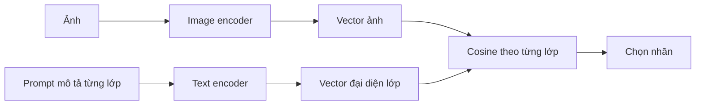
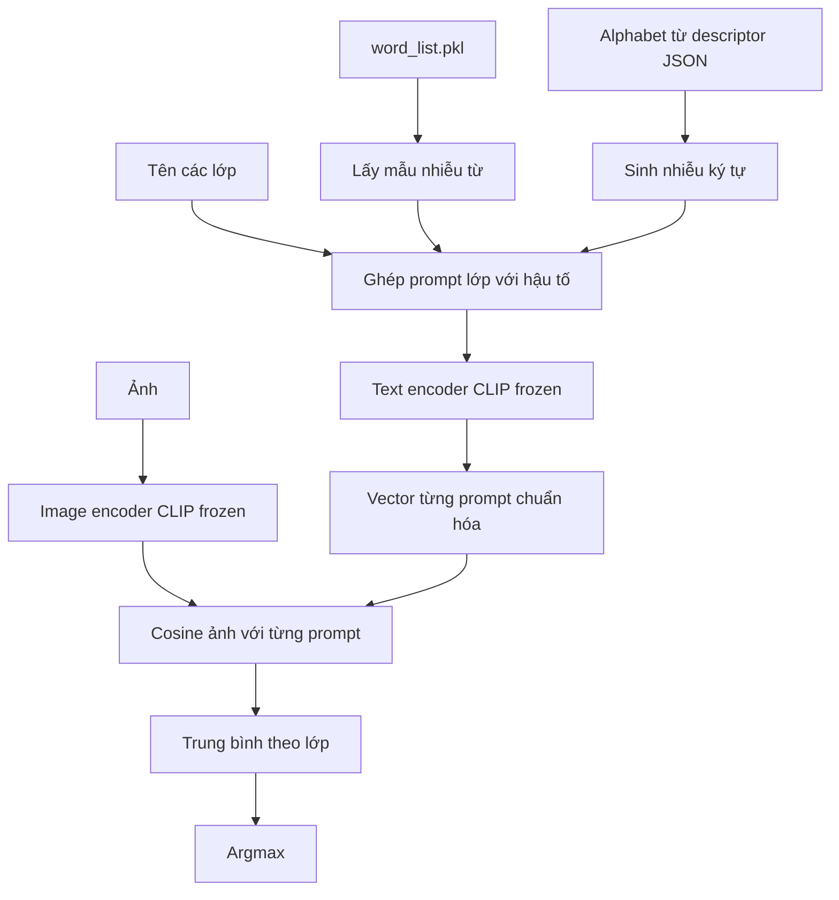
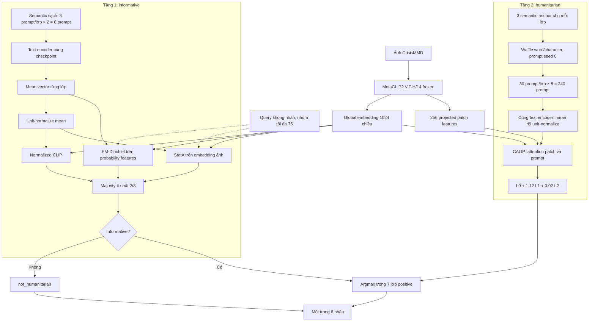

**BÁO CÁO TIẾN ĐỘ: TỪ WAFFLECLIP ĐẾN PHÂN LOẠI PHÂN TẦNG VÀ THÍCH NGHI CLIP CHO CRISISMMD, FAKEDDIT**

Ngày tổng hợp: 29/10/2026. Các giai đoạn dưới đây được trình bày theo chuỗi phát triển đã ghi trong cấu hình, mã và artifact; phần Waffle ban đầu có hồ sơ từ 22/10, các đợt thích nghi gần đây tập trung vào 28–29/10. Không coi tất cả các lượt là thí nghiệm hoàn thành trong đúng một ngày.

**Kết quả trọng tâm**

Mục tiêu là tìm cấu hình phân loại phù hợp với từng loại dữ liệu dựa trên CLIP và các nghiên cứu đã công bố. WaffleCLIP là điểm khởi đầu để nghiên cứu ảnh hưởng của biểu diễn lớp bằng ngôn ngữ; phạm vi sau đó mở rộng sang cấu trúc quyết định, thích nghi trên dữ liệu không nhãn, bộ nhớ và đặc trưng vùng ảnh.

- CrisisMMD: trong các cấu hình MetaCLIP2 đã đối chiếu trên cùng 2.219 ảnh dev, **majority + CALIP** có Macro-F1 tám lớp cao nhất: **51,14%**, Accuracy **70,36%**. Baseline hai tầng cùng tập đạt **48,06% / 66,20%**. Đây là ứng viên tốt nhất theo Macro-F1 dev trong phạm vi đã thử, chưa phải kết quả test độc lập.
- Majority + DN-unit vẫn có Accuracy dev cao hơn: **70,59%**, Macro-F1 **50,39%**. Không có cấu hình thắng mọi chỉ số.
- Fakeddit: majority với prompt semantic đạt **62,63% Accuracy / 62,59% Macro-F1** ở hai lớp. Với sáu lớp, cổng này kết hợp prompt baseline ở tầng chi tiết đạt **49,37% / 30,04%**, tốt hơn tổ hợp semantic-Waffle + CALIP **44,22% / 27,53%**.
- Thêm text cho Fakeddit theo tỷ lệ cố định 75% ảnh + 25% text chưa tạo cải thiện rõ: cấu hình tốt nhất trong các đối chứng thêm text ở cổng đạt **49,57% / 30,06%** ở sáu lớp. Chưa đánh giá trực tiếp quan hệ khớp/sai giữa ảnh và tiêu đề.

Các con số dạng `Accuracy / Macro-F1` đều tính bằng phần trăm. Các mức tăng được gọi là **điểm phần trăm**, không phải phần trăm tăng tương đối. Kết quả paper gốc và kết quả dự án được trình bày riêng.

**1. Bài toán và nền tảng CLIP**

CLIP gồm bộ mã hóa ảnh và bộ mã hóa văn bản. Hai bộ mã hóa tạo vector trong không gian có thể so sánh bằng cosine. Khi phân loại zero-shot, mỗi nhãn được biểu diễn bằng tên hoặc mô tả; ảnh được gán vào lớp có điểm tương đồng cao nhất. CLIP gốc được tiền huấn luyện trên cặp ảnh–văn bản, sau đó chuyển sang tác vụ mới mà không cần huấn luyện bộ phân loại bằng nhãn của tác vụ đó. [CLIP — Radford và cộng sự, ICML 2021](https://arxiv.org/abs/2103.00020).



Ký hiệu dùng trong phần triển khai:

\[
v(x)=\operatorname{norm}(f_I(x)),\qquad
u_{c,r}=\operatorname{norm}(f_T(p_{c,r})).
\]

`c` là lớp, `r` là prompt, `norm` là chuẩn hóa L2. Với nhiều prompt, dự án phân biệt hai cách gộp:

\[
m_c=\frac{1}{M_c}\sum_r u_{c,r},\qquad
s_c^{mean}(x)=v(x)^T m_c.
\]

\[
t_c=\operatorname{norm}(m_c),\qquad
s_c^{unit}(x)=v(x)^T t_c.
\]

Mean cosine và cosine với prototype được chuẩn hóa lại **không giống nhau**. Nếu độ dài `m_c` khác nhau giữa các lớp, chuẩn hóa lại có thể thay đổi cả nhãn dự đoán. Vì vậy luôn cần đối chứng normalization trước khi quy mức tăng cho một thuật toán khác. [Code gộp prototype của dự án](../../src/inference.py).

MetaCLIP2 ViT-H/14 là backbone CLIP-family đang được giữ cố định trong chuỗi thí nghiệm chính. Model registry sử dụng kiến trúc `ViT-H-14-worldwide-quickgelu`, checkpoint `metaclip2_worldwide`; đây không phải một model do các thuật toán Waffle, EM hoặc CALIP huấn luyện lại. [Model registry](../../src/models/model_registry.py).

Ba khái niệm cần tách:

| Thành phần | Vai trò trong dự án |
|---|---|
| Model/backbone | MetaCLIP2 tạo embedding ảnh và text |
| Prompt | Mô tả cách biểu diễn từng lớp trong không gian text |
| Thuật toán suy luận/thích nghi | Dùng embedding, score, quan hệ lân cận hoặc memory để quyết định nhãn |

Prompt lớp là nội dung cố định, khác với tweet/tiêu đề đi kèm từng mẫu. Một hệ chỉ nhận ảnh vẫn sử dụng text encoder để mã hóa prompt lớp; điều đó không có nghĩa hệ đã nhận tweet hoặc tiêu đề của mẫu.

**2. Dữ liệu thực nghiệm của dự án**

Hai dataset chính trong giai đoạn này có bản chất khác nhau. CrisisMMD cung cấp ảnh và tweet về thiên tai, với các tác vụ thông tin nhân đạo. Fakeddit cung cấp bài đăng Reddit và ảnh, với nhãn thật/giả và các loại thông tin sai. [CrisisMMD](https://arxiv.org/abs/1805.00713), [Fakeddit](https://arxiv.org/abs/1911.03854).

| Dataset/cohort dự án | Số mẫu | Nhãn | Vai trò |
|---|---:|---|---|
| CrisisMMD từ train | 3.000 | Hai nhãn informative và tám nhãn humanitarian, nhãn ảnh thật | Phát triển phương pháp; không huấn luyện backbone bằng nhãn |
| CrisisMMD humanitarian dev | 2.219 | Tám nhãn ảnh; không có binary GT tương ứng cho toàn cohort | Đánh giá phát triển ngoài cohort 3.000 |
| Fakeddit từ validate | 3.000 | Hai nhãn và sáu nhãn trên cùng mẫu | Đánh giá chuyển phương pháp sang miền khác |
| MM-IMDb | 3.000 trong hồ sơ dữ liệu chung | Nhiều nhãn thể loại | Có baseline; chưa có chuỗi cải tiến Waffle–CALIP tương đương trong báo cáo này |

Dev CrisisMMD được tạo từ 2.237 ảnh của tác vụ humanitarian; hồ sơ đã ghi loại 18 ảnh trùng SHA256 với cohort phát triển trước, còn 2.219. Việc loại trùng theo byte không bảo đảm loại hết ảnh gần trùng hoặc loại phụ thuộc theo sự kiện. Các số liệu và nguồn nhãn lấy từ hồ sơ cohort và artifact đã có, không đọc lại dữ liệu thô trong lần tổng hợp này. [Hồ sơ dữ liệu](../experiments/du_lieu_chinh_3000.md), [hồ sơ dev](../../experiments/clip_two_stage/DEV_EXPERIMENT.md).

Phân bố tám lớp CrisisMMD:

| Lớp | Train phát triển | Dev |
|---|---:|---:|
| Not humanitarian | 1.449 | 1.078 |
| Infrastructure/utility damage | 603 | 400 |
| Other relevant information | 404 | 336 |
| Rescue/volunteering/donation | 382 | 280 |
| Affected individuals | 86 | 77 |
| Vehicle damage | 52 | 38 |
| Injured/dead people | 22 | 8 |
| Missing/found people | 2 | 2 |
| **Tổng** | **3.000** | **2.219** |

Phân bố rất lệch. Accuracy bị ảnh hưởng mạnh bởi các lớp lớn; Macro-F1 cho mỗi lớp trọng số như nhau nhưng rất nhạy với lớp hai mẫu. Bởi vậy cần báo đồng thời Accuracy, Macro-F1, từng lớp và recall cứu trợ.

Fakeddit có 1.537 mẫu thật và 1.463 mẫu giả. Sáu lớp lần lượt có 1.537/204/602/92/407/158 mẫu. Ánh xạ phải giữ đúng: **2way: 1=real, 0=fake; 6way: 0=True, 1=Satire, 2=False Connection, 3=Imposter, 4=Manipulated, 5=Misleading**. [Xác nhận nhãn từ cộng tác viên Fakeddit](https://github.com/entitize/Fakeddit/issues/14#issuecomment-815355653).

Ở CrisisMMD, các dấu hiệu hư hại, phương tiện và cứu trợ có thể xuất hiện trực tiếp trong ảnh. Ở Fakeddit, ảnh thật vẫn có thể đi kèm tiêu đề sai; ảnh hài hước không tự động chứng minh satire theo annotation; tính thật/giả còn phụ thuộc nguồn và ngữ cảnh. Đây là cơ sở để không mặc định một phương pháp sẽ phù hợp với cả hai dataset.

**3. WaffleCLIP: câu hỏi nghiên cứu, dữ liệu và mục tiêu**

WaffleCLIP do Karsten Roth và cộng sự công bố tại ICCV 2023. Câu hỏi trung tâm: mức tăng khi thêm mô tả từ LLM đến từ kiến thức ngữ nghĩa, hay một phần đến từ việc trung bình nhiều biến thể prompt? Nghiên cứu xây đối chứng bằng từ/ký tự ngẫu nhiên, đồng thời khảo sát hướng dẫn bằng khái niệm cấp cao. [Bài báo gốc](https://arxiv.org/abs/2306.07282).

Đây là nghiên cứu **phương pháp suy luận trên CLIP đã tiền huấn luyện**. Không tạo dataset riêng mang tên Waffle, không học một image encoder mới, và không dùng các dataset đánh giá để huấn luyện backbone trong phép zero-shot.

**3.1. Dữ liệu và backbone của WaffleCLIP**

Phần benchmark chuẩn gồm **11 bộ/phiên bản**: ImageNet, ImageNetV2, CUB200-2011, EuroSAT, Places365, Food101, Oxford-IIIT Pets, DTD, Flowers102, FGVC-Aircraft và Stanford Cars. Bảng so sánh chính dùng tám bộ đầu; ba bộ cuối mở rộng miền đánh giá. Có thêm ba phiên bản dịch chuyển phân phối **ImageNet-A, ImageNet-R, ImageNet-Sketch**. Vì vậy có thể mô tả là 11 benchmark chuẩn và ba OOD bổ sung, không phải 14 miền dữ liệu hoàn toàn độc lập. Các backbone gồm CLIP ViT-B/32, ViT-L/14 và ResNet-50. [Paper, mục thực nghiệm](https://arxiv.org/html/2306.07282v2#S4).

Ý nghĩa của ma trận dữ liệu là kiểm tra tính chuyển miền: đồ vật tổng quát, phân biệt chim/xe/máy bay chi tiết, đồ ăn, vật nuôi, cảnh, ảnh vệ tinh, hoa và texture. Dữ liệu dự án về khủng hoảng/tin sai không nằm trong tập benchmark gốc này.

| Nhóm trong benchmark Waffle | Dữ liệu | Nội dung phân loại |
|---|---|---|
| Tám bộ chính | ImageNet, ImageNetV2 | Đồ vật/khái niệm tổng quát; V2 là bộ đánh giá phân phối khác |
| Tám bộ chính | CUB200-2011 | Loài chim, phân biệt chi tiết |
| Tám bộ chính | EuroSAT | Loại cảnh/đất từ ảnh vệ tinh |
| Tám bộ chính | Places365 | Cảnh và địa điểm |
| Tám bộ chính | Food101 | Món ăn |
| Tám bộ chính | Oxford-IIIT Pets | Loại vật nuôi |
| Tám bộ chính | DTD | Texture |
| Ba bộ mở rộng | Flowers102, FGVC-Aircraft, Stanford Cars | Hoa, máy bay, xe; các nhãn chi tiết |
| Ba OOD bổ sung | ImageNet-A, ImageNet-R, ImageNet-Sketch | Ảnh khó, rendition và phác họa |

**3.2. DCLIP là tiền đề nào?**

DCLIP đề xuất phân loại bằng các mô tả đặc điểm thay vì chỉ tên lớp. LLM có thể tạo danh sách đặc điểm cho mỗi lớp; CLIP kiểm tra độ tương đồng ảnh với các câu mô tả rồi tổng hợp. Điều mới của nghiên cứu là quy trình phân loại theo đặc điểm và cách tạo đặc điểm ở quy mô lớn, không phải việc mọi câu tiếng Anh do AI viết đều tự động trở thành DCLIP. Tách prompt ảnh và prompt text trong pipeline đa phương thức là thiết kế của dự án, không phải định nghĩa của DCLIP. [Menon và Vondrick, ICLR 2023](https://arxiv.org/abs/2210.07183).

**3.3. Cách Waffle hoạt động trong code gốc**

Code chính thức đã được ghim tại commit `7a1b8ee48e31285f62ecd839fecb6b89cbef81f1`. Hàm `load_gpt_descriptions`, mode `waffle`, thực hiện:

1. Giữ tên lớp làm thành phần mang ý nghĩa phân biệt.
2. Đọc `word_list.pkl`, là từ điển từ, không phải danh sách câu prompt đã viết sẵn.
3. Lấy mẫu chuỗi từ ngẫu nhiên và sinh chuỗi ký tự ngẫu nhiên. Độ dài dựa trên đặc điểm tên lớp; code còn cắt từ theo độ dài trung bình.
4. Tạo 15 cặp word/character, tương đương 30 prompt/lớp.
5. Dùng cùng bộ hậu tố cho các lớp trong một seed để giảm khác biệt do mỗi lớp nhận một tập nhiễu riêng.
6. Mã hóa từng câu, chuẩn hóa vector, lấy trung bình cosine của ảnh với các câu thuộc cùng lớp.
7. Chọn lớp có điểm trung bình cao nhất.

Nguồn ký tự trong checkout chính thức được rút từ nội dung descriptor JSON. Bản adapter ban đầu của dự án từng dùng alphabet ASCII và RNG khác, vì vậy không gọi hai bộ sinh là giống hệt nhau. Nhánh làm mốc sau đó dùng trực tiếp hàm tác giả. [Code Waffle gốc](https://github.com/ExplainableML/WaffleCLIP/blob/7a1b8ee48e31285f62ecd839fecb6b89cbef81f1/waffle_tools.py), [hồ sơ đối chiếu của dự án](waffleclip_giao_thuc_thu_nghiem.md).

Ví dụ minh họa cấu trúc, không phải câu trích của paper:

```text
Tên lớp: vehicle damage
Prompt 1: vehicle damage + hậu tố từ ngẫu nhiên
Prompt 2: vehicle damage + hậu tố ký tự ngẫu nhiên
...
Prompt 30: vehicle damage + hậu tố ngẫu nhiên
```

Tên lớp không bị bỏ. Nhiễu nằm trong ngữ cảnh của prompt; không thêm nhiễu pixel vào ảnh, không làm sai nhãn thật và không tạo mẫu ảnh huấn luyện mới.



Prompt và vector lớp có thể chuẩn bị trước, dùng chung cho toàn bộ ảnh. Ảnh mới không kích hoạt việc sinh một bộ prompt mới theo nội dung ảnh. Trong dự án hiện tại, bộ prompt đã đóng băng trong JSON; Waffle prompt seed giữ bằng 0 ở các phép thích nghi sau.

**3.4. Vì sao việc trung bình có thể giúp?**

Một lớp có nhiều cách diễn đạt; một câu duy nhất có thể đặt vector text vào hướng chưa phù hợp với ảnh. Nhiều ngữ cảnh tạo nhiều vector gần/xa lớp theo những hướng khác nhau. Trung bình có thể giảm sự phụ thuộc vào một ngữ cảnh cụ thể trong khi vẫn giữ phần ý nghĩa chung của tên lớp.

Đây là cách diễn giải cơ chế để kiểm tra, không phải định lý rằng thêm nhiễu luôn tốt. Nếu tên lớp quá trừu tượng hoặc nhiễu gây lệch có hệ thống, trung bình vẫn có thể sai. Từ điển ngẫu nhiên không bổ sung được kiến thức về việc một bức ảnh có caption sai hoặc một người đang mất tích.

**3.5. Khái niệm cấp cao và kết luận khoa học**

Nhánh `concept` bổ sung ngữ cảnh chung của bộ lớp để giảm nhập nhằng, khác với hậu tố nhiễu. Ví dụ diễn giải: lớp cùng liên quan đến thiên tai có thể được đặt trong miền mô tả khủng hoảng. Việc dùng concept/descriptor cùng Waffle đã có tiền lệ trong repo gốc; ghép semantic + Waffle đơn thuần không đủ để tuyên bố một thuật toán mới. [Repo chính thức và các mode mở rộng](https://github.com/ExplainableML/WaffleCLIP).

Waffle thuần không cần gọi LLM. Nhánh tạo concept bằng LLM có sử dụng mô hình bên ngoài ở bước chuẩn bị; đây là cấu hình mở rộng riêng, không mâu thuẫn với tính LLM-free của nhánh nhiễu thuần. Repo còn có đối chứng đổi descriptor giữa lớp, xáo trộn từ và thay descriptor bằng mẫu ngẫu nhiên. Chúng giúp phân biệt nhiễu ngẫu nhiên quanh tên lớp với thông tin sai có hệ thống kéo biểu diễn sang một lớp khác.

Bảng gốc trên tám benchmark chính, CLIP ViT-B/32:

| Phương án của paper | Accuracy trung bình (%) |
|---|---:|
| CLIP | 57,34 |
| DCLIP | 58,56 |
| WaffleCLIP | 58,57 |
| WaffleCLIP + concepts | 59,47 |

Các số trên là Accuracy benchmark của paper, không phải Macro-F1 CrisisMMD. Kết luận hợp lý là random prompt ensembling có thể cạnh tranh với mô tả LLM trong các thiết lập đã đo; không suy thành “ngữ nghĩa vô ích” hoặc “nhiễu luôn tốt hơn mô tả đúng”. [Paper, Bảng 2](https://arxiv.org/html/2306.07282v2#S4).

**3.6. Vì sao áp dụng vào dự án?**

Pipeline dự án cũng dùng vector prompt làm đại diện lớp, nên có thể thay bộ prompt mà giữ checkpoint, ảnh và hàm cosine. Đây là phép thử chi phí thấp để đo độ nhạy với diễn đạt nhãn. Nhiều phần còn lại của hệ thống cũng có thể tái sử dụng embedding, giúp triển khai đối chứng mà không huấn luyện lại backbone.

Tuy nhiên nhãn “Not Informative”, “Not Humanitarian” hoặc “False Connection” là nhãn trừu tượng/quan hệ. Giả thuyết phù hợp hơn là bổ sung mô tả cụ thể trước, rồi kiểm tra Waffle còn tạo lợi ích bổ sung hay không. Đây là lý do hình thành nhánh semantic và semantic_waffle.

**4. Giai đoạn đầu: tách hiệu ứng model, prompt và cách gộp**

Các bước đổi model được ghi riêng với các bước đổi thuật toán. Chuyển ViT-B/32 sang MetaCLIP2 không tự chứng minh Waffle tốt hơn; muốn đo hiệu quả Waffle phải so với CLIP dùng cùng backbone.

Trên 3.000 ảnh CrisisMMD phát triển, chỉ ảnh:

| Backbone / task | Một prompt tên lớp: Accuracy / Macro-F1 | Waffle gốc: Accuracy / Macro-F1 |
|---|---:|---:|
| OpenAI ViT-B/32 — 2 nhãn | 49,13 / 49,08 | 52,66 / 50,91 |
| OpenAI ViT-B/32 — 8 nhãn | 35,43 / 28,65 | 39,64 / 30,70 |
| MetaCLIP2 — 2 nhãn | 42,07 / 37,58 | 47,37 / 47,30 |
| MetaCLIP2 — 8 nhãn | 41,17 / 29,79 | 37,67 / 27,48 |

Các dòng OpenAI Waffle là mean ba prompt seed 0/1/2; MetaCLIP2 ở phép làm mốc là một seed 0. Không diễn giải một seed MetaCLIP2 như có cùng độ chắc chắn với ba seed OpenAI. Mốc một prompt này khác baseline prompt ensemble ảnh + text của pipeline chung.

Waffle tăng ở một số điều kiện, nhưng làm giảm phân loại tám lớp MetaCLIP2. Kết quả âm là bằng chứng cần thiết để chuyển từ việc chỉ thêm nhiễu sang việc cải thiện biểu diễn ngữ nghĩa lớp.

**5. Semantic, semantic_waffle và các biến thể neo**

Các descriptor của dự án là mô tả cố định từ định nghĩa lớp, được tạo với trợ giúp AI và rà soát, không lấy từ lỗi validation và không phải bộ GPT-3 của paper DCLIP. Ví dụ rescue được mô tả bằng cảnh cứu hộ đưa người đến nơi an toàn, phân phối nhu yếu phẩm và quyên góp.

| Biến thể | Cách tính | Vai trò |
|---|---|---|
| semantic | Ba mô tả cụ thể/lớp, mean cosine | Tách lợi ích diễn đạt nhãn |
| semantic_waffle | Gắn 30 hậu tố Waffle quanh ba neo, mỗi neo 10 prompt | Đo lợi ích nhiễu sau khi đã có nghĩa |
| waffle_unit | Chuẩn hóa lại prototype Waffle trung bình | Tách tác động norm |
| anchor_mix | Trộn 50% semantic sạch và 50% semantic_waffle | Đối chứng pha trộn cố định |
| stable_anchor | Giảm trọng số nhiễu khi các cặp word/character bất đồng | Heuristic kiểm soát nhiễu của dự án |

Stable anchor dùng độ đồng thuận giữa các cặp, hiệu chỉnh theo mức ngẫu nhiên `1/C`, rồi giới hạn trọng số nhiễu tối đa 0,5. Đồng thuận chỉ là sự nhất trí của prompt, không phải xác suất dự đoán đúng. [Code các biến thể](../../experiments/waffle_lab/core.py).

Kết quả cùng MetaCLIP2 và 3.000 ảnh:

| Task / phương án | Accuracy | Macro-F1 |
|---|---:|---:|
| 2 nhãn — Waffle gốc, seed 0 | 47,37 | 47,30 |
| 2 nhãn — semantic | **79,93** | **79,58** |
| 2 nhãn — semantic_waffle, seed 0 | 76,83 | 75,56 |
| 8 nhãn — semantic | 56,93 | 42,13 |
| 8 nhãn — semantic_waffle, seed 0 | 57,60 | 44,99 |
| 8 nhãn — semantic_waffle, mean ba prompt seed | 57,70 | 45,10 |
| 8 nhãn — anchor_mix, seed 0 | 57,97 | 45,16 |
| 8 nhãn — stable_anchor, seed 0 | 57,70 | 43,59 |

Quyết định hình thành từ các đối chứng: tầng hai nhãn dùng **semantic sạch**; tầng chi tiết dùng **semantic_waffle**. Ở hai nhãn, nghĩa cụ thể đóng góp rõ hơn nhiễu. Ở tám nhãn, Waffle quanh neo có tín hiệu tốt hơn semantic sạch. Stable anchor không vượt được đối chứng nên không giữ chỉ vì cấu trúc phức tạp hơn.

**6. Phân loại hai tầng và những kiểm tra không cải thiện**

Thay vì cho tám lớp cạnh tranh ngay từ đầu, hệ thống quyết định tính informative trước. Nếu negative, trả not_humanitarian; nếu positive, chọn trong bảy lớp nhân đạo còn lại. Tên gọi “hai tầng” mô tả quy tắc quyết định, không phải hai CLIP được huấn luyện riêng.

```text
Ảnh → MetaCLIP2 → semantic 2 nhãn
  ├─ not_informative → not_humanitarian
  └─ informative → semantic_waffle → chọn trong 7 lớp nhân đạo
```

Ánh xạ này là thiết kế vận dụng của dự án. Informativeness và humanitarian vẫn là hai tác vụ có annotation riêng; trên dev không tạo nhãn informative giả từ humanitarian để báo F1 hai nhãn.

| Cùng cohort | Một tầng: Accuracy / Macro-F1 | Hai tầng: Accuracy / Macro-F1 |
|---|---:|---:|
| Train phát triển 3.000, prompt seed 0 | 57,60 / 44,99 | **68,03 / 49,88** |
| Dev humanitarian 2.219 | 56,60 / 43,80 | **66,20 / 48,06** |

Trên dev, hai tầng tăng 9,60 điểm Accuracy và 4,25 điểm Macro-F1. Giải thích vận hành là một bộ phân loại hai nhãn cung cấp thêm quyết định loại ảnh không phù hợp trước khi chọn lớp chi tiết; không phải Waffle tự tạo toàn bộ mức tăng này.

Các đối chứng tiếp theo trên cùng dev:

| Phương án | Accuracy | Macro-F1 | Quyết định |
|---|---:|---:|---|
| Hai tầng cứng | 66,20 | 48,06 | Giữ đối chứng |
| Margin pool hai head | 62,73 | 47,61 | Không chọn |
| Thêm tweet, fixed fusion ở leaf | 66,43 | 46,91 | Không chọn |
| Thêm tweet khi hai nhánh đồng ý informative | 66,43 | 46,92 | Không chọn |
| Full-frame thay center crop | 66,65 | 47,30 | Không chọn |
| Trung bình view gốc và full-frame | 67,10 | 46,74 | Không chọn |

Margin pool cộng bằng nhau margin informative và margin positive-vs-negative của head humanitarian. Full-frame resize giữ tỷ lệ rồi pad để hạn chế mất ngoại vi; mean view gộp điểm hai view. Đây là các ablation của dự án, không phải tái lập TPT/MTA. Tweet được chấm theo **nhãn ảnh** trong cohort này, nên text có thể mang nội dung đúng về sự kiện nhưng không đúng nội dung ảnh. Các phép thử không đủ để kết luận tweet vô ích trong mọi định nghĩa bài toán.

**7. EM-Dirichlet: chuyển từ suy luận độc lập sang suy luận theo nhóm**

Nguồn: [Transductive Zero-Shot and Few-Shot CLIP — Martin và cộng sự, CVPR 2024](https://arxiv.org/abs/2405.18437), [repo gốc](https://github.com/SegoleneMartin/transductive-CLIP). Nghiên cứu gốc đánh giá trên 11 benchmark và có cả thiết lập zero-shot/few-shot; dự án chỉ dùng nhánh zero-shot không support.

**Bên trong bản triển khai:** từ cosine lớp `s_i`, tạo `q_i=softmax(30*s_i)`. Mỗi ảnh có một vector xác suất nằm trên simplex. EM-Dirichlet mô hình hóa các vector này bằng phân phối Dirichlet theo cụm, luân phiên cập nhật tham số phân phối và mức gán ảnh vào cụm; cuối cùng dùng Hungarian ghép cụm với tên lớp theo bằng chứng CLIP. Mỗi ảnh vẫn có dự đoán riêng, không gán một nhãn cho cả nhóm. [Core dự án](../../experiments/clip_transductive/core.py).

Cấu hình giữ nhóm tối đa 75 ảnh, 20 vòng ngoài, tối đa 1.000 vòng MM trong. Nhóm không dùng nhãn thật. Seed 0/1/2 thay cách chia query; prompt seed giữ 0.

Giả thuyết là các ảnh cùng miền cung cấp cấu trúc phân bố giúp sửa quyết định mơ hồ. Rủi ro là một nhóm có rất ít lớp thực hoặc lệch lớp, khiến phân phối ước lượng và nhãn giả không phù hợp.

| Vị trí EM | Accuracy | Macro-F1 | So với hai tầng cũ |
|---|---:|---:|---|
| Tầng chi tiết, dev 8 lớp | 60,46 | 40,41 | Giảm 7,64 điểm F1 |
| Tầng chi tiết, bỏ missing/found và còn 7 lớp | 60,26 | 43,71 | Baseline tương ứng 53,66 F1; vẫn kém |
| Chỉ cổng 2 nhãn, train 3.000 | 80,03 | 80,02 | Baseline binary 79,58 F1 |
| Cổng EM + leaf gốc, dev 8 lớp | 69,15 | 48,71 | Tăng 0,66 điểm F1 |

Bỏ lớp hiếm thay đổi bài toán và số lớp của Macro-F1; 53,66% của bài bảy lớp không phải cải thiện trên bài tám lớp. Kết quả này giúp loại giả thuyết rằng thất bại EM leaf chỉ do missing/found.

Cổng EM tăng chỉ số chung nhưng recall cứu trợ dev giảm 76,07% xuống 58,10%. Một guard giữ quyết định CLIP khi margin vượt median train không nhãn chỉ tăng F1 khoảng 0,01 điểm, nên không tiếp tục chọn ngưỡng để làm đẹp dev.

**8. StatA: thích nghi có điểm neo từ prompt**

Nguồn: [Realistic Test-Time Adaptation of Vision-Language Models — Zanella và cộng sự, CVPR 2025](https://arxiv.org/abs/2501.03729), [repo gốc](https://github.com/MaxZanella/StatA). Nghiên cứu nhấn mạnh tình huống batch không có đủ mọi lớp và dòng dữ liệu không i.i.d.

**Bên trong bản triển khai:** StatA dùng embedding ảnh thật, không chỉ score hai chiều; ước lượng tham số Gaussian cho lớp, kết hợp prior từ CLIP với ràng buộc lân cận và neo thống kê từ prototype text. Khi bằng chứng trong batch yếu, điểm neo giúp hạn chế phân phối bị trôi hoàn toàn khỏi kiến thức ban đầu. Dự án giữ nhóm 75, 10 vòng cập nhật và ba láng giềng. Encoder giữ frozen. [Core StatA](../../experiments/clip_stata/core.py).

Trên dev tám lớp, chỉ thay cổng bằng StatA đạt **71,17% Accuracy**, nhưng Macro-F1 **47,21%**, thấp hơn baseline **48,06%**. Recall cứu trợ giảm xuống **46,79%**. Accuracy cao không đồng nghĩa phù hợp với mục tiêu cân bằng các lớp. StatA chưa được chọn làm cổng riêng, nhưng được giữ làm một nguồn quyết định trong phép kết hợp tiếp theo.

**9. Majority, Recall OR, soft mean và protected majority**

Đây là các quy tắc kết hợp của dự án; không có một paper riêng được viện dẫn như nguồn phát minh majority. Ba nguồn dùng chung MetaCLIP2 và prompt semantic:

1. Normalized CLIP: phân loại độc lập bằng prototype đã chuẩn hóa.
2. EM-Dirichlet: thích nghi theo nhóm từ probability features.
3. StatA: thích nghi phân phối ảnh với neo text.

Majority cho informative khi ít nhất hai phiếu đồng ý. Nó có thể sửa trường hợp một thuật toán đi lệch nhưng hai nguồn còn lại nhất trí. Ba nguồn có tương quan nên không giả định bỏ phiếu chắc chắn tốt hơn.

| Cổng, cùng dev 2.219 và cùng leaf | Accuracy | Macro-F1 | Recall cứu trợ |
|---|---:|---:|---:|
| Hai tầng cũ | 66,20 | 48,06 | 76,07 |
| Normalized CLIP | 68,32 | 48,85 | 67,50 |
| EM | 69,15 | 48,71 | 58,10 |
| StatA | 71,17 | 47,21 | 46,79 |
| **Majority 2/3** | **69,84** | **49,24** | 60,48 |
| Recall OR 1/3 | 68,60 | 48,97 | 71,07 |

Majority có Macro-F1 cao hơn từng thành phần trong đối chứng này. Recall OR ưu tiên cho ảnh đi tiếp, tăng recall cứu trợ so với majority nhưng giảm Macro-F1.

Soft mean trung bình posterior ba thuật toán, khác với bỏ phiếu nhãn. Nó đạt **82,34% F1 binary train**, nhưng chỉ **47,89% F1 tám lớp dev**. Posterior khác thang độ tự tin có thể gây vấn đề; đây là một giả thuyết giải thích, không phải chứng minh nguyên nhân duy nhất. Protected majority = raw CLIP OR majority trùng baseline trong artifact đã thử, nên không đóng góp thêm. [Thiết kế và đối chứng](../../experiments/clip_transductive/FUSION_EXPERIMENT.md).

Vì vậy majority không phải cổng có F1 binary train cao nhất tuyệt đối. Soft mean và visual-anchor DMN đều có số đo khoảng 82,34% trong các lượt riêng, nhưng chưa tạo hệ tám lớp tốt nhất. Chọn cổng cho ứng dụng phải xét cả đầu ra cuối và recall lớp quan trọng.

**10. TDA: bộ nhớ nhãn giả cập nhật online**

Nguồn: [Efficient Test-Time Adaptation of Vision-Language Models — Karmanov và cộng sự, CVPR 2024](https://arxiv.org/abs/2403.18293), [repo gốc](https://github.com/kdiAAA/TDA). Paper kiểm tra dịch chuyển phân phối ImageNet và mười miền nhận dạng khác.

**Bên trong bản triển khai:** một cache positive giữ embedding và nhãn giả của ảnh độ tin cậy cao; cache negative giữ bằng chứng lớp khó có khả năng đúng. Ảnh mới truy hồi các embedding tương tự để bổ sung hoặc trừ điểm lớp. Dự án dùng một view thật/ảnh, không support có nhãn, reset cache theo task/split/stream seed. Hệ số gốc được giữ thay vì tối ưu theo dev.

TDA đạt binary train **80,55% F1**, nhưng cổng TDA đưa vào hệ tám lớp dev chỉ **48,59%**, thấp hơn majority **49,24%**. Với K=2 và ngưỡng mask 0,03 đã dùng, negative cache tạo mask `[1,1]` trên các ảnh được chấp nhận, trừ bằng nhau ở hai lớp nên không đổi thứ hạng. Đây là phát hiện có kiểm tra code và trace, không phải suy đoán từ điểm số. [Chi tiết TDA dự án](../../experiments/clip_tda/README.md).

**11. ZLaP: truyền nhãn từ text qua đồ thị ảnh**

Nguồn: [Label Propagation for Zero-shot Classification with Vision-Language Models — Stojnić và cộng sự, CVPR 2024](https://arxiv.org/abs/2404.04072), [repo gốc](https://github.com/vladan-stojnic/ZLaP). Paper đánh giá 14 dataset.

**Bên trong bản triển khai:** tạo node ảnh và node prototype text, xây cạnh láng giềng; điểm giống nhau ảnh–text được xử lý riêng với ảnh–ảnh rồi chuẩn hóa đồ thị. Nhãn chỉ đặt trên node text. Giải hệ `(I−αW)F=Y` để truyền thông tin đến ảnh. Dự án dùng graph toàn cohort mỗi split, k=5, gamma=5, alpha=0,3; không trộn train/dev và không dùng nhãn ảnh làm node gán nhãn.

Lý do thử là các ảnh cùng dạng hư hại có thể kết nối và chia sẻ bằng chứng lớp. Tuy nhiên gần nhau về thị giác không bảo đảm cùng nhãn chức năng nhân đạo.

Kết quả dev: **ZLaP cả hai tầng 41,78% F1**, majority + ZLaP leaf **42,95%**, thấp hơn majority leaf gốc **49,24%**. Không chọn cấu hình này. Kết quả không phủ định mọi phương pháp đồ thị, chỉ loại cấu hình đã đối chiếu. [Triển khai và kết quả](../../experiments/clip_zlap/README.md).

**12. DN-unit: hiệu chỉnh phần nền chung của embedding**

Nguồn: [Test-Time Distribution Normalization for Contrastively Learned Vision-language Models — Zhou và cộng sự, NeurIPS 2023](https://arxiv.org/abs/2302.11084), [repo gốc](https://github.com/fengyuli-dev/distribution-normalization).

**Bản dự án:** ước lượng mean ảnh từ 3.000 embedding train không nhãn và khóa mean đó cho train/dev. Với ảnh `v`, prototype unit `t_c` và hệ số cố định 0,25:

\[
v'=\operatorname{norm}(v-0.25\mu_I),\quad
t'_c=\operatorname{norm}(t_c-0.25\mu_T),\quad s_c=v'^Tt'_c.
\]

Đây là **DN-unit adaptation**: artifact có vector unit, trong khi DN gốc dùng đầu ra encoder chưa chuẩn hóa ở bước tương ứng. Không gọi các số dự án là tái lập đầy đủ DN gốc. [Code DN-unit](../../experiments/clip_zlap/dn_unit.py).

Giả thuyết là bớt thành phần chung giúp tín hiệu phân biệt lớp nổi hơn. Với cổng majority cố định, leaf DN-unit đạt **50,39% F1 / 70,59% Accuracy** dev, so với leaf mean cosine **49,24% / 69,84%**. Tuy nhiên chỉ unit-normalize leaf cũng đạt **50,40% F1**; không quy toàn bộ mức tăng so mean cosine cho DN. Train DN-unit **49,22% F1** vẫn thấp hơn hai tầng gốc **49,88%**.

**13. InMaP: học proxy lớp trong không gian ảnh**

Nguồn: [Intra-Modal Proxy Learning for Zero-Shot Visual Categorization with CLIP — Qian và cộng sự, NeurIPS 2023](https://arxiv.org/abs/2310.19752), [repo gốc](https://github.com/idstcv/InMaP). Paper đánh giá ImageNet và 13 tác vụ downstream.

**Bên trong bản triển khai:** prototype text tạo nhãn giả; từ đó tối ưu vector đại diện lớp trong không gian ảnh bằng projected gradient. Giữ encoder frozen, nhưng có tối ưu classifier; không gọi toàn bộ quy trình là không học tham số. Dự án khóa 2.000 vòng, tau_text=0,01, tau_image=0,04, kiểm tra cả không Sinkhorn và Sinkhorn prior đều.

Proxy ảnh có thể gần phân bố ảnh thực tế hơn proxy text. Ngược lại, nhãn giả sai sẽ làm proxy học sai; prior đều không phù hợp mặc nhiên với lớp rất lệch.

InMaP không Sinkhorn ở cổng đạt **81,75% F1 binary train**. Ghép cổng InMaP với DN-unit leaf đạt train/dev tám lớp **50,36% / 49,75% F1**, recall cứu trợ dev **70,36%**. Cấu hình prior đều cả hai tầng chỉ đạt dev **42,40% F1**. Vì thế giữ bản không ép cân bằng làm ứng viên, nhưng không chọn nó thay majority + DN theo F1 dev. [Core và kết quả](../../experiments/clip_inmap/README.md).

**14. LAME: làm trơn posterior theo láng giềng ảnh**

Nguồn: [Parameter-free Online Test-time Adaptation — Boudiaf và cộng sự, CVPR 2022](https://arxiv.org/abs/2201.05718), [repo gốc](https://github.com/fiveai/LAME).

**Bên trong bản triển khai:** giữ prior CLIP, hiệu chỉnh phân phối đầu ra để ảnh gần nhau có xu hướng nhất quán; cân bằng giữa bám prior, entropy và affinity. Không có node text như ZLaP và không học proxy như InMaP. Dự án thử RBF/kNN, k=5, lambda=1 trong nhóm 75, cùng ba seed.

Giả thuyết là giảm nhiễu ở ảnh mơ hồ; nguy cơ là lân cận thị giác khác nhãn, hoặc smoothing lấn prior. Cấu hình kNN ở leaf trên DN-unit chỉ đạt **47,11% F1 dev**; RBF leaf đạt **36,08%**, so đối chứng **50,39%**. Các cấu hình đã thử không được chọn. [Kết quả và đối chiếu solver](../../experiments/clip_lame/README.md).

**15. DMN và visual-anchor DMN: classifier theo ảnh từ memory**

Nguồn: [Dual Memory Networks — Zhang và cộng sự, CVPR 2024](https://arxiv.org/abs/2403.17589), [repo gốc](https://github.com/YBZh/DMN). DMN gốc có memory tĩnh từ support và memory động từ dữ liệu truy vấn; có nhiều thiết lập zero/few-shot trên 11 dataset.

**Bản dự án:** chỉ dùng DMN-ZS với memory động, không support thật. Mỗi lớp giữ tối đa 50 ảnh entropy thấp theo nhãn giả. Ảnh hiện tại đọc memory bằng trọng số theo cosine để tạo vector đại diện lớp thích nghi riêng cho ảnh; trộn bằng nhau với phân phối anchor. Cache cập nhật trước dự đoán theo code tác giả. Dùng một view thật, không giả vờ có 32 view của benchmark gốc.

DMN text gate + DN leaf đạt dev **47,89% F1**; DMN cả hai tầng **43,08%**. Mở rộng **visual-anchor DMN** dùng proxy InMaP làm anchor đạt binary train **82,34%**, nhưng dev tám lớp **49,92%**, recall cứu trợ **55,95%**. Đây là adaptation của dự án, không phải DMN nguyên bản. [Triển khai và trace memory](../../experiments/clip_dmn/README.md).

**16. Parent product lấy cảm hứng từ CHiLS**

Nguồn: [CHiLS — Novack và cộng sự, ICML 2023](https://proceedings.mlr.press/v202/novack23a.html), [repo gốc](https://github.com/acmi-lab/CHILS). CHiLS gốc mở rộng nhãn thành các lớp con rồi ánh xạ về lớp cha. Dự án chỉ kế thừa ý tưởng kết hợp thông tin phân cấp, không triển khai đầy đủ thuật toán sinh subclass của CHiLS.

Thay cổng cứng bằng:

\[
score_j=P_{leaf}(j)\,P_{root}(parent(j)).
\]

Nhờ vậy một quyết định root mơ hồ không loại toàn bộ bằng chứng leaf. Tuy nhiên confidence hai head chưa hiệu chuẩn; đây không phải xác suất điều kiện được bảo đảm bằng chain rule.

Visual DMN + DN parent product đạt dev **50,04% F1**, recall cứu trợ **79,29%**. Bỏ DMN chỉ còn InMaP + DN parent product vẫn đạt **50,01%**, recall **80,00%**. Memory không đem thêm lợi ích đủ rõ trong đối chứng này. Đổi lại binary train của bản bỏ memory chỉ **78,18% F1**, thấp hơn majority **80,83%**. Đây là ứng viên ưu tiên recall, không phải cấu hình tốt nhất trên mọi chỉ số.

**17. DPE: tiến hóa prototype và tối ưu residual**

Nguồn: [Dual Prototype Evolving — Zhang và cộng sự, NeurIPS 2024](https://arxiv.org/abs/2410.12790), [repo gốc](https://github.com/zhangce01/DPE-CLIP). Paper khảo sát 15 dataset, kết hợp dịch chuyển ImageNet và các miền nhận dạng khác.

**Bên trong bản triển khai:** duy trì prototype visual từ cache và prototype textual; với ảnh mới, tối ưu residual của cả hai bằng entropy loss và InfoNCE alignment, sau đó cập nhật text online khi đủ tự tin. Backbone không đổi, nhưng residual có gradient. Bản dự án là single-view, một bước AdamW/ảnh, cache ba ảnh/lớp, hệ số alignment 0,5; không gọi là bản ImageNet nhiều view gốc.

Đây là bước thử mạnh hơn memory đơn thuần: không chỉ truy hồi ví dụ, mà chỉnh lại vector đại diện để căn chỉnh hai không gian. Rủi ro là củng cố nhãn giả tự tin nhưng sai.

Majority + DPE leaf đạt dev **49,92% F1**, thấp hơn majority + DN-unit **50,39%**. DPE cả hai tầng **48,44%**. Vì vậy chưa có bằng chứng để chọn DPE trong cấu hình một view hiện có. [Kết quả và đối chiếu vòng tối ưu](../../experiments/clip_dpe/README.md).

**18. Confidence matching từ Frolic**

Nguồn: [Frolic — Zhu và cộng sự, NeurIPS 2024](https://arxiv.org/abs/2410.19294), [repo gốc](https://github.com/zhuhsingyuu/Frolic). Frolic đầy đủ gồm học phân phối prompt, ghép mô hình qua confidence matching và hiệu chỉnh label bias.

Dự án chỉ thử thành phần **confidence matching**: điều chỉnh độ sắc của phân phối để mức tự tin trung bình của hai head gần nhau, rồi gộp DPE và DN. Không dùng nhãn thật để chọn temperature; cũng không mặc định confidence đã hiệu chuẩn thành xác suất đúng.

Majority + DPE/DN confidence matching đạt dev **50,29% F1**, chưa vượt DN riêng **50,39%**. Cộng đều không matching đạt **50,28%**, gần như tương đương. Không gọi đây là benchmark Frolic đầy đủ; kiểm tra lịch sử repo tại thời điểm triển khai cho thấy còn thiếu thành phần tích hợp. [Phạm vi cụ thể](../../experiments/clip_dpe/README.md).

**19. CALIP: đưa thông tin vùng ảnh vào quyết định lớp**

Nguồn: [CALIP — Guo và cộng sự, AAAI 2023](https://arxiv.org/abs/2209.14169), [repo gốc](https://github.com/ZiyuGuo99/CALIP). Nghiên cứu gốc đánh giá 11 dataset ảnh 2D và ba dataset point cloud 3D; báo cáo này chỉ vận dụng nhánh zero-shot 2D. CALIP-FS có tham số học là nhánh khác, không được dùng.

**Vấn đề cần kiểm tra:** các bước trước chủ yếu điều chỉnh cùng một vector global. Một cảnh có nhiều người chưa đủ phân biệt chờ đợi, sơ tán hay phát cứu trợ; đặc trưng vùng có thể giữ thêm dấu hiệu bị giảm khi pooling toàn ảnh. Đây là giả thuyết, không phải kết luận đã xem và xác nhận mọi ảnh lỗi.

**Các tensor trong bản MetaCLIP2:**

- `g`: vector toàn ảnh, 1.024 chiều.
- `P`: 256 vector patch của lưới 16×16, cùng chiều với `g` sau projection có sẵn của encoder.
- `T`: tám prototype lớp từ semantic_waffle, được chuẩn hóa unit.

Ảnh global và patch lấy từ cùng forward. Extractor đi qua đúng layer norm và projection có sẵn, đồng thời xác minh global vector khớp forward tiêu chuẩn. Không lấy token sai không gian rồi nhân trực tiếp với text.

**Attention hai chiều trong code dự án:**

\[
A=2PT^T.
\]

Softmax theo patch tạo trọng số để mỗi lớp nhận bằng chứng từ các vùng, sinh text feature thích nghi theo ảnh. Softmax theo lớp tạo thông tin text cho từng patch, rồi mean+max pooling sinh visual feature thích nghi theo text. Không chuẩn hóa lại hai feature đã tương tác ở bước mà code gốc không chuẩn hóa.

Ba nguồn logit:

\[
L_0=100gT^T,\quad L_1=100g(T^a)^T,\quad L_2=100v^aT^T,
\]

\[
L=L_0+1.12L_1+0.02L_2.
\]

Hệ số attention 2 và beta `[1,1.12,0.02]` lấy từ cấu hình ImageNet tác giả, khóa trước khi đo. Không tìm hệ số theo nhãn dev. “Parameter-free” nghĩa không thêm trọng số được học trong module này; vẫn có hyperparameter và vẫn sử dụng encoder đã được tiền huấn luyện. [Core attention](../../experiments/clip_calip/core.py), [extractor](../../experiments/clip_calip/extract.py).

**Đối chứng quan trọng nhất: cùng cổng majority, cùng dev, chỉ đổi leaf**

| Leaf | Accuracy dev | Macro-F1 dev |
|---|---:|---:|
| Mean cosine | 69,84 | 49,24 |
| Chỉ unit-normalize prototype | 69,96 | 50,40 |
| DN-unit | **70,59** | 50,39 |
| **CALIP** | 70,36 | **51,14** |

CALIP tăng khoảng **0,74 điểm F1 so với unit control**, là phép so giúp tách phần attention khỏi việc chuẩn hóa prototype. Không cộng cả 1,90 điểm so mean cosine thành “lợi ích riêng của attention”. So DN, CALIP F1 tăng 0,75 điểm nhưng Accuracy giảm 0,23 điểm.

Các đánh đổi đã kiểm tra:

- F1 vehicle damage: DN **52,36%** → CALIP **59,74%**.
- F1 rescue: DN **51,96%** → CALIP **48,81%**; recall rescue **60,00%** → **61,07%**.
- Humanitarian train: DN **49,22%** → CALIP **47,63%**, không cải thiện đồng thời train/dev.
- Dev ba seed CALIP: **51,05 / 50,60 / 51,78% F1**. Mỗi seed cao hơn DN cùng seed, nhưng không chọn seed 2 làm đại diện.
- Bootstrap ghép cặp theo query/event vẫn có khoảng tin cậy chứa 0. Chưa chứng minh tăng có ý nghĩa thống kê hoặc giữ được trên test độc lập.
- Attention rất phân tán ở train: entropy chuẩn hóa khoảng **0,9994**. Chưa có bằng chứng bản đồ attention định vị đúng; không dùng hình heatmap để khẳng định đã tìm ra vùng cứu trợ chính xác.

Số liệu và các kiểm tra nằm trong [README CALIP](../../experiments/clip_calip/README.md).

**20. Sơ đồ đầy đủ của ứng viên CrisisMMD hiện tại**



CALIP sử dụng đủ tám prototype trong attention; chỉ khi chọn nhãn sau cổng positive mới giới hạn còn bảy lớp. Đây là điểm khác giữa “tạo feature” và “ra quyết định”.

Prompt thực tế trong asset đã khóa:

```text
Tầng 1:
Informative: a view showing the effects of a disaster or an ongoing emergency.

Tầng 2, một semantic_waffle prompt:
Rescue/Volunteering/Donation: rescue workers helping people reach safety, which has meter's fluke.
```

Phần `meter's fluke` là nhiễu, không phải kiến thức cứu hộ. Ba mô tả/lớp và hậu tố cố định tạo bộ prompt dùng chung cho mọi ảnh. [Toàn bộ prompt](prompt_majority_calip.json).

Trong lượt CALIP thực tế, cổng majority được lấy từ artifact đã đối chiếu, không chạy lại EM/StatA trên GPU. CALIP tính score cho toàn bộ ảnh rồi áp cổng ở bước quyết định, không tuyên bố tiết kiệm inference leaf bằng cách bỏ ảnh negative. Ba thuật toán root dùng cùng backbone, không phải ensemble ba model độc lập. Phương án này không chứa DN; DN là leaf đối chứng hoặc ứng viên khác.

**21. Chuỗi cải thiện có đối chứng trên cùng dev CrisisMMD**

| Mốc | Accuracy | Macro-F1 | Ý nghĩa của thay đổi |
|---|---:|---:|---|
| Một tầng semantic_waffle | 56,60 | 43,80 | Điểm xuất phát cùng model/dev |
| Hai tầng semantic → semantic_waffle | 66,20 | 48,06 | Thêm cấu trúc quyết định |
| Majority gate + leaf mean cosine | 69,84 | 49,24 | Đổi cách quyết định root |
| Majority gate + leaf prototype unit | 69,96 | 50,40 | Tách tác động normalization |
| Majority gate + CALIP | 70,36 | 51,14 | Thêm tương tác global/local |

Đầu cuối tăng **13,76 điểm Accuracy** và **7,34 điểm Macro-F1** trên cùng dev. So với baseline hai tầng, ứng viên CALIP tăng **4,16 điểm Accuracy** và **3,08 điểm Macro-F1**. Đây là khác biệt đo được giữa các cấu hình, không phải chứng minh từng thành phần có đóng góp độc lập trong mọi tổ hợp. Không lấy mức tăng của Waffle ViT-B/32 trên train để cộng vào chuỗi dev này.

**22. Chuyển sang Fakeddit: cùng cơ chế, khác cấu hình phù hợp**

Phép chuyển miền giữ MetaCLIP2 và 3.000 mẫu validate đã có baseline. Prompt được rà theo taxonomy; giữ nguyên prompt baseline làm đối chứng. Semantic mới có ba mô tả/lớp. Hai nhãn có sáu semantic prompt; sáu nhãn có 180 semantic_waffle prompt. CALIP attention dùng sáu lớp, rồi cổng fake chọn trong năm lớp giả.

```text
Ảnh → semantic 2way → majority
  ├─ real (2way=1) → True (6way=0)
  └─ fake (2way=0) → chọn trong 6way=1..5
```

Không biến False Connection thành “ảnh đã chỉnh sửa”. Một ảnh nguyên bản có thể thuộc lớp này khi ghép với tiêu đề không liên quan. Vì vậy một hệ ảnh-only có giới hạn thông tin đối với một số lớp, dù prompt được viết tốt.

| Task | Phương án | Accuracy | Macro-F1 |
|---|---|---:|---:|
| 2way | Baseline ảnh + text cũ | 54,20 | 50,36 |
| 2way | Baseline chỉ ảnh, prompt cũ | 55,73 | 52,93 |
| 2way | Semantic unit | 61,73 | 61,73 |
| 2way | Semantic_waffle mean cosine | 60,97 | 60,92 |
| 2way | Semantic_waffle unit | 61,43 | 61,43 |
| 2way | CALIP trực tiếp | 61,87 | 61,86 |
| 2way | **Majority semantic** | **62,63** | **62,59** |
| 6way | Baseline ảnh + text cũ | 34,87 | 25,20 |
| 6way | Baseline chỉ ảnh, prompt cũ | 35,70 | 25,61 |
| 6way | Semantic unit | 23,40 | 19,94 |
| 6way | Semantic_waffle mean cosine | 31,27 | 22,26 |
| 6way | Semantic_waffle unit | 26,33 | 21,69 |
| 6way | CALIP trực tiếp | 25,00 | 21,58 |
| 6way | Majority + semantic_waffle unit leaf | 44,17 | 27,17 |
| 6way | Majority + CALIP leaf | 44,22 | 27,53 |
| 6way | **Majority + prompt baseline mean-cosine leaf** | **49,37** | **30,04** |

Tổ hợp cuối được kiểm tra bổ sung offline sau khi xem lượt CALIP; nó là ứng viên thăm dò, không ngầm coi là cấu hình đã đăng ký trước lượt GPU. Không cần encoder mới vì prototype và embedding baseline đã lưu.

So với baseline chỉ ảnh, majority semantic hai lớp tăng **6,90 điểm Accuracy / 9,66 điểm F1**; hệ sáu lớp dùng leaf baseline tăng **13,67 điểm Accuracy / 4,44 điểm F1**. So với baseline ảnh + text cũ, mức tăng sáu lớp là **14,50 / 4,84 điểm** nhưng đây cũng là khác biệt đầu vào, nên đối chứng chỉ ảnh mới giúp quy nguyên nhân tốt hơn.

Kết quả cho thấy prompt semantic mới phù hợp hơn ở cổng binary nhưng không phù hợp hơn prompt cũ ở leaf sáu lớp. CALIP không phải lựa chọn tốt nhất cho Fakeddit trong các đối chứng đã thử. [Báo cáo Fakeddit](../../experiments/fakeddit_calip/README.md).

**23. Bổ sung text Fakeddit: kết quả mới nhất**

Điểm text từ MetaCLIP2 đã có trong baseline: title dùng prompt legacy, text scale 25; ảnh dùng scale 100. Các baseline có cùng ID, thứ tự, nhãn và text hash. Vì vậy thử fusion không cần chạy lại GPU hay nạp dataset.

\[
p_{mix}=0.75p_{image}+0.25p_{text}.
\]

Giữ hệ số từ baseline, không tìm lại trọng số theo nhãn. Với CALIP, logits đã có scale, nên softmax trực tiếp, không nhân thêm 100 lần nữa.

Hai vị trí được kiểm tra riêng: thêm text vào leaf và thay lá phiếu normalized CLIP bằng lá phiếu ảnh semantic + title legacy trong majority. EM/StatA vẫn dùng ảnh. Không gọi đây là ba thuật toán multimodal hoàn chỉnh; không dùng tỷ lệ phiếu như posterior đã hiệu chuẩn.

| Task | Phương án | Accuracy | Macro-F1 |
|---|---|---:|---:|
| 2way | Majority ảnh | 62,63 | 62,59 |
| 2way | Thêm text vào voter CLIP | 62,62 | 62,55 |
| 6way | Majority ảnh + legacy ảnh leaf | 49,37 | 30,04 |
| 6way | Thêm text vào voter CLIP; leaf vẫn ảnh | **49,57** | **30,06** |
| 6way | Thêm text vào voter CLIP và legacy leaf | 49,51 | 30,06 |
| 6way | Giữ cổng ảnh, chỉ thêm text vào legacy leaf | 49,31 | 30,04 |
| 6way | Giữ cổng ảnh, CALIP ảnh leaf | 44,22 | 27,53 |
| 6way | Giữ cổng ảnh, thêm text vào CALIP leaf | 44,06 | 27,37 |

Thêm text ở voter CLIP tăng khoảng **0,20 điểm Accuracy**, nhưng chỉ **0,016 điểm Macro-F1** ở tổ hợp legacy leaf. Các seed sửa đúng 15/12/13 mẫu, đồng thời làm sai 7/9/6 mẫu. Chưa có cơ sở kết luận cải thiện ổn định.

Nhánh text legacy riêng đạt 47,27% Accuracy / 38,51% F1 ở binary và 15,60% / 10,26% ở sáu lớp. Điều này chẩn đoán một nhánh text yếu trong cấu hình cụ thể, không chứng minh mọi nội dung text không hữu ích. Các phép hiện tại mới trộn phân phối lớp, chưa trực tiếp so embedding ảnh với chính tiêu đề để nhận biết cặp không khớp, chưa xây bộ prompt text mới hoặc xác minh tri thức bên ngoài. [Code fusion](../../experiments/fakeddit_calip/multimodal.py).

**24. Tóm tắt các hướng đã đo trên CrisisMMD dev**

Mỗi dòng dưới là một cấu hình, không phải tất cả đều cộng nối trong hệ hiện tại. Các dòng transductive/stream là mean ba seed; cấu hình xác định không được xem là ba lần huấn luyện độc lập.

| Cấu hình | F1 8 lớp dev | Kết luận trong phạm vi đã thử |
|---|---:|---|
| Một tầng semantic_waffle | 43,80 | Mốc cùng model/dev |
| Hai tầng gốc | 48,06 | Mốc cấu trúc |
| Tweet fixed / conditional | 46,91 / 46,92 | Chưa giúp target nhãn ảnh |
| Full-frame / mean-view | 47,30 / 46,74 | Không chọn |
| EM tầng chi tiết | 40,41 | Không chọn |
| EM cổng | 48,71 | Có tín hiệu nhỏ, giảm recall |
| StatA cổng | 47,21 | Accuracy tăng, F1 giảm |
| Majority / Recall OR | 49,24 / 48,97 | Giữ majority theo F1 |
| Soft mean posterior | 47,89 | Binary train tốt không đủ |
| TDA cổng | 48,59 | Chưa vượt majority |
| ZLaP cả hai tầng | 41,78 | Không chọn |
| Majority + DN-unit | 50,39 | Ứng viên Accuracy |
| Majority + unit leaf | 50,40 | Đối chứng chuẩn hóa quan trọng |
| InMaP gate + DN-unit | 49,75 | Cân nhắc recall / train |
| LAME kNN leaf trên DN | 47,11 | Không chọn |
| DMN text gate + DN | 47,89 | Không chọn |
| Visual DMN gate + DN | 49,92 | Giảm recall cứu trợ |
| InMaP + DN parent product, không DMN | 50,01 | Recall cứu trợ 80,00% |
| Majority + DPE leaf | 49,92 | Chưa vượt DN |
| Majority + DPE/DN confidence matching | 50,29 | Chưa vượt DN |
| **Majority + CALIP** | **51,14** | **Ứng viên F1 dev cao nhất** |

Không báo mọi hướng đều thành công. Việc loại các hướng không tăng điểm là một kết quả nghiên cứu về mức phù hợp giữa giả định thuật toán và dữ liệu thực tế.

**25. Đóng góp có thể bảo vệ trong báo cáo tiến độ**

1. **Thiết kế quy trình đối chứng có thể tái lập:** khóa ảnh/ID/nhãn, backbone, prompt, aggregation và tham số; tách nguồn split, seed và phương pháp. Lưu prompt, score, prototype và dự đoán để kiểm tra lại.
2. **Vận dụng nghiên cứu vào nhãn trừu tượng:** phân biệt ích lợi mô tả semantic và nhiễu Waffle; kết quả cho thấy cần cấu hình khác nhau ở root/leaf và giữa dataset.
3. **Thiết kế hệ phân tầng với các lựa chọn có bằng chứng:** kiểm tra độc lập root và leaf, tránh suy từ tăng binary sang tăng tám/sáu lớp. Majority kết hợp ba cách suy luận cùng backbone; CALIP bổ sung thông tin patch cho leaf khi phù hợp.
4. **Phân tích cơ chế và đánh đổi:** đối chứng normalization, lớp hiếm, recall cứu trợ, trường hợp negative cache không tác động thứ hạng binary, memory có/không và title ở root/leaf.
5. **Chuyển miền và báo kết quả âm:** Fakeddit cho thấy tổ hợp tốt nhất không trùng CrisisMMD; text fusion hiện tại không tự động giải quyết quan hệ ảnh–caption.

Đây là đóng góp ở thiết kế, triển khai, kiểm chứng và phân tích ứng dụng. Waffle, EM, StatA, DN, CALIP hoặc majority đều có nguồn gốc rõ; chưa có cơ sở nhận toàn bộ cách kết hợp là một thuật toán mới toàn cầu.

**26. Seed, metric và giới hạn diễn giải**

- Prompt seed thay chuỗi nhiễu; grouping seed thay nhóm query; stream seed thay thứ tự cập nhật cache. Ba loại seed không được gộp thành cùng một khái niệm.
- Mean ba seed dùng để mô tả độ nhạy, không dùng để chọn seed cao nhất và không có nghĩa khi triển khai phải chạy cả ba rồi chọn nhãn tốt nhất bằng GT.
- `train` trong các bảng là tên nguồn cohort phát triển. Các nhãn thật không đi vào core zero-shot; InMaP tối ưu proxy bằng nhãn giả và DPE tối ưu residual không nhãn, trong khi encoder giữ frozen.
- Không có binary GT trên toàn dev CrisisMMD hiện dùng, nên không báo F1 informativeness dev từ nhãn humanitarian suy ra.
- Dev/validate đã được xem qua nhiều phương pháp. Các lần khóa tham số trước từng phép thử hạn chế tuning cục bộ, nhưng không loại bỏ nguy cơ lựa chọn thích nghi qua nhiều phép so sánh.
- Hai ảnh missing/found không cho ước lượng lớp ổn định; không bỏ lớp để làm bảng tám lớp đẹp hơn. Bài bỏ lớp chỉ là ablation có số lớp khác.
- CALIP attention không phải ground-truth segmentation. Bootstrap còn chứa 0; không tuyên bố thắng có ý nghĩa thống kê.
- Không so trực tiếp số train với dev như cùng bộ ảnh. Mức tăng paper ImageNet không phải kỳ vọng phần trăm cho CrisisMMD/Fakeddit.
- Kết quả hiện có chưa thay thế đánh giá test độc lập sau khi chốt phương án. Frozen plan DN-unit v1 đã chuẩn bị không tự động trở thành test của CALIP; nếu đổi ứng viên phải khóa protocol tương ứng trước khi đo test.

**27. Phạm vi chưa triển khai và công việc còn lại**

Few-shot Tip-Adapter đã được ghi nhận làm dự phòng; chưa tạo support gán nhãn hoặc có kết quả dự án. Tip-Adapter dùng cache ảnh có nhãn nên thuộc few-shot dù không fine-tune backbone. [Tip-Adapter, ECCV 2022](https://arxiv.org/abs/2207.09519).

Qwen không nằm trong chuỗi CLIP chính của báo cáo. Các hướng TPT, MTA, CLIP Surgery, WinCLIP, SuS-X mới được khảo sát hoặc cân nhắc ở một số hồ sơ; không có bằng chứng hoàn tất tương đương các phương pháp được liệt kê kết quả ở trên. Không đưa chúng vào bảng như đã chạy thành công.

Các bước cần hoàn tất để chốt đồ án:

1. Chốt định nghĩa target và vai trò text với từng dataset, nhất là nhãn ảnh CrisisMMD và quan hệ ảnh–title Fakeddit.
2. Chọn một cấu hình chính theo tiêu chí đã thống nhất, đồng thời giữ baseline và cấu hình đơn giản làm đối chứng.
3. Khóa prompt, model, aggregation, tham số và protocol; sau đó đánh giá tập độc lập có kiểm tra trùng ảnh/ID. Không dùng test để lựa chọn phương pháp.
4. Với Fakeddit, ưu tiên kiểm tra tương tác ảnh–tiêu đề và chất lượng nhánh text thay vì tiếp tục trộn cùng điểm yếu bằng nhiều trọng số.
5. Báo chi phí suy luận, độ phụ thuộc nhóm/query và số view. Hiện chưa có phép đo runtime chuẩn hóa đủ để tuyên bố cấu hình nào nhanh nhất.

**28. Hồ sơ chứng cứ và truy xuất số liệu**

Các số liệu được trích từ summary/artifact hiện có, không chạy train hoặc inference mới để viết báo cáo. File [số liệu máy đọc](bao_cao_tien_do_waffle_clip_20261029_so_lieu.json) gom 42 nguồn summary để tra từng bước; một số bảng mở rộng dựa trên README và audit riêng được dẫn ngay tại phần phương pháp.

| Nhóm kết quả | Nguồn nội bộ |
|---|---|
| Waffle gốc và prompt audit | `experiments/waffle_lab/`, `docs/research/waffleclip_prompt_audit_20261022.json` |
| Hai tầng dev | `results/clip_two_stage_heldout/crisismmd/humanitarian/samples_2219/metaclip2_vith14/humanitarian_77187aa56f13/` |
| Majority và các quy tắc cổng | `results/analysis/clip_gate_ensemble/8ee92bf95f2c/`, `clip_gate_fusion/74ed4f8f37f4/` |
| CALIP train/dev | `humanitarian_2503caa2909f`, `humanitarian_03a1f0babaaf` trong `results/clip_calip*` |
| Audit CALIP dev | `results/analysis/clip_calip_review/a5ebf3236af7/` |
| Fakeddit ảnh | `results/fakeddit_calip/fakeddit/6way/samples_3000/metaclip2_vith14/6way_a3f7a8a3a561/` |
| Audit Fakeddit ảnh và đối chứng offline | `results/analysis/fakeddit_calip_review/a3f7a8a3a561/audit.json` |
| Fakeddit thêm text | `results/fakeddit_multimodal/fakeddit/paired/samples_3000/metaclip2_vith14/f127102348e4/` |

CALIP train/dev đã đối chiếu global feature và toán get_logits tác giả trên feature kiểm tra thật; Fakeddit ảnh đã replay EM/StatA cả ba seed từ embedding, kiểm tra 25 cột dự đoán, hash 8 artifact và 30 file nguồn. Một đối chứng semantic mean cosine có một ảnh gần hòa 4,47e-8 khi nhân ma trận lại trên nền tảng khác; dự đoán gốc được giữ và chỉ số được tái tính từ artifact gốc. Fakeddit text đã kiểm tra 46 cột dự đoán, mean/std, tính nhất quán phân tầng và tái tạo baseline ảnh + text. Patch Fakeddit không lưu lại nên audit không chạy lại toàn bộ attention từ patch; giới hạn này được ghi trong audit.

**29. Nội dung kết luận có thể dùng khi trình bày tiến độ**

Nghiên cứu bắt đầu từ câu hỏi liệu nhiều ngữ cảnh prompt có giúp CLIP phân loại tốt hơn mà không cần huấn luyện lại. WaffleCLIP cung cấp cơ sở để kiểm tra vai trò của prompt ensembling, nhưng thí nghiệm cho thấy nhiễu thuần không đủ cho các nhãn khủng hoảng trừu tượng. Mô tả semantic phù hợp theo tầng, cấu trúc hai tầng và cách quyết định cổng tạo các mức tăng quan sát được. Các hướng thích nghi tiếp theo được giữ hoặc loại dựa trên đối chứng cùng cohort, thay vì giả định nghiên cứu mới hơn luôn tốt hơn.

Với CrisisMMD, ứng viên theo Macro-F1 dev là MetaCLIP2 + majority gate + CALIP leaf: 51,14% Macro-F1, so baseline hai tầng 48,06%. Với Fakeddit, cổng semantic majority hữu ích nhưng prompt baseline phù hợp hơn ở tầng sáu lớp; thêm text bằng fusion hiện tại chỉ thay đổi rất nhỏ. Thành quả hiện tại là hệ thống có bằng chứng thực nghiệm, có giải thích về thành phần hiệu quả và thành phần không hiệu quả. Bước xác nhận còn thiếu là đánh giá độc lập sau khi khóa cấu hình cuối.
