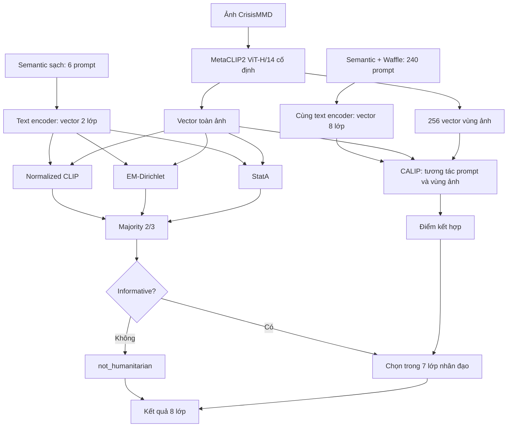

**WAFFLECLIP VÀ ỨNG DỤNG CẢI THIỆN PHÂN LOẠI CRISISMMD**

**1. Nghiên cứu WaffleCLIP**

WaffleCLIP đặt câu hỏi: **CLIP tốt hơn khi thêm mô tả từ AI vì có thêm kiến thức, hay vì được tổng hợp nhiều cách diễn đạt?** DCLIP dùng LLM tạo đặc điểm từng lớp; WaffleCLIP kiểm tra bằng cách thay các mô tả đó bằng từ và ký tự ngẫu nhiên, trong khi vẫn giữ tên lớp. [WaffleCLIP, ICCV 2023](https://arxiv.org/abs/2306.07282), [DCLIP, ICLR 2023](https://arxiv.org/abs/2210.07183).

**Mô hình:** CLIP ViT-B/32, ViT-L/14 và ResNet-50, giữ nguyên trọng số khi áp dụng Waffle.

**Dữ liệu:** 11 benchmark chuẩn, gồm tám bộ trong bảng so sánh chính và ba bộ mở rộng:

| Nhóm | Dataset | Nội dung ảnh và mục tiêu phân loại |
|---|---|---|
| Chính | ImageNet | Ảnh đồ vật, động vật và nhiều đối tượng đời thường; nhận diện đối tượng trong ảnh |
| Chính | ImageNetV2 | Bộ ảnh tự nhiên mới cùng hệ lớp ImageNet; kiểm tra khả năng nhận diện khi đổi tập ảnh |
| Chính | CUB200-2011 | Ảnh các loài chim; phân biệt những loài có hình dáng gần giống nhau |
| Chính | EuroSAT | Ảnh vệ tinh có rừng, sông, đồng ruộng, khu dân cư…; phân loại lớp phủ/sử dụng đất |
| Chính | Places365 | Ảnh phòng, đường phố, sân bay và các địa điểm khác; phân loại loại cảnh |
| Chính | Food101 | Ảnh món ăn như pizza, sushi…; nhận diện món ăn |
| Chính | Oxford-IIIT Pets | Ảnh chó và mèo; phân biệt giống vật nuôi |
| Chính | DTD | Ảnh bề mặt có sọc, chấm, nếp nhăn và các dạng kết cấu; phân loại texture |
| Mở rộng | Flowers102 | Ảnh hoa; phân biệt loại hoa |
| Mở rộng | FGVC-Aircraft | Ảnh máy bay; phân biệt biến thể máy bay |
| Mở rộng | Stanford Cars | Ảnh ô tô; phân biệt các dòng/phiên bản xe |

Ba bộ bổ sung kiểm tra **dịch chuyển phân phối (OOD)** — nội dung hoặc cách thể hiện ảnh khác ảnh tự nhiên thông thường:

| Dataset | Nội dung ảnh | Mục đích kiểm tra |
|---|---|---|
| ImageNet-A | Ảnh tự nhiên được chọn vì gây khó cho mô hình nhận dạng | Khả năng nhận diện các ảnh khó |
| ImageNet-R | Đối tượng được thể hiện bằng tranh vẽ, hoạt hình, điêu khắc… | Khả năng nhận diện khi thay đổi cách thể hiện |
| ImageNet-Sketch | Bản phác họa đen trắng của các đối tượng | Khả năng nhận diện khi thiếu màu sắc và texture ảnh chụp |

Các bộ trên là dữ liệu đánh giá, không dùng để huấn luyện lại CLIP trong phương pháp Waffle. Chúng bao phủ đồ vật, cảnh, ảnh vệ tinh và phân loại chi tiết, giúp kiểm tra phương pháp có hữu ích ở nhiều loại nội dung ảnh hay không. [Nguồn: phần thực nghiệm WaffleCLIP](https://arxiv.org/html/2306.07282v2#S4).

**Cách hoạt động:**

```text
Tên lớp + hậu tố từ/ký tự ngẫu nhiên
                  ↓
          30 prompt cho mỗi lớp
                  ↓
       CLIP mã hóa ảnh và các prompt
                  ↓
     Trung bình cosine theo từng lớp
                  ↓
          Chọn lớp có điểm cao nhất
```

Ví dụ minh họa cấu trúc:

```text
Prompt thường: A photo of a damaged car.
Waffle:        A photo of a damaged car, which has <random words>.
```

Waffle tạo 15 cặp word/character, tổng 30 prompt/lớp. Từ được lấy từ `word_list.pkl`; file này chứa từ điển, không chứa sẵn các câu prompt. Bộ hậu tố được chia sẻ giữa các lớp trong cùng seed. Prompt có thể tạo trước và dùng chung cho mọi ảnh. [Code chính thức](https://github.com/ExplainableML/WaffleCLIP/blob/7a1b8ee48e31285f62ecd839fecb6b89cbef81f1/waffle_tools.py).

**Vì sao có thể tốt hơn?** Một prompt duy nhất có thể biểu diễn lớp chưa phù hợp. Tổng hợp nhiều ngữ cảnh giúp giảm phụ thuộc vào một câu cụ thể. Nhiễu không bổ sung kiến thức về lớp; lợi ích cần kiểm tra nằm ở việc tổng hợp biểu diễn. Nhánh mở rộng của paper còn bổ sung concept cấp cao để giảm nhập nhằng tên lớp.

Kết quả gốc, Accuracy trung bình trên tám benchmark chính với ViT-B/32:

| Phương pháp | Accuracy |
|---|---:|
| CLIP | 57,34% |
| DCLIP | 58,56% |
| WaffleCLIP | 58,57% |
| WaffleCLIP + concept | 59,47% |

**Kết luận:** nhiều biến thể prompt có thể đem lại mức tăng tương đương mô tả LLM trong các thiết lập đã đo. Điều này không có nghĩa nhiễu luôn tốt hơn mô tả đúng. [Paper, Bảng 2](https://arxiv.org/html/2306.07282v2#S4).

**2. Áp dụng phần nào vào CrisisMMD?**

CrisisMMD có ảnh và tweet về khủng hoảng. Phạm vi triển khai hiện tại sử dụng **hai task với nhãn ảnh**:

**Task 1 — Informativeness (`informativeness`): xác định ảnh có cung cấp thông tin hữu ích về khủng hoảng hay không.**

| Lớp tiếng Anh | Tiếng Việt | Ví dụ minh họa |
|---|---|---|
| Informative | Có thông tin hữu ích | Ảnh nhà sập, xe bị ngập hoặc hoạt động cứu hộ |
| Not informative | Không có thông tin hữu ích | Ảnh chân dung/sinh hoạt không thể hiện thông tin khủng hoảng |

**Task 2 — Humanitarian categorization (`humanitarian`): phân loại nội dung nhân đạo thành tám lớp.**

| Lớp tiếng Anh | Tiếng Việt |
|---|---|
| Not humanitarian | Không có thông tin nhân đạo liên quan |
| Other relevant information | Thông tin liên quan khác |
| Rescue, volunteering or donation effort | Cứu hộ, tình nguyện hoặc quyên góp |
| Infrastructure and utility damage | Thiệt hại hạ tầng và tiện ích công cộng |
| Affected individuals | Người bị ảnh hưởng |
| Vehicle damage | Thiệt hại phương tiện |
| Injured or dead people | Người bị thương hoặc tử vong |
| Missing or found people | Người mất tích hoặc được tìm thấy |

Ví dụ: ảnh ô tô ngập nước có thể được phân loại **Informative** ở task 1 và **Vehicle damage** ở task 2. [Nguồn task và nhãn CrisisMMD](https://crisisnlp.qcri.org/crisismmd.html).

Dự án giữ **MetaCLIP2 ViT-H/14** làm backbone, không huấn luyện lại trọng số. Đầu vào hiện tại là **ảnh**; text encoder mã hóa prompt lớp, không nhận tweet của từng mẫu. Có 3.000 ảnh phát triển và 2.219 ảnh dev để so sánh các cấu hình.

Tên lớp khủng hoảng khá trừu tượng, nên dự án dùng **semantic anchor: mô tả lớp cụ thể**, rồi mới thêm Waffle. Đây là vận dụng cơ chế prompt ensembling, không nhận là một thuật toán Waffle mới.

Ví dụ prompt thật của lớp cứu trợ:

```text
Semantic:
Rescue/Volunteering/Donation: rescue workers helping people reach safety.

Semantic + Waffle:
Rescue/Volunteering/Donation: rescue workers helping people reach safety,
which has meter's fluke.
```

`meter's fluke` là nhiễu. Mỗi lớp có ba mô tả semantic; ở tầng chi tiết, mỗi mô tả nhận 10 prompt Waffle, tổng **30 prompt/lớp × 8 lớp = 240 prompt**. Các vector prompt được lấy trung bình rồi chuẩn hóa thành vector đại diện lớp. [Bộ prompt đang dùng](prompt_majority_calip.json).

**3. Hệ thống tốt nhất hiện tại: hai tầng + majority + CALIP**

“Tốt nhất” ở đây là **Macro-F1 cao nhất trên dev trong các cấu hình MetaCLIP2 đã đối chiếu**, chưa phải kết luận trên test độc lập.

**Hai tầng — tách quyết định tổng quát và chi tiết**

```text
Ảnh → có thông tin hữu ích không?
  ├─ Không → not_humanitarian
  └─ Có → chọn một trong 7 lớp nhân đạo
```

Tầng 1 dùng **semantic sạch: ba prompt/lớp, tổng sáu prompt**. Tầng 2 dùng semantic + Waffle. Thiết kế này giúp lớp không liên quan không phải cạnh tranh trực tiếp với bảy lớp chi tiết ngay từ đầu. Hai task vẫn có nhãn thật riêng; đây là quy tắc định tuyến của hệ thống.

**Majority — ba cách suy luận cùng bỏ phiếu ở tầng 1**

**Normalized CLIP:** mã hóa ba prompt semantic của mỗi lớp, chuẩn hóa từng vector, lấy trung bình rồi chuẩn hóa lại thành vector đại diện lớp. Ảnh được so cosine với hai vector lớp; lớp có điểm cao hơn là dự đoán. Mỗi ảnh được xét độc lập.

**EM-Dirichlet — suy luận từ phân phối điểm của nhóm ảnh**

EM sử dụng thông tin từ **một nhóm ảnh không nhãn**, thay vì chỉ chốt nhãn ngay từ score của từng ảnh:

1. **Tạo probability features:** từ mean cosine với hai lớp, tính `q = softmax(30 × score)`. Ví dụ `q = [0,52; 0,48]` thể hiện ảnh chỉ hơi nghiêng về Informative. Hai phần tử là điểm của hai lớp, không phải tọa độ vùng ảnh.
2. **Ước lượng phân phối:** dùng các vector `q` trong nhóm để ước lượng hai phân phối Dirichlet. Dirichlet mô tả những vector xác suất không âm, có tổng bằng 1.
3. **Lặp cập nhật:** tính mức phù hợp của từng ảnh với mỗi cụm; dùng các mức gán đó cập nhật tham số phân phối; tiếp tục tính lại mức gán. Đây là quá trình cập nhật luân phiên của EM, không phải chỉ đổi tên nhãn.
4. **Ghép cụm với lớp:** Hungarian chọn cách ghép cụm với Informative/Not informative dựa trên bằng chứng CLIP, không dựa vào nhãn thật; từ đó có nhãn cuối cho từng ảnh.

```text
Score CLIP từng ảnh → vector xác suất q
                              ↓
              Ước lượng phân phối theo nhóm
                              ↕
                Cập nhật mức gán từng ảnh
                              ↓
               Ghép cụm–lớp → dự đoán EM
```

**Ví dụ:** ảnh B có điểm `[0,52; 0,48]`, nên quyết định CLIP ban đầu khá mơ hồ. EM dùng thêm cấu trúc phân phối của những ảnh trong nhóm để tính lại mức phù hợp của B; nhãn có thể giữ hoặc đổi. Các ảnh cùng nhóm **không bị gán chung một nhãn**. Lợi ích cần kiểm tra là giảm quyết định mơ hồ; phân phối ước lượng sai cũng có thể làm dự đoán kém hơn. [EM-Dirichlet, CVPR 2024](https://arxiv.org/abs/2405.18437).

**StatA — thích nghi phân phối embedding, có điểm neo từ prompt**

Khác EM ở trên, StatA mô hình hóa **embedding ảnh**, không dùng vector probability features hai chiều làm dữ liệu phân phối:

1. **Khởi tạo:** prototype text là vector đại diện hai lớp, tạo dự đoán tham chiếu CLIP và tâm phân phối ban đầu.
2. **Ước lượng Gaussian:** từ embedding và mức gán lớp hiện tại, ước lượng tâm và mức phân tán của từng lớp. Gaussian giúp đánh giá ảnh mới phù hợp với vùng phân phối nào.
3. **Giữ statistical anchor:** ràng buộc tham số về prototype text; khi bằng chứng trong nhóm ít, phân phối không được tự do trôi khỏi kiến thức CLIP. Quan hệ láng giềng giữa ảnh cũng hỗ trợ tính nhất quán của mức gán.
4. **Cập nhật luân phiên:** điều chỉnh phân phối và mức gán ảnh, sau đó chọn lớp có điểm đầu ra cao nhất.

```text
Embedding ảnh + prototype text
               ↓
Gaussian từng lớp + điểm neo + quan hệ lân cận
               ↕
       Cập nhật mức gán từng ảnh
               ↓
          Dự đoán StatA
```

**Ví dụ:** một ảnh xe ngập bị CLIP phân loại mơ hồ. Nếu embedding phù hợp với phân phối Informative được ước lượng từ nhóm, StatA có thể bổ sung bằng chứng cho lớp này; điểm neo text hạn chế phân phối bị kéo lệch theo một nhóm ảnh không đại diện. Đây là cơ chế cần đánh giá, không bảo đảm StatA luôn sửa đúng. [StatA, CVPR 2025](https://arxiv.org/abs/2501.03729).

EM và StatA dùng cùng nhóm tối đa 75 ảnh, xáo trộn theo seed rồi chia nhóm; bước chia nhóm không dựa trên nhãn thật hoặc độ giống ảnh. Cả hai đều giữ backbone cố định.

**Quy tắc majority:** ít nhất hai trong ba nhánh chọn informative thì ảnh đi tiếp. Ba nhánh chia sẻ vector ảnh, không cần mã hóa ảnh ba lần. Đây là ensemble ba cách suy luận dùng chung backbone, không phải ba model ảnh được huấn luyện riêng.

Ví dụ minh họa:

```text
Ảnh một nhóm người nhận hàng cứu trợ:
Normalized CLIP → not_informative
EM-Dirichlet    → informative
StatA           → informative
                     ↓
               Majority: 2/3
                     ↓
             Chuyển sang tầng chi tiết
```

Lợi ích kỳ vọng là giảm tác động của một nhánh sai khi hai nhánh còn lại nhất trí. Hiệu quả phải được xác nhận bằng kết quả, vì các nhánh vẫn có thể cùng sai.

**CALIP — dùng cả toàn ảnh và các vùng ảnh ở tầng 2**

CLIP cơ bản so một vector toàn ảnh với các lớp. CALIP bổ sung **attention hai chiều giữa đặc trưng vùng ảnh và vector prompt**. [CALIP, AAAI 2023](https://arxiv.org/abs/2209.14169).

**Các bước trong bản MetaCLIP2:**

1. **Lấy đặc trưng:** một forward tạo vector toàn ảnh và **256 vector vùng ảnh**, cùng các prototype text của tám lớp.
2. **Tính attention:** so từng vector vùng với từng prototype bằng dot product, nhân hệ số 2. Softmax tạo trọng số tương tác.
3. **Ảnh hướng dẫn text:** chuẩn hóa trọng số theo các vùng; mỗi lớp lấy tổng có trọng số của vector vùng để tạo đại diện thích nghi với ảnh hiện tại.
4. **Text hướng dẫn ảnh:** chuẩn hóa theo các lớp; từng vùng nhận tổng có trọng số của prototype. Gộp các vùng đã tương tác bằng mean + max để tạo visual feature mới.
5. **Tính ba điểm:** global ảnh–text gốc; global ảnh–text đã thích nghi; visual đã thích nghi–text gốc. Kết hợp thành điểm cuối:

```text
L = L_global + 1.12 × L_text_adapted + 0.02 × L_visual_adapted
```

Các hệ số được khóa trước khi đo; không chọn bằng nhãn dev. CALIP không thêm trọng số attention được học; nó tính lại trọng số tương tác từ chính feature của từng ảnh và các lớp.

Ví dụ minh họa: một ảnh có nhiều người chưa đủ phân biệt “người bị ảnh hưởng” với “cứu trợ”. Các vùng có cảnh trao nhu yếu phẩm có thể bổ sung bằng chứng cho lớp cứu trợ. Đây là giải thích giả thuyết về cơ chế; chưa chứng minh attention định vị đúng vùng trên mọi ảnh.

CALIP chấm đủ tám lớp; nếu cổng informative cho qua, quyết định cuối chỉ chọn trong bảy lớp nhân đạo. Nhờ vậy cổng và tầng chi tiết đảm nhiệm hai việc khác nhau.

**4. Sơ đồ tổng thể**



Các ví dụ trên minh họa cách hoạt động, không phải dự đoán đã đo trên một mẫu cụ thể. Prompt được tạo sẵn; thay đổi theo từng ảnh là embedding, kết quả thích nghi và attention.

**5. Kết quả so sánh trên CrisisMMD**

**Thiết lập chung:** MetaCLIP2 ViT-H/14, chỉ ảnh, nhãn ảnh thật. `Semantic` = ba mô tả sạch/lớp; `Semantic + Waffle` = 30 prompt/lớp. Baseline xác định dùng seed 0; các hàng majority là trung bình ba grouping seed 0/1/2, prompt seed giữ 0.

**Task 1 — Informativeness, 2 lớp; cùng 3.000 ảnh train dùng phát triển**

| Phương pháp | Prompt | Accuracy | Macro-F1 |
|---|---|---:|---:|
| Baseline CLIP — mean cosine, argmax | Semantic: 6 prompt | 79,93% | 79,58% |
| **Majority: Normalized CLIP + EM-Dirichlet + StatA** | **Cùng Semantic: 6 prompt** | **80,86%** | **80,83%** |

Majority tăng **0,92 điểm Accuracy** và **1,24 điểm Macro-F1**, tính từ số chưa làm tròn. CALIP không tham gia cổng này; cải thiện binary đến từ thay cách suy luận trên cùng prompt semantic.

**Task 2 — Humanitarian categorization, 8 lớp**

| Tập đánh giá | Phương pháp | Prompt cổng 2 lớp | Prompt 8 lớp | Accuracy | Macro-F1 |
|---|---|---|---|---:|---:|
| Train phát triển, 3.000 ảnh | Baseline CLIP một tầng | — | Semantic + Waffle: 240 | 57,60% | 44,99% |
| Train phát triển, 3.000 ảnh | Baseline hai tầng | Semantic: 6 | Semantic + Waffle: 240 | 68,03% | 49,88% |
| Train phát triển, 3.000 ảnh | Majority + CALIP hai tầng | Semantic: 6 | Semantic + Waffle: 240 | 69,76% | 47,63% |
| Dev, 2.219 ảnh | Baseline CLIP một tầng | — | Semantic + Waffle: 240 | 56,60% | 43,80% |
| Dev, 2.219 ảnh | Baseline hai tầng | Semantic: 6 | Semantic + Waffle: 240 | 66,20% | 48,06% |
| **Dev, 2.219 ảnh** | **Majority + CALIP hai tầng** | **Semantic: 6** | **Semantic + Waffle: 240** | **70,36%** | **51,14%** |

Trên **cùng dev**, cấu hình hiện tại tăng **4,16 điểm Accuracy** và **3,08 điểm Macro-F1** so với baseline hai tầng. Đối chứng cùng cổng majority và cùng prototype chuẩn hóa cho thấy CALIP tăng thêm khoảng **0,74 điểm Macro-F1**; không quy toàn bộ mức tăng cho attention.

Task 1 chưa có kết quả trên toàn cohort dev 2.219 vì không có nhãn informative thật tương ứng; không suy nhãn đó từ humanitarian. Không so điểm train với dev như thể cùng một bộ ảnh.

**Ý nghĩa:** Waffle bổ sung nhiều cách biểu diễn lớp; semantic làm rõ nội dung lớp; majority cải thiện quyết định cổng; CALIP bổ sung tương tác giữa vùng ảnh và prompt. Các thành phần giải quyết những phần khác nhau của bài toán.

**Giới hạn:** đây là kết quả dev, chưa xác nhận bằng test độc lập. Macro-F1 train của cấu hình mới giảm từ 49,88% xuống 47,63%, và mức tăng dev chưa chứng minh có ý nghĩa thống kê. Vì vậy giữ phương án này là ứng viên theo Macro-F1 dev, không kết luận cải thiện mọi lớp hoặc mọi tập dữ liệu.

[Bảng đối chứng binary](../../experiments/clip_tda/README.md), [chi tiết đối chiếu cả hai task và giới hạn](../../experiments/clip_calip/README.md).
