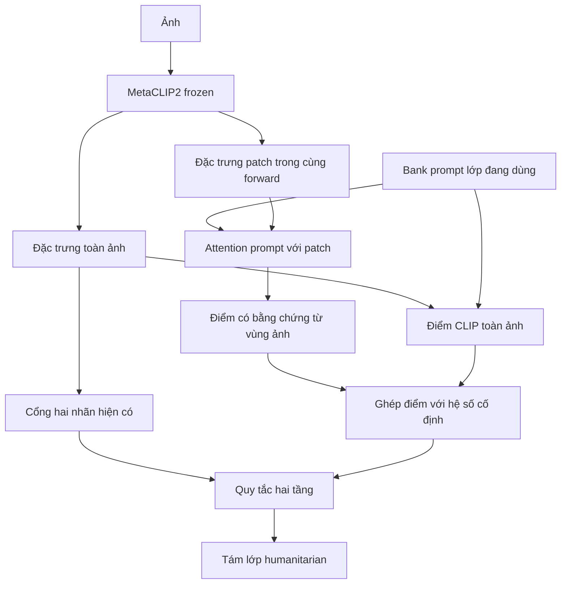

# Hướng mới: dùng đặc trưng toàn ảnh và từng vùng cho CLIP hai tầng

Ngày 29-10-2026. CALIP đã chạy trên **3.000 train** (`2503caa2909f`) và
**2.219 dev** (`03a1f0babaaf`), audit/đối chiếu tác giả đạt. Majority + CALIP
đạt train/dev 47,63/51,14%, DN 49,22/50,39%: cải thiện dev, giảm train.
**Chưa có CALIP test.** Giữ ứng viên, không đổi pipeline/frozen test plan.

Cập nhật triển khai: đã có [CALIP runner local/Kaggle](../../experiments/clip_calip/README.md),
extractor global/patch, các đối chứng cố định và analyzer ZIP. Sáu test mới
đạt, toán attention đã đối chiếu mã tác giả. Người dùng đã chạy lượt thật;
majority + CALIP đạt 47,6304% train, gần unit control 47,6258%, thấp hơn DN
49,2208%. Trên dev mới, CALIP tăng Macro-F1 0,75 điểm so với DN nhưng
Accuracy giảm, CI query/event vẫn chứa 0. Chi tiết audit ở README; các mục
dưới mô tả cơ sở và giao thức phép thử đã định trước.

## 1. Vì sao chuyển hướng

Phần lớn các lượt gần đây sửa cách suy luận từ cùng một embedding toàn ảnh
1024 chiều. DN/InMaP có tín hiệu tốt; memory/đồ thị và residual chưa vượt
ứng viên hiện có. Đây là cơ sở để kiểm tra thêm thông tin không gian trong
encoder, chưa phải bằng chứng embedding hiện tại đã đạt trần hoặc mọi lỗi
đến từ mất chi tiết vùng.

Đã thêm chẩn đoán có thể tái lập:
`experiments/clip_diagnostics/bottleneck.py`, chỉ đọc result artifact.
Kết quả `results/analysis/clip_bottleneck/93aaeef5ace4/analysis.json`.

Trên 2.219 dev, majority + DN-unit, mean ba grouping seed:

| Lỗi theo target humanitarian | Số ảnh trung bình/lượt |
|---|---:|
| Ảnh thuộc bảy lớp liên quan nhưng bị cổng chặn | 182,33 |
| Ảnh not_humanitarian được cổng cho qua | 220,33 |
| Ảnh liên quan qua cổng nhưng chọn sai lớp chi tiết | 250,00 |

Ba nhóm không giao nhau, tổng đúng bằng số lỗi thực tế từng seed. Đây là
phân tích theo **nhãn humanitarian**, không tự tạo GT informative dev.
Nhãn thật dùng duy nhất cho chẩn đoán sau dự đoán, không fit thuật toán.

Ngay cả bỏ qua cổng, DN chọn đúng lớp affected_individuals cho 37/77 ảnh
thật thuộc lớp đó; raw head là 26/77. Vẫn còn lỗi phân biệt lớp trước khi
đụng đến cổng. Chưa xem ảnh lỗi để kết luận các mẫu này có dấu hiệu cục bộ
có thể khai thác được; chỉ dùng con số để ưu tiên phép thử.

Hai counterfactual cũng được lưu: dùng target để định tuyến hoàn hảo cho
DN đạt 61,23% Macro-F1 dev; sửa hoàn hảo lớp chi tiết trên các ảnh positive
đã qua cổng đạt 72,64% với majority gate. **Chúng dùng GT và không triển khai
được, không phải điểm model mới, mức tăng dự báo hoặc cam kết khả thi.**
Chúng chỉ xác nhận cả cổng lẫn phân biệt lớp đều còn lỗi.

## 2. Nghiên cứu đã đối chiếu

### CALIP, AAAI 2023 — hướng ưu tiên

- [Paper](https://arxiv.org/html/2209.14169v2).
- [Repo chính thức](https://github.com/ZiyuGuo99/CALIP).
- Đã đọc core `run_imagenet.py` (get_logits và nhánh search),
  `clip/model.py` (VisionTransformer.forward), và phần phương pháp/cấu hình
  của paper; chưa clone/ghim commit hoặc tuyên bố đã tái lập.

CALIP dùng attention hai chiều giữa spatial visual feature và prototype
text. Nó tạo thêm hai nguồn điểm từ các đặc trưng đã tương tác, rồi ghép
với điểm global gốc. Không cần memory nhãn giả hoặc fit encoder. Model có
thể dùng vùng ảnh để bổ sung bằng chứng cho một lớp thay vì chỉ dựa vector
global. Text ở đây là prompt lớp, không phải tweet của CrisisMMD.

Điểm cần giữ đúng: **parameter-free không có nghĩa không có hyperparameter**.
Paper chọn các hệ số logits theo dataset trên validation. Repo có nhánh
search đánh giá từng bộ trọng số bằng labels; không chạy nhánh đó trên
dev/test dự án rồi gọi là lựa chọn không nhãn. Khi triển khai, ghim source
và cố định một bộ hệ số trước khi đo. Có thể dùng bộ ImageNet tác giả
(beta1=1, beta2=1.12, beta3=0.02), không chuyển mức tăng paper thành kỳ vọng
CrisisMMD. Core attention nhân similarity với 2; cần theo code đã ghim,
không trộn lẫn với cách ký hiệu chia alpha trong phương trình paper.

### Các hướng liên quan được cân nhắc

| Nghiên cứu | Có thể kế thừa | Vì sao chưa ưu tiên triển khai trước |
|---|---|---|
| [WinCLIP, CVPR 2023](https://openaccess.thecvf.com/content/CVPR2023/html/Jeong_WinCLIP_Zero-Few-Shot_Anomaly_Classification_and_Segmentation_CVPR_2023_paper.html) | Kết hợp thông tin window/patch/image | Bài gốc là anomaly detection, không đổi informativeness thành normal/anomaly hoặc chuyển AUROC paper sang F1 dự án |
| [CLIP Surgery](https://github.com/xmed-lab/CLIP_Surgery) | Cải thiện tín hiệu không gian và giảm kích hoạt nhiễu | Cần sửa inference attention và kiểm tra kiến trúc MetaCLIP2; attention map đẹp chưa chứng minh tăng phân loại |
| [SuS-X, ICCV 2023](https://github.com/vishaal27/SuS-X) | Support ngoài target từ ảnh sinh/truy hồi | Thêm chi phí, nhiễu nhãn và kiểm tra trùng; lớp quan hệ như missing/found khó đảm bảo ảnh sinh đúng nghĩa |
| Tip-Adapter/few-shot đã lưu | Support có nhãn để học/truy hồi đúng miền | Vẫn giữ dự phòng theo quyết định trước; chưa kích hoạt nhãn train làm support |

Không nhận toàn bộ các hướng này đã được cài đặt hoặc chạy trên CrisisMMD.

## 3. Thiết kế áp dụng cho dự án

Ví dụ minh họa, không phải kết luận từ ảnh đã xem: cảnh có nhiều người có
thể cần bằng chứng về trao hàng cứu trợ để phân biệt với một nhóm người
chỉ đang đứng/chờ. Local feature có thể giữ tín hiệu bị giảm khi tổng hợp
toàn ảnh; cũng có thể gây sai nếu chỉ thấy người hoặc đồ vật thông thường.
Vì vậy giữ điểm global và đánh giá từng lớp, không dùng max một patch rồi
mặc định có cứu trợ. Local patch không bổ sung được thông tin hoàn toàn
không có trong ảnh, nhất là các nhãn phụ thuộc ngữ cảnh như missing/found.

### Phép thử đầu tiên

1. Giữ model, ảnh, prompt seed và cổng majority hiện có. Chỉ thay head tám
   lớp bằng CALIP để tách tác động đặc trưng vùng khỏi thay đổi cổng.
2. Đối chứng cùng lượt: mean-cosine cũ, normalized prototype, majority +
   DN-unit. Cần cả đối chứng normalized vì CALIP dùng prototype unit.
3. Cố định hệ số tác giả trước khi đo, không sweep trên dev. CALIP + DN
   chỉ là nhánh bổ sung sau khi operator CALIP cơ bản được xác minh; không
   giả định mean global của DN luôn phù hợp cho patch.
4. Tách phép thử root-only với cùng head DN-unit để đo binary thật trên
   3.000 train và đầu ra tám lớp dev. Không báo binary dev khi chưa có GT.
   Không gộp ngay root/leaf mới rồi khó quy nguyên nhân tăng/giảm.
5. Smoke kỹ thuật 5 ảnh, sau đó một lượt trên cohort phát triển cố định.
   Không encode lại riêng cho mỗi cổng hoặc seed; lưu các score term và
   attention map gọn để tái dùng offline.

### Tương thích và chi phí

Wrapper hiện tại chỉ trả global embedding ở `src/models/model_registry.py`;
cached global vector không thể khôi phục lại patch đã mất. Cần một lượt
encoder mới lấy thêm token, dự kiến có thể chia sẻ cùng forward với global
thay vì encode nhiều crop. Đây là dự kiến cần smoke, chưa đo runtime/GPU.

Đã đối chiếu [OpenCLIP v3.3.0 transformer.py](https://raw.githubusercontent.com/mlfoundations/open_clip/v3.3.0/src/open_clip/transformer.py)
với CALIP ViT: output token không mặc định đã cùng chiều/cùng normalization
với text. Cần đi qua đúng ln_post/projection hiện có và xác minh hình dạng,
giá trị hữu hạn, unit norm. Bắt buộc tái dựng global score và các prediction
baseline trước khi đánh giá head mới; không âm thầm đổi preprocess, pooling
hoặc checkpoint để lấy spatial feature. Kiểm tra đúng phiên bản OpenCLIP
thực tế trước khi ràng buộc API; chưa đọc thư viện cài sẵn/weights.

Giữ nguyên luồng mặc định; dùng extractor/runner opt-in riêng. Dữ liệu GPU
do người dùng chạy vẫn phải giữ cohort/hash cũ và giới hạn đọc theo quyền
được cấp. Lượt nghiên cứu này không gửi job hoặc đọc dataset ảnh mới.

## 4. Điều kiện giữ hoặc dừng hướng

- Mốc đối chứng dev chính: majority + DN-unit 50,3947% Macro-F1; normalized
  text leaf 50,3969% gần như tương đương, cũng phải đưa vào so sánh.
- Đo Macro-F1 đủ tám lớp, F1/recall từng lớp, Accuracy và chi phí; báo cả
  train/dev riêng. Kiểm tra mức tăng có phụ thuộc hai mẫu missing/found hay
  một seed không. Không tự bỏ lớp hiếm để làm đẹp kết quả.
- Cổng mới phải được đo task binary thật, nhưng không lấy binary F1 tăng
  làm bằng chứng rằng tám lớp tăng. Chú ý recall cứu trợ và ảnh positive bị chặn.
- Bản đồ vùng chỉ là tín hiệu giải thích; không gọi là localization đúng
  khi không có bounding-box/mask GT. Có thể đo tác động che vùng bằng crop
  cố định như phân tích bổ sung, không chọn vùng theo nhãn thật.
- Không cam kết số phần trăm tăng. Nếu phép thử có đối chứng không cải thiện,
  ghi kết quả âm và dừng cấu hình đó, không dò nhiều coefficient trên cùng
  dev để buộc thắng. Test chỉ mở sau khi khóa phương án cuối.

Đóng góp khả thi cho môn học là thiết kế và kiểm chứng phân loại zero-shot
ảnh khủng hoảng bằng đặc trưng global/local trong hai tầng, cùng phân tích
lỗi cổng, lớp hiếm, khả năng giải thích và chi phí. CALIP/attention/local
feature đều đã có tiền lệ; chưa khẳng định tính mới toàn cầu của cách ghép.
