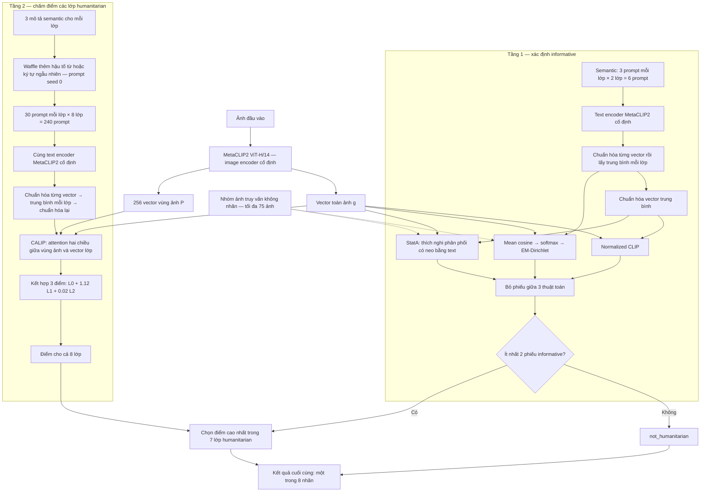

# Sơ đồ phương án majority + CALIP

Ứng viên tốt nhất hiện tại theo Macro-F1 8 lớp trên dev: MetaCLIP2 ViT-H/14, cổng majority và tầng chi tiết CALIP. Đây là kết quả trên dev đã được sử dụng nhiều lần, chưa phải kết luận trên test độc lập. Mô hình được giữ cố định, không huấn luyện trọng số. Đầu vào là ảnh, không có nội dung tweet.

## Prompt thực tế

Tầng 1 dùng phương pháp `semantic`, không thêm Waffle:

- `Informative: a view showing the effects of a disaster or an ongoing emergency.`
- `Informative: a scene of damaged property, affected people, or emergency response.`
- `Informative: a map, weather chart, or public warning about a disaster.`
- `Not Informative: an everyday scene unrelated to a disaster or emergency.`
- `Not Informative: a personal portrait, advertisement, or entertainment image.`
- `Not Informative: a generic illustration with no concrete disaster information.`

Tầng 2 dùng `semantic_waffle`. Ví dụ mô tả nền là `rescue workers helping people reach safety`. Một prompt thực tế sau Waffle:

> Rescue/Volunteering/Donation: rescue workers helping people reach safety, which has meter's fluke.

`meter's fluke` là nhiễu ngẫu nhiên, không phải kiến thức cứu hộ. Mỗi lớp có 3 mô tả nền, mỗi mô tả sinh 10 prompt; tổng cộng 30 prompt/lớp, gồm 15 prompt nhiễu từ và 15 prompt nhiễu ký tự. Toàn bộ 246 prompt được trích nguyên văn trong `prompt_majority_calip.json` từ `configs/prompts/crisismmd_calip_reference.json`.

## Vai trò từng thuật toán

- Normalized CLIP: so độ tương đồng giữa vector ảnh và vector prompt lớp đã chuẩn hóa.
- EM-Dirichlet: dùng phân phối xác suất từ mean cosine, thích nghi trên nhóm ảnh không nhãn, sau đó ánh xạ cụm về lớp.
- StatA: dùng embedding ảnh và vector lớp để thích nghi phân phối trên nhóm ảnh không nhãn, có điểm neo từ text.
- Majority: lấy nhãn được ít nhất hai trong ba thuật toán chọn. Không phải bỏ phiếu giữa các seed.
- Waffle: tạo nhiều biến thể prompt bằng nhiễu, rồi tổng hợp thành vector đại diện lớp. Nó không sửa ảnh hoặc huấn luyện mô hình.
- CALIP: sử dụng vùng ảnh và prompt để điều chỉnh đặc trưng bằng attention, rồi kết hợp với điểm CLIP toàn ảnh. L0 là điểm toàn ảnh–text gốc; L1 là điểm toàn ảnh–text được điều chỉnh theo ảnh; L2 là điểm ảnh được điều chỉnh theo text–text gốc. Attention scale = 2, hệ số kết hợp = [1, 1.12, 0.02]. Các hệ số đã được cố định trước khi xem kết quả hiện tại.

## Các chi tiết cần hiểu đúng

- Hai ô text encoder trong sơ đồ dùng cùng mô hình và trọng số. Ba thuật toán ở tầng 1 cũng dùng cùng backbone và cùng bộ prompt.
- CALIP dùng vector của cả 8 lớp trong attention; chỉ khi chọn nhãn sau cổng informative mới loại `not_humanitarian` và chọn trong 7 lớp còn lại.
- Bảy lớp đó gồm: other_relevant_information, rescue_volunteering_or_donation_effort, infrastructure_and_utility_damage, affected_individuals, vehicle_damage, injured_or_dead_people, missing_or_found_people.
- Trong lượt CALIP đã chạy, kết quả cổng majority được tái sử dụng từ cache đã đối chiếu ID/hash. Điểm CALIP được tính cho tất cả ảnh; cổng chỉ điều khiển quyết định cuối. Sơ đồ thể hiện hệ thống logic đầy đủ, không khẳng định lượt CALIP đã chạy lại EM/StatA hoặc bỏ qua tính CALIP cho ảnh âm.
- Seed 0/1/2 thay đổi cách chia nhóm ảnh cho phương pháp transductive. Chạy riêng từng seed rồi lấy trung bình chỉ số; không chọn seed tốt nhất. Prompt seed cố định bằng 0.
- Nhãn thật chỉ dùng để đánh giá sau dự đoán, không đưa vào các bước thích nghi. Phương án này không dùng DN hoặc few-shot.

## Kết quả đang đối chiếu

Dev 2.219 ảnh, trung bình 3 grouping seed, task 8 lớp:

| Phương án | Macro-F1 | Accuracy |
|---|---:|---:|
| Baseline hai tầng | 48,06% | 66,20% |
| Majority + DN | 50,39% | 70,59% |
| Majority + CALIP | 51,14% | 70,36% |

Majority + CALIP tốt nhất theo Macro-F1 trong so sánh này; majority + DN vẫn nhỉnh hơn về Accuracy. Chưa thể kết luận mức tăng so với DN có ý nghĩa thống kê hoặc sẽ giữ nguyên trên test độc lập.
