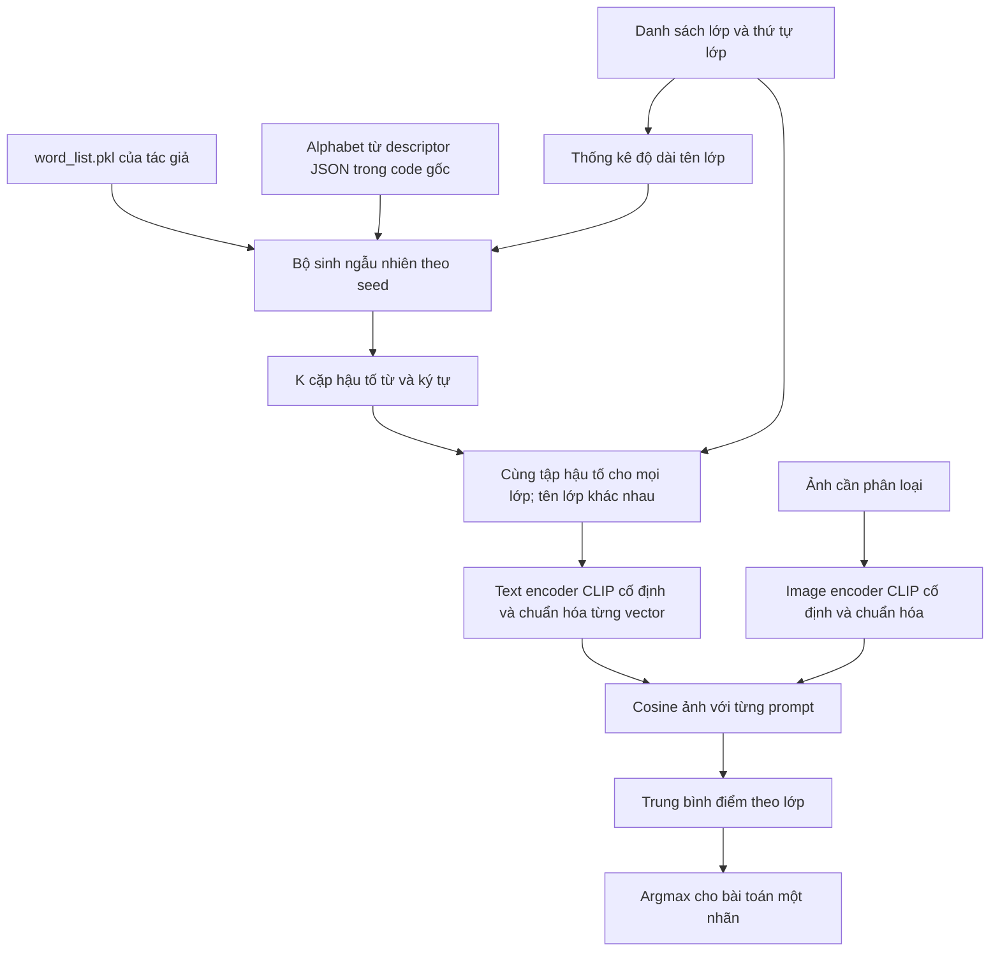

# WaffleCLIP: câu hỏi nghiên cứu, cơ chế và hướng thích nghi cho dự án

Ngày đối chiếu: **22/10/2026**. Trạng thái: **phân tích nghiên cứu và đề xuất thí nghiệm**. Sau bản phân tích đã có [Waffle lab độc lập](../../experiments/waffle_lab/README.md) để kiểm tra các biến thể mới; chưa chạy inference thật cho chúng.

Tài liệu phân biệt ba mức: **[Tác giả]** là điều paper/repo công bố; **[Code]** là hành vi đọc trực tiếp từ mã nguồn; **[Đề xuất]** là suy luận hoặc giả thuyết cho dự án, cần kiểm chứng. Mô tả cơ chế trực quan không thay thế một chứng minh nhân quả.

Rà soát thực thi bổ sung: [giao thức thử nghiệm đầu tiên và các điểm cần hoàn thiện](waffleclip_giao_thuc_thu_nghiem.md), kèm [kiểm tra sinh prompt/tokenizer qua bảy seed](waffleclip_prompt_audit_20261022.json). Đây là kiểm tra kỹ thuật, chưa phải kết quả phân loại trên dữ liệu thật.

## 1. Trả lời ba thắc mắc chính

| Thắc mắc | Kết luận |
|---|---|
| Tác giả chủ yếu làm về food? | **Không.** Food101 là một benchmark và food là ví dụ minh họa nổi bật. Repo có loader, lệnh và concept riêng cho nhiều miền ảnh. |
| Paper muốn chứng minh prompt vô nghĩa bổ sung kiến thức mới? | Câu hỏi chính là **lợi ích của descriptor đến từ nội dung mô tả hay từ việc tổng hợp nhiều biến thể prompt**. Nhiễu là một đối chứng giúp tách hai cách giải thích đó. |
| Có thể lấy phương pháp áp thẳng vào dữ liệu hiện tại? | Có thể dùng làm baseline nghiên cứu trên nhánh ảnh. Để kết luận cho ảnh + tweet hoặc nhãn trừu tượng, phải bổ sung đối chứng và kiểm tra đúng nghĩa nhãn, cách tổng hợp và nguồn dữ liệu. |

**Tóm tắt phát hiện của tác giả:** biến thể ngẫu nhiên có thể cho mức tăng tương đương descriptor có nghĩa; semantic descriptor vẫn có tác dụng bổ sung. Ngữ cảnh cấp cao, như loại đối tượng đang phân loại, là một nhánh riêng. Đây là bằng chứng thực nghiệm trên các benchmark được khảo sát, không phải định lý rằng ngữ nghĩa không quan trọng hoặc nhiễu luôn cải thiện model. [Paper, mục 3–4 và phụ lục](https://arxiv.org/html/2306.07282v2).

## 2. Phạm vi tài liệu đã đối chiếu

- Paper ICCV 2023 *Waffling Around for Performance: Visual Classification with Random Words and Broad Concepts*, phần chính và Appendix A/B của bản arXiv v2; đối chiếu cả các kết quả bổ sung về backbone.
- README, `base_main.py`, các nhánh sinh prompt và hàm mã hóa/tổng hợp trong `waffle_tools.py`, `generate_concepts.py`, `generate_descriptors.py`, `replicate_key_runs.sh`, `evaluate_results.py`, phần loader/preprocess của repo.
- Hai đường tích hợp của dự án: `src/research/upstream.py` và `src/research/adapted_methods.py`; cách tổng hợp và fusion trong `src/inference.py`.
- Tài liệu cohort hiện tại và summary kết quả Waffle cũ. **Không đọc dữ liệu thô, không nạp trọng số hoặc chạy các script benchmark của tác giả.** Chưa tái lập điểm paper trên benchmark gốc.

Checkout WaffleCLIP được dự án ghim ở commit **`7a1b8ee48e31285f62ecd839fecb6b89cbef81f1`**, trùng [`configs/research/sources.json`](../../configs/research/sources.json). Các nhận xét code dưới đây dựa trên checkout này.

## 3. Vì sao tác giả đưa nhiễu vào prompt?

### 3.1. Câu hỏi đặt ra cho phương pháp descriptor

Khi thêm nhiều mô tả vào một lớp và Accuracy tăng, ta đồng thời thay ít nhất hai yếu tố:

1. **Thông tin mô tả:** thêm đặc điểm liên quan tới lớp.
2. **Số cách biểu diễn lớp:** từ một câu thành nhiều câu, rồi tổng hợp chúng.

Chỉ so một prompt ngắn với nhiều mô tả dài sẽ chưa phân biệt được đóng góp của hai yếu tố. WaffleCLIP tạo một đối chứng mà tên lớp vẫn giữ nguyên nhưng hậu tố được sinh ngẫu nhiên. Nhờ vậy, ta có thể hỏi liệu việc tổng hợp nhiều biểu diễn đã đủ tạo ra phần lớn lợi ích hay chưa.

Đây là lý do Waffle đáng học cho dự án: **một cải thiện điểm số cần được giải thích bằng đối chứng**, không chỉ bằng câu chuyện trực giác về prompt tốt hơn. Khi dự án thay cả mô tả, số prompt, cách tổng hợp và backbone, mức tăng chưa thể quy riêng cho một yếu tố.

### 3.2. “Vô nghĩa” cần hiểu chính xác

Ví dụ minh họa cấu trúc, không phải prompt lấy từ một lượt chạy:

```text
A photo of a cat, which has [chuỗi từ ngẫu nhiên].
A photo of a dog, which has [cùng chuỗi từ ngẫu nhiên].
```

Phần `cat`/`dog` và mẫu câu vẫn mang ý nghĩa. Chỉ hậu tố không được chọn vì mô tả đúng lớp hay ảnh đang xét. Từng từ/token vẫn có biểu diễn đã học; một chuỗi khó hiểu với người không có nghĩa text encoder biến nó thành vector 0.

**[Suy luận từ phép tính]** Tên lớp và hậu tố cùng đi qua text encoder phi tuyến, nên một hậu tố giống nhau vẫn có thể làm hai tên lớp dịch chuyển khác nhau. Việc lấy trung bình nhiều biến thể có thể thay hướng và độ dài vector đại diện lớp. Đó là một cách hiểu cơ chế biểu diễn, chưa chứng minh rằng mọi thành phần nhiễu đều triệt tiêu hoặc hướng trung bình luôn tốt hơn.

Vì vậy không diễn giải kết quả thành “model biết thêm sự thật nhờ chuỗi ký tự”, “không cần tên lớp”, hay “từ ngẫu nhiên là một lời giải thích cho ảnh”.

### 3.3. Các đối chứng cần đọc cùng kết luận

Repo có các chế độ `shared_random_descriptions`, `swapped_descriptions`, `scrambled_descriptions`, `random_descriptions`, `prompt_ensemble`, `waffle_and_gpt` và các cách aggregate. Chúng giúp đặt những câu hỏi khác nhau:

| Đối chứng | Câu hỏi có thể kiểm tra | Giới hạn khi giải thích |
|---|---|---|
| Dùng cùng tập descriptor cho nhiều lớp | Descriptor riêng từng lớp đóng góp bao nhiêu? | Tên lớp vẫn giữ lại; không loại toàn bộ ngữ nghĩa. |
| Chuyển descriptor của lớp này sang lớp khác | Mô tả sai có làm biểu diễn lệch có hệ thống? | Còn thay từ khóa và phân bố token. |
| Xáo/lấy lại từ trong mô tả | Cấu trúc mô tả và vốn từ ảnh hưởng thế nào? | Không phải phép can thiệp chỉ vào một thuộc tính ngôn ngữ. |
| Mean so với max similarity | Cách tổng hợp có ảnh hưởng kết quả? | Max còn nhạy với điểm cực trị; kết quả không tự chứng minh model không hiểu ngữ nghĩa. |
| Nhiều template có nghĩa so với Waffle | Nhiễu có hơn prompt ensembling thông thường ở cùng ngân sách? | Phải giữ backbone, số prompt và cách aggregate giống nhau. |
| Waffle kết hợp descriptor | Hai loại biểu diễn có bổ sung cho nhau? | Phép ghép này **đã có trong repo**, không phải ý tưởng mới của dự án. |

Mã kiểm tra: [`load_gpt_descriptions`](https://github.com/ExplainableML/WaffleCLIP/blob/7a1b8ee48e31285f62ecd839fecb6b89cbef81f1/waffle_tools.py#L229), [`base_main.py`](https://github.com/ExplainableML/WaffleCLIP/blob/7a1b8ee48e31285f62ecd839fecb6b89cbef81f1/base_main.py). Vị trí kết quả trong paper: Bảng 1/3/4/7, Hình 3 và mục 4.7–4.8. Không sao chép các bảng benchmark này thành số liệu của dự án.

## 4. WaffleCLIP thực sự làm gì trong code?

### 4.1. Luồng xử lý



Phần prompt lớp có thể chuẩn bị trước khi nhận từng ảnh. Không có bước quan sát ảnh rồi sinh mô tả riêng cho ảnh đó, không cập nhật trọng số model trong phương pháp mặc định.

### 4.2. Công thức và ý nghĩa

Gọi $u(x)$ là embedding ảnh đã chuẩn hóa, $t_{c,j}$ là embedding đã chuẩn hóa của prompt thứ $j$ cho lớp $c$, $M$ là số prompt mỗi lớp:

$$
s_c(x) = \frac{1}{M}\sum_{j=1}^{M} u(x)^\top t_{c,j}
$$

$$
\hat y(x) = \operatorname*{argmax}_{c} s_c(x)
$$

Trong code mặc định, `waffle_count=15` là **15 cặp**, tương ứng $M=30$: 15 hậu tố từ và 15 hậu tố ký tự. Đây là số biến thể **ngôn ngữ của lớp**, không phải 30 crop ảnh và cũng không phải 30 backbone. Model nhìn một ảnh gốc qua preprocess của checkpoint.

### 4.3. Từ điển, alphabet và seed

**[Code]** Từ được lấy trong `word_list.pkl` kèm repo, rồi cắt độ dài theo thống kê tên lớp. Tập hậu tố được chia sẻ giữa các lớp. Repo không cho nguồn rõ đủ để khẳng định đây là Oxford, WordNet hay từ vựng tokenizer CLIP.

Alphabet của nhánh `waffle` gốc được rút từ ký tự xuất hiện trong descriptor JSON. Vì vậy code gốc vẫn đọc file descriptor dù không dùng nội dung mô tả có nghĩa làm descriptor trong chế độ Waffle mặc định. Đây là phụ thuộc kỹ thuật; không có lời gọi GPT trong inference Waffle. Đổi JSON có thể đổi alphabet và kết quả sinh prompt.

**[Code]** `base_main.py` gọi `seed_everything(rep)` trong vòng `for rep in range(opt.reps)`. Với `--reps 7`, các lần sinh prompt dùng seed **0–6**. Cờ `--seed` ban đầu còn được dùng trước vòng lặp, nhưng không thay thế việc seed lại theo `rep` bên trong. Vì vậy đây không phải bảy thuật toán lấy từ khác nhau.

Cần lưu seed **cùng** prompt đã sinh, thứ tự lớp, template, vocabulary hash, alphabet/descriptor hash và code version. Cùng một số seed nhưng khác code hoặc thứ tự lớp không bảo đảm cùng prompt. Code gốc sinh các bộ trung gian rồi chọn một bộ để chia sẻ; adapted sinh trực tiếp một bộ chung, nên không hứa hai đường cho cùng chuỗi chỉ nhờ seed giống nhau.

## 5. Dataset của tác giả và vai trò ví dụ food

**[Code]** `DATASETS`, `setup()` và script tái lập bao gồm:

| Miền ảnh | Dataset trong repo |
|---|---|
| Đối tượng đa dạng | ImageNet, ImageNetV2 |
| Chim | CUB200-2011 |
| Ảnh vệ tinh/sử dụng đất | EuroSAT |
| Cảnh/địa điểm | Places365 |
| Món ăn | Food101 |
| Thú nuôi | Oxford-IIIT Pets |
| Kết cấu | DTD |
| Hoa | Flowers102 |
| Máy bay | FGVCAircraft |
| Xe hơi | Stanford Cars |

Repo liệt kê RN50, ViT-B/32, ViT-L/14 làm các backbone CLIP. Nguồn: [`waffle_tools.py`](https://github.com/ExplainableML/WaffleCLIP/blob/7a1b8ee48e31285f62ecd839fecb6b89cbef81f1/waffle_tools.py), [`replicate_key_runs.sh`](https://github.com/ExplainableML/WaffleCLIP/blob/7a1b8ee48e31285f62ecd839fecb6b89cbef81f1/replicate_key_runs.sh).

Food là ví dụ dễ minh họa sự mơ hồ giữa tên đối tượng và ngữ cảnh. Khó khăn chuyển miền của dự án **không nằm ở việc mọi thành phần đã được thiết kế riêng cho food**. Khác biệt cần nghiên cứu là: nhãn có nhìn thấy được trong ảnh không, tên nhãn có nghĩa rõ trong ngôn ngữ tự nhiên không, và nhãn có cần quan hệ với tweet hoặc kiến thức ngoài ảnh không.

## 6. Nhánh ngữ cảnh cấp cao khác với hậu tố ngẫu nhiên

Repo cho phép đổi prefix theo miền, ví dụ `food`, `bird`, `land use`, `place`, `breed`; script `generate_concepts.py` hỏi GPT-3 từ danh sách tên lớp, không từ ảnh đang đánh giá. Script trong checkout dùng `text-davinci-003`. Ngữ cảnh được chốt trước khi phân loại. [Code sinh concept](https://github.com/ExplainableML/WaffleCLIP/blob/7a1b8ee48e31285f62ecd839fecb6b89cbef81f1/generate_concepts.py).

```text
Prompt cơ sở:     A photo of a {class}.
Có ngữ cảnh miền: A photo of a {concept}: a {class}.
Có thêm Waffle:   A photo of a {concept}: a {class}, which has {noise}.
```

Ba thay đổi này phải có hàng đối chứng riêng. Concept có nghĩa giúp đặt tên lớp vào đúng miền; noise tạo nhiều biến thể biểu diễn. Khi đưa `disaster` vào mọi câu, phải kiểm tra câu cho `not_informative`/`not_humanitarian` có trở thành khẳng định mâu thuẫn hay không. Những lớp phủ định và nhóm “other” không tương đương các tên loài chim hoặc tên món ăn.

**[Đề xuất]** Có thể thử mô tả tác vụ trung tính hoặc mô tả thị giác riêng theo định nghĩa lớp, nhưng chưa có bằng chứng prefix nào tốt hơn cho CrisisMMD. Không thay `food` bằng `disaster` rồi mặc định đã thích nghi đúng. Các mẫu câu mới phải được cố định từ ontology, không chỉnh bằng lỗi của tập đánh giá cuối.

## 7. Hai đường tích hợp hiện tại có những khác biệt nào?

| Thành phần | Waffle gốc/upstream của dự án | Waffle adapted của dự án |
|---|---|---|
| Backbone | OpenAI CLIP; upstream hiện có lượt ViT-B/32 | Backbone chọn từ pipeline dự án |
| Mã sinh prompt | Gọi thân hàm tác giả | Hàm `waffle_prompts()` trong dự án |
| Từ ngẫu nhiên | `word_list.pkl` của tác giả | Cùng nguồn từ điển |
| Ký tự | Alphabet rút từ descriptor JSON | `ascii_lowercase` cố định |
| RNG | Hàm gốc dùng NumPy RNG toàn cục; wrapper lưu/khôi phục trạng thái | RNG cục bộ, quy trình lấy mẫu khác |
| Lớp và dữ liệu | Loader benchmark gốc được thay bằng loader/nhãn dự án | Dùng loader/nhãn dự án |
| Gộp điểm mặc định | Trung bình cosine qua hàm tác giả | `mean_sim`, tương đương trung bình cosine |
| Input mẫu | `original_image` dùng ảnh; `multimodal` là mở rộng riêng | Thường ảnh + tweet, chỉ đổi prompt nhánh ảnh |
| Concept và kết hợp GPT descriptor | Có trong CLI tác giả; wrapper hiện không chuyển tiếp đầy đủ | Chưa phải phép thử context/GPT nguyên mẫu |

Đối chiếu: [`upstream.py`](../../src/research/upstream.py), [`adapted_methods.py`](../../src/research/adapted_methods.py), [sơ đồ Waffle hiện tại](../so_do_he_thong/07_waffleclip.md).

Các JSON CrisisMMD hiện tại chứa descriptor do assistant chuẩn bị từ định nghĩa lớp, **không phải** đầu ra của script GPT-3 tác giả. DCLIP adapted và Waffle adapted cần được ghi đúng nguồn khi so sánh. Việc đưa descriptor vào Waffle để tạo phương pháp lai cũng đã có tiền lệ `waffle_and_gpt`.

## 8. Điểm cần điều tra kỹ: gộp prompt thay đổi cả hướng và norm

**[Suy ra trực tiếp từ code và đại số; chưa đo trên embedding thật của cohort mới]**

Đặt vector trung bình của lớp:

$$
v_c = \frac{1}{M}\sum_j t_{c,j}, \quad
\rho_c = \lVert v_c\rVert_2, \quad
q_c = \frac{v_c}{\rho_c}
$$

Khi $\rho_c>0$, hai cách chấm là:

$$
s_c^{\mathrm{mean\_sim}}(x) = u(x)^\top v_c
= \rho_c\,u(x)^\top q_c
$$

$$
s_c^{\mathrm{mean\_embed}}(x) = u(x)^\top q_c
$$

Do đó đổi cách tổng hợp có thể đổi cả độ dài prototype riêng từng lớp. Trong pipeline fusion, softmax còn biến chênh lệch thang điểm ảnh thành phân phối sắc/phẳng khác nhau. Nếu điểm ảnh gần đều hơn, phần phân biệt nhãn trong fusion 50/50 có thể nghiêng về tweet nhiều hơn, dù hệ số ghi trong cấu hình vẫn là 0,5.

Nếu mọi $\rho_c$ bằng cùng một hằng số dương, riêng argmax nhánh ảnh sẽ không đổi do hệ số đó, nhưng độ sắc sau softmax vẫn có thể đổi. Nếu $\rho_c$ khác nhau giữa các lớp, cả thứ hạng lớp cũng có thể thay đổi. Vì vậy cần đo norm theo từng lớp thay vì kết luận chung rằng chuẩn hóa chỉ đổi confidence.

Ở repo tác giả, `--merge_predictions` cung cấp một đường gộp vector rồi chuẩn hóa lại; mặc định chấm mean similarity. Ở dự án, baseline thường dùng `mean_embed`, còn nhánh nghiên cứu dùng `mean_sim`. Đây **không mặc nhiên là lỗi**: mỗi phép có thể là một giao thức hợp lệ. Nhưng thay cả prompt lẫn phép gộp làm phép so khó quy nguyên nhân. [Code tổng hợp dự án](../../src/inference.py).

**[Đề xuất đối chứng]** Dùng cùng bộ prompt rồi chỉ đổi `mean_embed`/`mean_sim`; log $\rho_c$, cosine giữa prototype các lớp, khoảng cách top-1/top-2 và entropy từng nhánh. Chỉ sau đó mới kết luận thay đổi fusion có đến từ biểu diễn ảnh tốt hơn hay từ thang điểm. Không suy ra các norm cụ thể chỉ từ Accuracy/Macro-F1.

## 9. Khả năng áp dụng theo từng bộ dữ liệu

| Tác vụ | Phần phù hợp với Waffle | Điều phải thay đổi/kiểm tra |
|---|---|---|
| CrisisMMD informativeness | Thử biểu diễn ngôn ngữ ổn định cho quyết định về thông tin hữu ích trong ảnh | `Informative` là đánh giá theo ngữ cảnh, không phải tên vật thể. Dùng mô tả thị giác theo định nghĩa nhãn và có đối chứng anchor-only trước khi thêm noise. |
| CrisisMMD humanitarian | Một số lớp có dấu hiệu thị giác như hư hại công trình, xe, cứu trợ | Tên lớp dài, nhóm gộp và nhóm phủ định dễ mơ hồ. Không xem một mô tả là bao phủ hết lớp “other” hoặc “not”. |
| Fakeddit 2way/6way | Có thể dùng làm đối chứng về prompt cho nhánh ảnh | Không diễn giải nhìn ảnh với từ `True` là xác minh sự thật. Nhiều nhãn phụ thuộc nguồn/ngữ cảnh/quan hệ với tiêu đề. Không ép “ảnh–text hợp = real”. |
| MM-IMDb | Thử cách biểu diễn từng thể loại từ poster | Đây là multi-label; giữ quy tắc quyết định nhiều nhãn, báo micro/macro-F1 và cố định xử lý plot dài. Argmax một nhãn của Waffle gốc không giải quyết trọn tác vụ. |

Nguồn đặc tính dữ liệu: [CrisisMMD chính thức](https://crisisnlp.qcri.org/crisismmd.html), [paper Fakeddit](https://arxiv.org/abs/1911.03854), code và cấu hình MM-IMDb của dự án. CrisisMMD có thể có nhãn ảnh và tweet khác nhau; cần chốt target label trước khi kết luận fusion thành công hay thất bại.

Theo [tài liệu chuyển cohort ngày 20/10](../experiments/du_lieu_chinh_3000.md), bộ CrisisMMD chính mới gồm 3.000 cặp từ phần train chung của hai task và dùng **nhãn ảnh**. Đây là thông tin từ tài liệu dự án, chưa đối chiếu lại annotation thô trong lần nghiên cứu này. Nếu target là nhãn ảnh, image-only là đối chứng rất quan trọng; tweet không đương nhiên mang đúng nhãn ảnh. Bộ train có thể dùng khảo sát mà model vẫn frozen; khi chọn cấu hình sau khi xem nhãn, cần tập xác nhận độc lập cho kết luận cuối.

## 10. Kết quả dự án hiện có nói được gì về Waffle?

Các số dưới đây là **kết quả lịch sử trên cohort cũ 1.000 mẫu/task**, không đại diện cho bộ 3.000 cặp mới. Đọc summary gốc; không chạy lại dữ liệu.

| Giao thức và task | Baseline Accuracy / Macro-F1 | Waffle seed 0 Accuracy / Macro-F1 |
|---|---:|---:|
| OpenAI CLIP ViT-B/32, chỉ ảnh, informativeness | 0,501 / 0,490 | 0,557 / 0,514 |
| OpenAI CLIP ViT-B/32, chỉ ảnh, humanitarian | 0,424 / 0,278 | 0,474 / 0,301 |
| MetaCLIP2, ảnh + tweet, informativeness | 0,806 / 0,806 | 0,729 / 0,729 |
| MetaCLIP2, ảnh + tweet, humanitarian | 0,731 / 0,456 | 0,723 / 0,480 |

Nguồn và các archive đã đối chiếu nằm trong [báo cáo tổng hợp, phần A/B/D](../experiments/tong_hop_phuong_phap_crisismmd.md).

**Diễn giải:** Waffle vượt mốc tên lớp rất đơn giản trên nhánh ảnh OpenAI CLIP của cohort cũ, nhưng không cải thiện đồng đều hệ thống MetaCLIP2 fusion có prompt đầy đủ hơn. Những hàng này đổi backbone, giao thức và baseline, nên chưa kiểm tra riêng được “noise có tốt hơn prompt có nghĩa không”. Một seed cũng chưa cho độ ổn định của cơ chế ngẫu nhiên. Chưa tìm thấy summary Waffle 3.000 mẫu trong lần rà file này; các lượt baseline/DCLIP 3.000 mới không được dùng thay cho Waffle.

## 11. Những thay đổi cần thiết để thích nghi đúng

### 11.1. Chốt nghĩa nhãn trước khi đổi prompt

- Giữ nguyên ID và thứ tự nhãn của từng task; chỉ thay cách diễn đạt ngôn ngữ và lưu mapping.
- Mô tả nhánh ảnh phải nói về dấu hiệu quan sát được trong ảnh. Không vô tình dùng yêu cầu chỉ đọc được từ tweet làm đặc điểm bắt buộc của ảnh.
- Đặt nhãn vào ngữ cảnh phù hợp nhưng không khẳng định sai cho nhóm phủ định. Không giả định mọi ảnh CrisisMMD đều chụp thiên tai.
- Descriptor/alias lấy từ ontology và hướng dẫn annotation; ghi rõ nguồn assistant/LLM/tài liệu. Nếu dùng LLM mới, lưu model/version, yêu cầu sinh, output gốc và bước biên tập.

Ví dụ **đề xuất diễn đạt**, chưa khẳng định tốt hơn và chưa thay cấu hình:

```text
Tên hành chính: Infrastructure/Utility Damage
Diễn đạt thị giác: damage to buildings, roads, bridges, or utilities
```

So diễn đạt mới **chưa có noise** với diễn đạt mới **có noise** để biết lợi ích có thật sự đến từ Waffle. Nhóm khác nhau phải dùng cùng diễn đạt cốt lõi khi kiểm tác dụng noise.

### 11.2. Giữ phần cốt lõi của phép thử Waffle

Giữ model frozen, hậu tố chung qua các lớp, ngân sách prompt tương đương, mean similarity làm mốc và log prompt/hash đầy đủ. Đổi alphabet, loại từ, độ dài suffix hoặc cách chuẩn hóa phải được ghi là biến thể. Không chọn suffix hoặc seed bằng nhãn test.

Độ dài tên lớp trong code tác giả được đo bằng từ/ký tự, không phải BPE token. Nhãn humanitarian dài hoặc nhiều dấu `/` có thể gây khác biệt token hóa. Cần đo độ dài **prompt hoàn chỉnh**, không chỉ tweet; giữ nội dung phân biệt lớp trong context của checkpoint. Đây là kiểm tra chưa chạy trong lần đọc này.

### 11.3. Chỉ thêm fusion sau khi hiểu được nhánh ảnh

Đầu tiên dùng một backbone, cùng ảnh và cùng target; kiểm riêng prompt ảnh. Sau đó đưa tweet trở lại, giữ nhánh tweet và trọng số cố định để đo tác dụng của thay prompt ảnh. So cả metric nhánh ảnh lẫn metric fusion. Không thêm đồng thời noise, entropy, quan hệ ảnh–tweet và ensemble backbone trong phép thử tìm nguyên nhân.

## 12. Ma trận thí nghiệm đề xuất trước khi viết phương pháp mới

Ưu tiên CrisisMMD hai task và **một backbone OpenAI CLIP ViT-B/32** để nối với repo gốc. Đây là thiết kế nghiên cứu, **không phải danh sách job/flag đã được triển khai đầy đủ**.

| Mã | Biểu diễn lớp ở nhánh ảnh | Mục đích |
|---|---|---|
| B0 | Một template với tên lớp hiện tại | Mốc gần CLI tác giả |
| W0 | B0 + Waffle 15 cặp | Tác dụng Waffle quanh tên lớp hiện tại |
| B1 | Diễn đạt thị giác cố định theo nhãn, chưa thêm noise | Tách tác dụng làm rõ nghĩa nhãn |
| E1 | Ensemble template có nghĩa, ngân sách 30 prompt/lớp | Tách tác dụng nhiều prompt thông thường |
| W1 | Cùng diễn đạt của B1 + Waffle 15 cặp | Noise còn hữu ích sau khi tên lớp đã rõ không? |
| N1 | Giữ nguyên prompt W1, chỉ chuẩn hóa lại prototype | Tách hướng prototype và norm/thang điểm |

W0 và W1 dùng seed 0–6, báo từng seed và mean/std. Nếu template ensemble được lấy ngẫu nhiên, dùng cùng danh sách seed đã định; nếu cố định hoàn toàn, báo đó là baseline xác định. **Mean metric của bảy seed khác với ensemble bảy bộ dự đoán**; hai thí nghiệm cần tên riêng. Seed không tạo bảy lần lấy lại 3.000 ảnh.

Các kiểm tra không cần inference lớn trước: cùng ID/thứ tự lớp; số prompt đúng; suffix chia sẻ; template không cắt mất tên lớp; cùng phép aggregate. Lặp một prompt y hệt 30 lần phải cho đúng điểm của một prompt đó khi mean similarity; đây là kiểm tra phép tính, không phải một phương pháp ensemble mới.

Nếu W1 hữu ích trên nhánh ảnh, mới thử MetaCLIP2 với cùng ma trận rút gọn và thêm fusion. Cache ảnh nếu dùng phải gắn với checkpoint/preprocess/cohort/hash ảnh; không dùng cache chỉ theo tên dataset khi đã đổi dữ liệu. `base_main.py` gốc đặt tên cache theo dataset/model, nên cần quản lý riêng khi thay loader hoặc cohort của dự án.

### Cần đo ngoài Accuracy

- Macro-F1, Precision/Recall/F1 và support từng lớp; micro-F1 cho MM-IMDb.
- Sai → đúng, đúng → sai, sai → sai khác; mức trùng lỗi giữa B1/E1/W1.
- Norm prototype, cosine giữa lớp, margin, entropy nhánh ảnh và nhánh tweet; tách score thô khỏi score sau softmax.
- Biến thiên theo seed và theo sự kiện. Seed std đo ngẫu nhiên prompt, không phải độ bất định do lấy mẫu dataset.
- So ghép cặp trên cùng cohort; bootstrap nên xét nhóm tweet/sự kiện nếu các bản ghi có phụ thuộc, không mặc định mọi ảnh độc lập. Báo hạn chế lớp cực hiếm.

Không xem margin cao hơn là cải thiện nếu số đúng không tăng hoặc nhiều mẫu đúng bị lật sai. Nếu thử nhiều cấu hình rồi chọn theo nhãn, cần đánh giá cuối trên cohort độc lập, giữ nguyên tất cả lựa chọn đã chốt. Không trộn cohort v1 1.000 mẫu với cohort chính mới 3.000 mẫu.

## 13. Hướng đóng góp riêng có thể phát triển

### 13.1. Hướng ưu tiên: biểu diễn lớp có mô tả cốt lõi và nhiễu được kiểm soát

**[Đề xuất, chưa có kết quả và chưa xác nhận tính mới]** Từ B1/W1/N1, nghiên cứu cách giữ rõ ý nghĩa nhãn trong các biến thể ngẫu nhiên, sau đó kiểm tra giá trị trong fusion ảnh + tweet. Đóng góp có thể gồm một phân tích cơ chế trên nhãn trừu tượng/phủ định và một quy tắc biểu diễn lớp có lợi ích lặp lại ngoài cohort khảo sát.

Một ứng viên cụ thể để nghiên cứu sau đối chứng: gọi $a_c$ là embedding chuẩn hóa của mô tả cốt lõi từ định nghĩa lớp. Với prompt nhiễu $t_{c,j}$, tính trọng số bảo toàn nghĩa dựa trên độ gần với $a_c$:

$$
h_{c,j}=\max(0,a_c^\top t_{c,j}), \quad
w_{c,j}=\frac{h_{c,j}}{\sum_k h_{c,k}}
$$

Nếu tổng bằng 0, dùng trọng số đều. Sau đó so prototype có trọng số với Waffle uniform và anchor-only, giữ riêng đối chứng chuẩn hóa norm. Công thức này không đọc nhãn thật để chọn prompt; nhưng độ gần anchor cũng có thể ưu tiên prompt tầm thường và bỏ mất biến thể hữu ích. Nó **chỉ là một giả thuyết có thể bị bác bỏ**, không phải khẳng định đã tốt hơn hoặc chưa ai làm.

Nếu các biến thể quanh anchor không hơn anchor-only/E1, không có bằng chứng để giữ module noise chỉ vì nó làm mô hình có vẻ phức tạp. Nếu gain chỉ xuất hiện khi thay norm, phải trình bày đó là tác dụng của cách gộp/thang điểm thay vì tuyên bố thêm kiến thức thị giác.

### 13.2. Hướng phân vân: độ ổn định qua prompt

Phân phối dự đoán qua nhiều prompt/seed có thể cung cấp tín hiệu **độ nhạy với cách biểu diễn lớp**, bổ sung margin của một lần chấm. Tuy nhiên, mọi prompt có thể ổn định ở cùng nhãn sai. Trước tiên đo khả năng phát hiện lỗi và các nhóm lật nhãn; chỉ đưa vào quy tắc sửa nhãn sau khi có bằng chứng độc lập.

Đây không phải uncertainty do học lại model, cũng không tự cho xác suất đúng đã hiệu chuẩn. Waffle mặc định là phương pháp biểu diễn lớp, không phải một thuật toán chuyên sửa mọi ca margin thấp. Không gọi `needs_review` là tăng chất lượng dự đoán toàn bộ mẫu.

### 13.3. Những ý tưởng đã có và ranh giới nghiên cứu

- **Waffle + descriptor** và **Waffle + concept miền** đã có trong repo. Chỉ thay dataset hoặc thay GPT-3 bằng descriptor assistant chưa tự tạo thành phương pháp mới.
- Chọn từ/descriptor dựa vào nhãn của vài mẫu đã có hướng **Descriptor and Word Soups**; đó là setting few-shot, khác mục tiêu không thích nghi bằng nhãn đích. [Nguồn gốc](https://arxiv.org/abs/2311.13612).
- **TAG** nghiên cứu tăng cường prompt cho OOD detection. Việc dùng biến thiên prompt để chấm độ tin cậy cần phân biệt với phát hiện mẫu ngoài miền; một mẫu CrisisMMD bị dự đoán sai chưa tự động là OOD. [Paper TAG, ECCV 2024](https://www.ecva.net/papers/eccv_2024/papers_ECCV/papers/09304.pdf).

Để tuyên bố đóng góp mới, còn phải rà tài liệu về semantic filtering/weighting, prompt ensembling và calibration; phạm vi rà hiện tại chưa chứng minh ứng viên ở trên là mới. Một phương pháp inference với backbone frozen có thể là đóng góp nghiên cứu hợp lệ; không cần gọi đó là một backbone được huấn luyện mới.

## 14. Quyết định nghiên cứu hiện tại

**Tiếp tục nghiên cứu WaffleCLIP là hợp lý**, trước hết như một đối chứng để giải thích vì sao thay prompt ảnh hưởng hệ thống. CrisisMMD là điểm bắt đầu phù hợp hơn việc đưa ngay mọi bộ dữ liệu vào một thuật toán chung, vì có nhãn ảnh và nhiều lớp có dấu hiệu quan sát được. Informativeness và nhóm phủ định vẫn cần kiểm tra riêng.

Thứ tự đề xuất: **chốt target và cohort → làm rõ tên/mô tả lớp → tách noise khỏi ensemble có nghĩa và norm → kiểm tra nhánh ảnh → thử fusion → xác nhận ngoài cohort đã khảo sát**. Chưa có căn cứ để hứa gain, chọn Waffle làm lõi model cuối, hoặc tự đổi cấu hình đang chạy.

## 15. Tài liệu và code để kiểm chứng

| Nguồn | Nội dung cần đối chiếu |
|---|---|
| [Paper và appendix, arXiv v2](https://arxiv.org/html/2306.07282v2) | Mục 3–4; Bảng 1–8; Appendix A/B |
| [Trang công bố ICCV 2023](https://openaccess.thecvf.com/content/ICCV2023/html/Roth_Waffling_Around_for_Performance_Visual_Classification_with_Random_Words_and_ICCV_2023_paper.html) | Metadata và bản công bố; một số endpoint CVF trả 403 trong lần đọc, nên đọc bản arXiv đầy đủ |
| [README tác giả ở commit đã ghim](https://github.com/ExplainableML/WaffleCLIP/blob/7a1b8ee48e31285f62ecd839fecb6b89cbef81f1/README.md) | Các mode, số cặp, concept, cách tái lập |
| [waffle_tools.py](https://github.com/ExplainableML/WaffleCLIP/blob/7a1b8ee48e31285f62ecd839fecb6b89cbef81f1/waffle_tools.py) | Danh sách dataset; `load_gpt_descriptions`; mã hóa prompt; tổng hợp cosine |
| [base_main.py](https://github.com/ExplainableML/WaffleCLIP/blob/7a1b8ee48e31285f62ecd839fecb6b89cbef81f1/base_main.py) | Model frozen, cache ảnh, vòng seed, mean/max và merge |
| [generate_concepts.py](https://github.com/ExplainableML/WaffleCLIP/blob/7a1b8ee48e31285f62ecd839fecb6b89cbef81f1/generate_concepts.py) | Sinh concept trước inference từ tên lớp |
| [generate_descriptors.py](https://github.com/ExplainableML/WaffleCLIP/blob/7a1b8ee48e31285f62ecd839fecb6b89cbef81f1/generate_descriptors.py) | Script descriptor theo LLM, không phải nhánh Waffle mặc định |
| [Sơ đồ code Waffle của dự án](../so_do_he_thong/07_waffleclip.md) | Upstream/adapted và những điểm đã thay |
| [Báo cáo kết quả CrisisMMD](../experiments/tong_hop_phuong_phap_crisismmd.md) | Số liệu lịch sử v1; nguồn archive từng lượt |
| [Tài liệu cohort mới](../experiments/du_lieu_chinh_3000.md) | Phân biệt bộ 3.000 hiện tại với các phép thử cũ |

Thay đổi của lần làm việc này chỉ là tài liệu nghiên cứu và liên kết tới nó. Không chỉnh descriptor, launcher, dữ liệu, scoring hoặc các file kết quả đã có.
