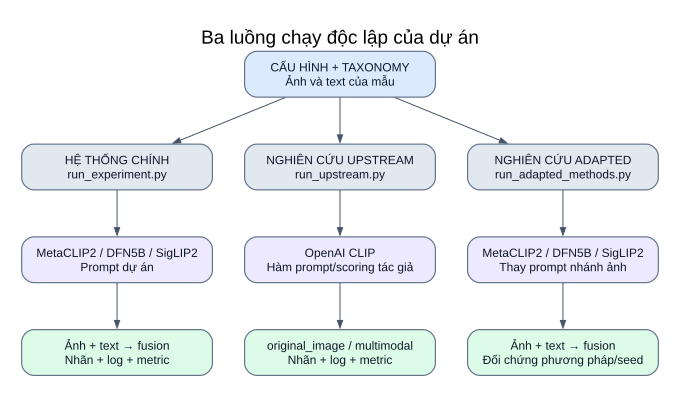

# 01 — Toàn cảnh hệ thống

**Hệ thống nhận ảnh + text, so từng nội dung với prompt của các lớp, kết hợp điểm rồi chọn nhãn.** Ba runner dưới đây là ba điểm vào độc lập; chạy hệ thống chính không tự chạy nghiên cứu.



[Mở SVG](so_do/01_tong_quan.svg) · [Mục lục](README.md)

## Ba lớp khái niệm

| Lớp | Vai trò | Thành phần hiện có |
|---|---|---|
| Backbone/model | Chuyển ảnh hoặc chuỗi text thành vector | MetaCLIP2, DFN5B, SigLIP2, OpenAI CLIP |
| Phương pháp prompt | Quyết định các câu nào đại diện cho mỗi lớp | Prompt dự án, tên lớp, WaffleCLIP, DCLIP |
| Pipeline quyết định | Chấm điểm, fusion, chọn nhãn, đánh giá | Single-label softmax/argmax; multi-label relative_z hoặc sigmoid/ngưỡng |

WaffleCLIP và DCLIP sử dụng backbone CLIP để mã hóa. Chúng thay cách biểu diễn lớp bằng prompt; không có thêm encoder ảnh độc lập mang tên WaffleCLIP/DCLIP trong code đang tích hợp.

## Bảng input → xử lý → output

| Luồng | Input và cấu hình | Xử lý | Output |
|---|---|---|---|
| Chính | Processed + ảnh; `experiment_config.yaml` | VLMWrapper → prompt dự án → hai nhánh → fusion → chọn nhãn | Một nhãn hoặc nhiều thể loại, log từng mẫu, audit, summary đánh số |
| Upstream | Cùng schema dự án; `upstream.yaml` + base config; repo ghim commit | OpenAI CLIP → hàm prompt/encoding/mean của tác giả → ảnh gốc hoặc fusion | `original_image` và/hoặc `multimodal`; summary theo method/seed |
| Adapted | Dataset/task được chọn trong `adapted.yaml`; backbone từ base config | Prompt ảnh thay theo method; prompt text giữ nền; dùng runner dataset chung | Đối chứng ảnh + text theo method/seed trên cùng cohort |

## Những đường dữ liệu cần nhớ

```text
Ảnh mẫu  ── image encoder ── I ── so với prompt lớp ── điểm ảnh ──┐
Text mẫu ── text encoder  ── T ── so với prompt lớp ── điểm text ─┤
Prompt   ── text encoder  ── E lớp                               │
                                                               ▼
                                                    Fusion → chọn nhãn
                                                               │
Nhãn thật ────────────────────────────────────────────── Đánh giá + log
```

Ảnh không được ghép chuỗi với text để đưa vào một LLM sinh câu trả lời. Hai nhánh tạo bảng điểm, kết hợp tại tầng điểm sau biến đổi quy định bởi task. Nhánh text so **text mẫu với prompt lớp**, đây là lựa chọn thực nghiệm của dự án.

Nhãn thật xác định taxonomy/kiểm tra dữ liệu/đánh giá. Giá trị nhãn thật từng mẫu không tham gia công thức similarity hoặc fusion; runner đánh giá không train hay fine-tune.

## Cấu hình đang bật khi viết tài liệu

- Chính: `metaclip2_vith14`; Fakeddit `6way`, CrisisMMD `informativeness`, MM-IMDb `genres`, mỗi dataset giới hạn 1000 dòng sau bộ lọc tương ứng.
- Upstream: OpenAI CLIP `ViT-B/32`; CrisisMMD `humanitarian`, 5 mẫu; bốn method và hai output, seed Waffle `[0]`.
- Adapted: CrisisMMD `humanitarian`, 1000 mẫu; baseline/current_mean_sim/class_name/waffle; năm seed Waffle `[0,1,2,3,4]`. DCLIP đã hỗ trợ nhưng chưa bật trong danh sách method này.

Đây là lựa chọn trong YAML, không phải xác nhận rằng đã chạy đủ các thí nghiệm. Xem [bảng cấu hình](12_doi_chieu_cau_hinh.md).

## Điểm vào code

| Thành phần | File |
|---|---|
| Chạy model × dataset của hệ thống chính | [run_experiment.py](../../src/run_experiment.py) |
| Nạp backbone của bạn | [model_registry.py](../../src/models/model_registry.py) |
| Suy luận và fusion | [inference.py](../../src/inference.py) |
| Runner dùng code tác giả | [run_upstream.py](../../src/research/run_upstream.py), [upstream.py](../../src/research/upstream.py) |
| Runner thích nghi | [run_adapted_methods.py](../../src/research/run_adapted_methods.py), [adapted_methods.py](../../src/research/adapted_methods.py) |

Đọc tiếp: [pipeline chính](02_pipeline_chinh.md), [upstream](09_nghien_cuu_upstream.md), [adapted](10_nghien_cuu_adapted.md).
