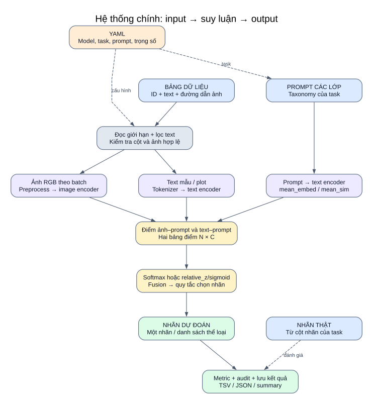
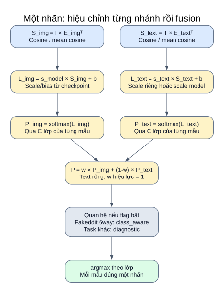
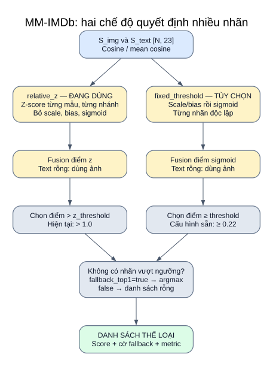

# 02 — Pipeline chính: từ input đến nhãn

**Ba backbone dùng chung luồng này. Dataset/task quyết định quy tắc chọn nhãn; tên backbone không tự quyết định softmax hay sigmoid.**



[Mở SVG](so_do/02_pipeline.svg) · [Mục lục](README.md)

## Input và các bước thực thi

| Bước | Input | Dùng gì / làm gì | Output |
|---|---|---|---|
| 1. Đọc cấu hình | YAML | `load_config` kiểm cấu trúc/task; wrapper kiểm tên model khi nạp; runner duyệt model rồi dataset được bật | Cấu hình hiệu lực |
| 2. Lấy mẫu | TSV/CSV/Parquet | pandas/pyarrow trong `load_dataframe`; lọc text nếu có rồi giới hạn dòng | Bảng mẫu được chọn |
| 3. Chuẩn bị lớp | Taxonomy + prompt | `get_prompt_set` → `build_class_embeddings` | `E_text [C,D]` và `label_order` |
| 4. Kiểm tra ảnh | Đường dẫn ảnh | `resolve_image_paths` → `load_images_safe`; giữ chỉ số ảnh hợp lệ | Cohort hợp lệ; ảnh mở theo batch |
| 5. Audit đầu lượt | Cohort/cấu hình/prompt | `prepare_audit` | Snapshot, ID bộ mẫu/prompt, khóa mẫu nếu cấu hình yêu cầu |
| 6. Mã hóa mẫu | PIL RGB và text | `encode_multimodal_embeddings`; model encode, L2; chunking nếu bật | `I [N,D]`, `T [N,D]`, mask text rỗng; hoặc điểm max_sim |
| 7. Chấm điểm | Embedding và vector lớp | Phép nhân với chuyển vị vector lớp | `S_img`, `S_text [N,C]` |
| 8. Chọn nhãn | Điểm + scale/bias/trọng số/ngưỡng | Các công thức dưới đây | Nhãn và điểm từng nhánh/fusion |
| 8b. Quan hệ tùy chọn | Vector ảnh/text cùng mẫu | Cosine; single-label thêm JS/entropy; class_aware hiệu chỉnh sau fusion trước argmax | Log quan hệ, điểm fusion cuối |
| 9. Đánh giá/lưu | Dự đoán + nhãn thật + audit | scikit-learn; TSV/JSON | Metric, log từng mẫu, summary |

Trong pipeline chính, `E_img = E_text`. Điểm nối nghiên cứu cho phép thay riêng `E_img`; chi tiết ở [adapted](10_nghien_cuu_adapted.md). Các vector lớp luôn cùng thứ tự `label_order`.

## Prompt ensembling: hai cách gộp khác nhau

Với `v_cj` là embedding đã chuẩn hóa của prompt `j` thuộc lớp `c`:

```text
u_c = mean_j(v_cj)

mean_embed: E_c = u_c / ||u_c||₂
mean_sim:   E_c = u_c                 (không chuẩn hóa lại)

x · E_c ở mean_sim = mean_j(x · v_cj)
```

`mean_sim` tạo vector lớp có thể không có norm bằng 1. Vì vậy điểm là **trung bình cosine với các prompt**, không gọi mọi phần tử của bảng điểm này là cosine giữa hai vector đơn vị. Chuẩn hóa lại trung bình sẽ chuyển sang `mean_embed`, làm thay đổi phép chấm điểm.

## Fakeddit và CrisisMMD: một nhãn



[Mở SVG](so_do/06_single_label.svg)

```text
S_img  = I × E_imgᵀ
S_text = T × E_textᵀ
L_img  = s_model × S_img  + b_model
L_text = s_text  × S_text + b_model
P_img  = softmax(L_img, qua các lớp)
P_text = softmax(L_text, qua các lớp)
P      = w × P_img + (1-w) × P_text
y_hat  = label_order[argmax(P)]
```

Khi flag enabled=true và mode hiệu lực class_aware (auto chọn cho Fakeddit 6way), P là điểm nền B; hiệu chỉnh thành P' trước argmax theo [trang 13](13_quan_he_anh_text.md). Các task khác dùng diagnostic. Mặc định flag tắt và mọi đầu ra/nhánh encode giữ cách nền.

`s_model = exp(model.logit_scale)`; `b_model` lấy từ model nếu có, mặc định 0. `s_text` dùng số dương trong cấu hình hoặc scale model khi `null`. Dự án không tự học thêm một scale cho text–text trong lượt đánh giá; phân phối softmax của nhánh này không chứng minh đã được hiệu chỉnh xác suất.

SigLIP2 cũng dùng **softmax** trong hai dataset một nhãn này, vì runner gọi `predict_single_label`.

## MM-IMDb: nhiều nhãn



[Mở SVG](so_do/07_multi_label.svg)

`relative_z` đang bật:

```text
Z_img  = (S_img  - mean_lớp(S_img))  / std_lớp(S_img)
Z_text = (S_text - mean_lớp(S_text)) / std_lớp(S_text)
Z      = w × Z_img + (1-w) × Z_text
y_hat  = các lớp có Z_c > relative_z_threshold
```

Mean/std được tính **qua 23 lớp của từng mẫu và từng nhánh**, không lấy thống kê toàn dataset. Dòng có std ≤ 1e-8 được cho điểm 0. Điểm z không phải xác suất; mode này bỏ scale, bias và sigmoid. Hiện ngưỡng là **> 1.0**.

`fixed_threshold` tùy chọn:

```text
P_img  = sigmoid(s_model × S_img + b_model)
P_text = sigmoid(s_text × S_text + b_model)
P      = w × P_img + (1-w) × P_text
y_hat  = các lớp có P_c ≥ threshold
```

`threshold: 0.22` chỉ dùng ở mode này. Với CLIP-family, sigmoid thiếu bias huấn luyện theo mục tiêu sigmoid nên không mặc định diễn giải là xác suất thể loại đã hiệu chỉnh.

## Các điều kiện làm đổi đường đi

| Điều kiện | Xử lý thực tế |
|---|---|
| Text rỗng | Ép trọng số ảnh hiệu lực của mẫu thành 1; không encode text rỗng |
| `image_weight = 1` | Bỏ encode text mẫu; giữ ảnh |
| `image_weight = 0` | Bỏ encode ảnh của mẫu có text; vẫn encode ảnh cho mẫu text rỗng |
| Ảnh lỗi | Bỏ mẫu trước inference, kể cả cấu hình text-only; không lấy mẫu tiếp theo bù |
| MM-IMDb chưa có lớp vượt ngưỡng | `fallback_top1=true` mặc định lấy lớp điểm cao nhất; nếu false trả danh sách rỗng |
| `chunk_long_text=true` | Chia plot theo context; `mean_embed` hoặc `max_sim` theo cấu hình |
| Không có ảnh hợp lệ | Runner dừng bằng lỗi |

## Code và output

- [common.py](../../src/run/common.py): loader, ảnh, lựa chọn trọng số, summary.
- [inference.py](../../src/inference.py): `build_class_embeddings`, `predict_single_label`, `predict_multi_label`, `relative_multilabel_scores`.
- [text_scale.py](../../src/text_scale.py): thứ tự lựa chọn scale và metadata scale hiệu lực.
- [text_chunking.py](../../src/text_chunking.py): xử lý plot dài.
- [evaluate.py](../../src/evaluate.py), [evaluation_audit.py](../../src/evaluation_audit.py), [logging_utils.py](../../src/logging_utils.py): metric/audit/file.

Đầu ra chính của API suy luận: nhãn, bảng điểm fusion `[N,C]`, bảng điểm ảnh/text `[N,C]`, mask text rỗng; multi-label thêm cờ fallback. Tên biến `probs` trong code vẫn có thể chứa **điểm z**. Phải đọc `score_type`/`decision_mode` khi diễn giải log.

File đầu ra chi tiết: [11 — Dữ liệu và output](11_du_lieu_output.md).
