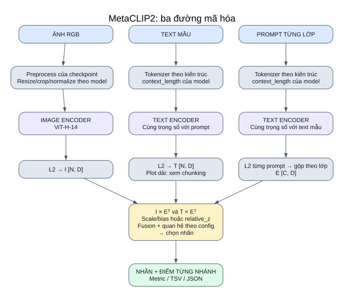

# 03 — MetaCLIP2 trong hệ thống của bạn

**Vai trò:** backbone mã hóa ảnh, text mẫu và prompt lớp. Đây là model duy nhất đang bật trong YAML chính tại thời điểm đối chiếu.

[Mở SVG](so_do/03_metaclip2.svg) · [Mục lục](README.md)

## Định danh và cách nạp

| Thuộc tính | Giá trị trong code |
|---|---|
| Khóa runner | `metaclip2_vith14` |
| Kiến trúc OpenCLIP | `ViT-H-14-worldwide-quickgelu` |
| Pretrained | `metaclip2_worldwide` |
| Metadata family | `clip_softmax` |
| Thư viện tải | `open_clip.create_model_and_transforms` |
| Tokenizer | `open_clip.get_tokenizer(arch)` |
| Trạng thái | `model.eval()`; các hàm encode có `torch.no_grad()` |

Tên kiến trúc phải giữ cả `worldwide-quickgelu` để khớp pretrained. Cấu hình encoder bên trong do OpenCLIP/checkpoint cung cấp; dự án không viết lại ViT hay tokenizer này.

## Input → từng khối → output

| Đường đi | Input | Xử lý | Output |
|---|---|---|---|
| Ảnh | PIL RGB từ đường dẫn hợp lệ | Preprocess trả về theo checkpoint → stack batch → `encode_image` → L2 | `I [N,D]` |
| Text mẫu | Title/tweet/plot | Tokenizer với `model.context_length` → `encode_text` → L2; plot có thể chunk | `T [N,D]` hoặc điểm max_sim |
| Prompt lớp | Danh sách câu theo taxonomy | Cùng tokenizer/text encoder → L2 từng câu → mean_embed/mean_sim | `E [C,D]`, `label_order` |
| Chấm điểm | I, T, E | I×Eᵀ, T×Eᵀ → quy tắc theo task → fusion | Nhãn và bảng điểm |

Wrapper gọi encoder text cùng trọng số cho **text mẫu** và **prompt lớp**. Tên ViT-H/14 nói tới lựa chọn kiến trúc ảnh; sơ đồ không tự gán cùng kiến trúc cho encoder text.

## Các đường quyết định hiện tại

Backbone này hỗ trợ cosine ảnh–text khi bật flag; mặc định tắt. Mode auto chọn class_aware cho Fakeddit 6way và diagnostic cho các task khác. Xem [công thức quan hệ](13_quan_he_anh_text.md).

| Dataset | Input cụ thể | Điều kiện trong YAML | Nhãn đầu ra |
|---|---|---|---|
| Fakeddit | Ảnh + `clean_title` | 6way; mean_sim; w ảnh 0.75; scale text 25 | Một trong 6 ID lớp |
| CrisisMMD | Ảnh + `clean_text` | Informativeness; mean_embed; w ảnh 0.5; scale text lấy model | Một trong 2 lớp |
| MM-IMDb | Poster + `plot` | 23 lớp; mean_sim; chunk mean_embed; relative_z > 1.0; w ảnh 0.5 | Danh sách thể loại |

Ảnh/tweet/title không đi vào một generative decoder. Scale model được dùng cho single-label/fixed_threshold; `relative_z` bỏ scale/bias.

## Trong nghiên cứu adapted

Model này cũng có thể chạy baseline/current_mean_sim/class_name/waffle/dclip qua `run_adapted_methods.py`. Encoder vẫn là MetaCLIP2; chỉ vector prompt nhánh ảnh được thay. Nhánh text và quy tắc quyết định lấy từ base config. Không chuyển thành OpenAI CLIP khi chọn method Waffle/DCLIP.

## Thông số và giới hạn chứng cứ

Wrapper lấy `embed_dim`, kích thước ảnh, `context_length`, scale và bias từ model nạp thực tế. Smoke quan hệ ngày 12-10-2026 xác nhận D=1024, ảnh (224,224), context 77, scale≈100, bias=0 trên model đã nạp. Số layer/head chưa được kiểm tra; tokenizer vẫn truyền context runtime.

Scale được học trên cặp ảnh–text; áp dụng cho text mẫu–prompt là lựa chọn thực nghiệm. Prompt Fakeddit thể hiện giả thuyết nội dung, không bảo đảm ảnh đơn lẻ có thể xác minh tính thật/giả.

## Đối chiếu code

[model_registry.py](../../src/models/model_registry.py): `MODEL_CONFIGS`, `VLMWrapper`, `encode_images`, `encode_texts`.

[experiment_config.yaml](../../configs/experiment_config.yaml) · [pipeline và công thức](02_pipeline_chinh.md) · [adapted](10_nghien_cuu_adapted.md).
