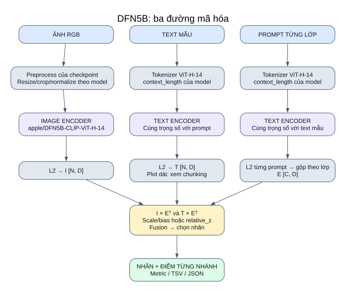

# 04 — DFN5B trong hệ thống của bạn

**Vai trò:** backbone CLIP-family thay cho MetaCLIP2 trong cùng pipeline. Model đã khai báo và có thể chọn; hiện dòng bật trong YAML đang được comment.

[Mở SVG](so_do/04_dfn5b.svg) · [Mục lục](README.md)

## Định danh và cách nạp

| Thuộc tính | Giá trị trong code |
|---|---|
| Khóa runner | `dfn5b_vith14` |
| `arch` | `hf-hub:apple/DFN5B-CLIP-ViT-H-14` |
| `pretrained` | `None` khi arch đã chỉ định Hugging Face Hub |
| Tokenizer ID riêng | `ViT-H-14` |
| Metadata family | `clip_softmax` |
| Backend | OpenCLIP qua `VLMWrapper` |

Điểm cấu hình đặc thù: model nạp bằng **Hub ID**, còn tokenizer lấy bằng **`ViT-H-14`**. Nếu lấy tokenizer bằng Hub ID hoặc thêm một pretrained không phù hợp, cách nạp sẽ khác khai báo đang dùng.

## Input → từng khối → output

| Khối | Input | Công cụ và xử lý | Output |
|---|---|---|---|
| Ảnh | PIL RGB | Preprocess từ model → batch tensor → `model.encode_image` → L2 | `[N,D]` |
| Text mẫu | Title/tweet/plot | Tokenizer ViT-H-14; truyền context runtime → text encoder → L2 | `[N,D]`; plot dài dùng chunking nếu bật |
| Prompt lớp | Các câu trong bộ prompt của task | Cùng encoder text → L2 từng câu → gộp theo lớp | `[C,D]` |
| Similarity | Embedding mẫu và lớp | I×E_imgᵀ, T×E_textᵀ | Hai bảng điểm `[N,C]` |
| Quyết định | Điểm và config dataset | Softmax/relative_z/sigmoid theo task → fusion → argmax hoặc ngưỡng | Nhãn + điểm + mask/fallback |
| Đánh giá/lưu | Dự đoán và nhãn thật | Metric/audit/logger chung | TSV/JSON/summary |

## Quy tắc phân loại và tích hợp nghiên cứu

API chung có thêm cosine ảnh–text, JS/entropy và class_aware cho Fakeddit 6way. Quan hệ dùng chính embedding DFN5B, không so vector của backbone khác. Xem [công thức](13_quan_he_anh_text.md).

- Fakeddit/CrisisMMD: scale/bias → softmax từng nhánh → fusion → một nhãn.
- MM-IMDb trong cấu hình hiện tại: relative_z từng nhánh → fusion → chọn tất cả lớp điểm > 1.0; top-1 dự phòng khi cần.
- `fixed_threshold` MM-IMDb chỉ được dùng khi chủ động chọn; sigmoid trên model CLIP-family không mặc định tạo xác suất multi-label được hiệu chỉnh.
- Khi đưa DFN5B vào `models` của base config, runner adapted áp dụng các method prompt ảnh trên DFN5B. Runner upstream vẫn nạp OpenAI CLIP riêng.

## Phạm vi kiến trúc

Ảnh dùng lựa chọn ViT-H/14 khai báo bởi Hub ID. Smoke quan hệ ngày 12-10-2026 xác nhận D=1024, ảnh (224,224), context 77, scale≈14.28, bias=0 trên model đã nạp. Dự án không tự xây layer ViT, pooling text hay tokenizer DFN; số head/layer và pooling chi tiết chưa được kiểm tra.

Việc đổi sang DFN5B thay backbone cho cả ảnh/text/prompt, không chỉ đổi tên phương pháp. So sánh backbone phải giữ cùng task, cohort, prompt và quy tắc quyết định.

## Đối chiếu code

[model_registry.py](../../src/models/model_registry.py): cấu hình DFN và wrapper chung.

[experiment_config.yaml](../../configs/experiment_config.yaml) · [pipeline và công thức](02_pipeline_chinh.md) · [adapted](10_nghien_cuu_adapted.md).
