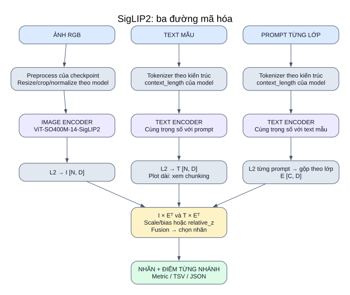

# 05 — SigLIP2 trong hệ thống của bạn

**Vai trò:** backbone ảnh/text đã huấn luyện sẵn với scale và bias riêng. Model đã tích hợp; hiện chưa được bật trong danh sách `models` của YAML chính.

[Mở SVG](so_do/05_siglip2.svg) · [Mục lục](README.md)

## Định danh và cách nạp

| Thuộc tính | Giá trị trong code |
|---|---|
| Khóa runner | `siglip2_so400m` |
| Kiến trúc | `ViT-SO400M-14-SigLIP2` |
| Pretrained | `webli` |
| Metadata family | `siglip_sigmoid` |
| Tokenizer | `open_clip.get_tokenizer(arch)` |
| Hiệu chỉnh | `exp(model.logit_scale)` và `model.logit_bias` nếu có |

Wrapper/docstring ghi context SigLIP2 64; code truyền **`model.context_length`** vào tokenizer khi chạy, không dùng mặc định 77 của CLIP. Quy tắc này áp dụng cho cả text mẫu và prompt.

## Input → từng khối → output

| Đường đi | Input | Xử lý | Output |
|---|---|---|---|
| Ảnh | PIL RGB | Preprocess checkpoint → image encoder → L2 | `I [N,D]` |
| Text mẫu | Title/tweet/plot | Tokenizer đúng context → text encoder → L2; plot dài có thể chia đoạn | `T [N,D]` hoặc điểm max_sim |
| Prompt lớp | Danh sách mô tả | Cùng tokenizer/text encoder → L2 từng prompt → mean_embed/mean_sim | `E [C,D]` |
| Chấm điểm | Embedding và vector lớp | Hai bảng ảnh–prompt/text–prompt | `[N,C]` mỗi nhánh |
| Quyết định/lưu | Điểm + task config | Biến đổi theo task, fusion, chọn nhãn, metric/logger | Nhãn + TSV/JSON/summary |

## Tên family và hành vi thực thi

| Task/mode | Biến đổi thật trong inference | Scale/bias |
|---|---|---|
| Fakeddit/CrisisMMD một nhãn | **Softmax** riêng ảnh/text → fusion → argmax | Có dùng; bias cộng đều vào các lớp nên không đổi softmax |
| MM-IMDb `relative_z` đang cấu hình | Z-score riêng ảnh/text → fusion → nhiều nhãn | Bỏ cả scale và bias |
| MM-IMDb `fixed_threshold` tùy chọn | Sigmoid riêng ảnh/text → fusion → ngưỡng | Có dùng; bias ảnh hưởng giá trị sigmoid |

Tên metadata `siglip_sigmoid` mô tả family; code không có quy tắc “hễ SigLIP2 là luôn sigmoid”. Chính lời gọi `predict_single_label`/`predict_multi_label` và `decision_mode` quyết định.

## Plot dài và nghiên cứu

MM-IMDb bật chunking: số token mỗi đoạn lấy theo tokenizer/context của **SigLIP2**, không dùng độ dài đoạn cố định của MetaCLIP2. Hàm chunking chỉ nhận tokenizer được hỗ trợ (`SimpleTokenizer` hoặc `HFTokenizer` với điều kiện tương ứng); tokenizer không hỗ trợ bị từ chối để tránh cắt ngầm.

Runner adapted dùng SigLIP2 nếu chọn model này trong base config. Method Waffle/DCLIP thay prompt ảnh, còn encoder, bias, text prompt, chunking và ngưỡng vẫn đi theo hệ thống của bạn.

## Phạm vi kiến trúc

OpenCLIP/checkpoint định nghĩa chi tiết image/text encoder và preprocess. Bộ tài liệu không mặc định sao chép sơ đồ pooling EOT hay causal text transformer của OpenAI CLIP sang SigLIP2; phần đó chưa được kiểm tra từ thư viện/trọng số trong nhiệm vụ này. Kích thước ảnh, D, số layer/head lấy từ model thực tế khi có lượt chạy được yêu cầu.

## Đối chiếu code

[model_registry.py](../../src/models/model_registry.py) · [inference.py](../../src/inference.py) · [text_chunking.py](../../src/text_chunking.py).

[experiment_config.yaml](../../configs/experiment_config.yaml) · [pipeline và công thức](02_pipeline_chinh.md) · [adapted](10_nghien_cuu_adapted.md).
