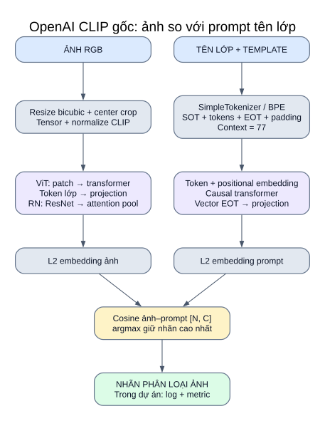

# 06 — OpenAI CLIP: backbone của nghiên cứu upstream

**Vai trò:** encoder ảnh/text nguyên bản lấy từ checkout `third_party/OpenAI_CLIP`. Runner nghiên cứu đang chọn `ViT-B/32`; WaffleCLIP và DCLIP dùng backbone này để mã hóa.



[Mở SVG](so_do/09_openai_clip.svg) · [Mục lục](README.md)

## Hai mức sử dụng

| Mức | Input | Output |
|---|---|---|
| Model CLIP `forward(image, text)` | Tensor ảnh và token text | Logits ảnh–text và bảng chuyển vị; chưa tự trả nhãn |
| Phân loại zero-shot của runner | Ảnh và các prompt lớp | Cosine theo lớp → argmax cho một nhãn; logger và metric của dự án |

API gốc trả logits: `exp(logit_scale) × normalize(image_features) × normalize(text_features)ᵀ`. Runner upstream gọi **`encode_image`/`encode_text` riêng**, rồi hàm scoring; không mặc định chạy toàn bộ `forward` hay pipeline demo trong README tác giả.

## Bên trong encoder: đối chiếu trực tiếp code clone

| Nhánh | Chuỗi khối trong code gốc |
|---|---|
| Ảnh ViT | Conv2d patch với stride bằng patch size → trải phẳng patch → thêm class token và positional embedding → LayerNorm → Transformer → lấy class token → LayerNorm → projection |
| Ảnh ModifiedResNet | Stem 3 convolution → average pool → 4 stage residual bottleneck có anti-aliasing downsampling → AttentionPool2d ra không gian embedding |
| Text | SimpleTokenizer/BPE → SOT/EOT/padding → token embedding + positional embedding → Transformer có causal mask → LayerNorm → lấy vị trí EOT → text projection |
| Similarity | Chuẩn hóa L2 cả ảnh/text → tích vô hướng → scale nếu đường scoring yêu cầu |

Text encoder và image encoder có cấu trúc khác nhau; chúng chiếu vào không gian chung chiều `D`. Context tokenizer mặc định **77**, gồm các token đặc biệt. Chiều hidden của transformer không nhất thiết bằng chiều output `D`.

## Preprocess và tokenizer

`clip.load(backbone, device, jit=False)` trả model và preprocess. Preprocess gốc: resize bicubic theo resolution của model → center crop → RGB → tensor → normalize bằng:

```text
mean = (0.48145466, 0.4578275, 0.40821073)
std  = (0.26862954, 0.26130258, 0.27577711)
```

`OpenAIClipBackend` giữ model ở eval, tắt gradient, chuyển float trên CPU/MPS; encode trả vector L2. `encode_texts` của adapter dùng `truncate=True` cho text/prompt nền. Prompt ảnh sinh trong bước plan được kiểm tra bằng `clip.tokenize` không cắt ngầm; prompt quá dài khiến chuẩn bị thất bại. Plot bật chunking được chia vừa context trước encode.

## Các backbone hiện có trong checkout

| Nhánh ảnh | Checkpoint được `available_models()` khai báo |
|---|---|
| ModifiedResNet | RN50, RN101, RN50x4, RN50x16, RN50x64 |
| VisionTransformer | ViT-B/32, ViT-B/16, ViT-L/14, ViT-L/14@336px |

`upstream.yaml` chọn **ViT-B/32**. WaffleCLIP CLI gốc liệt kê RN50, ViT-B/32, ViT-L/14. Runner upstream kiểm tên theo `available_models()` của OpenAI CLIP, nên danh sách backend rộng hơn ba tên chú thích trong YAML. Có khai báo checkpoint không có nghĩa trọng số đã tải hoặc đã chạy kiểm chứng tất cả.

Patch size được thể hiện trong tên ViT; số layer/head/embedding dimension và resolution cụ thể được `build_model(state_dict)` suy từ checkpoint. Bộ tài liệu không nạp trọng số để điền các số đó.

## Baseline và phần mở rộng trong dự án

- `clip`: một prompt ảnh `A photo of a {class}.` theo template WaffleCLIP.
- `dclip_labels`: một prompt tên lớp với template DCLIP hiện để trống tiền tố/hậu tố.
- `waffle`/`dclip`: nhiều prompt ảnh; lấy mean similarity theo lớp.
- `original_image` một nhãn: argmax cosine; softmax cosine với scale 1 dùng trong log không đổi nhãn argmax.
- `multimodal`: thêm text mẫu và prompt nền dự án; scale model hoặc relative_z, fusion theo config.
- MM-IMDb: cả hai output dùng quy tắc multi-label của dự án; đây là phần mở rộng của bài toán ảnh một nhãn.

## Nguồn code

[clip/model.py](../../third_party/OpenAI_CLIP/clip/model.py) · [clip/clip.py](../../third_party/OpenAI_CLIP/clip/clip.py) · [simple_tokenizer.py](../../third_party/OpenAI_CLIP/clip/simple_tokenizer.py) · [README tác giả](../../third_party/OpenAI_CLIP/README.md).

[Adapter upstream](../../src/research/upstream.py) · [runner upstream](09_nghien_cuu_upstream.md) · [nguồn/commit ghim](../../configs/research/sources.json).
