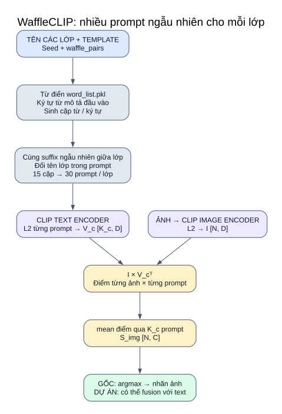

# 07 — WaffleCLIP: lớp được biểu diễn bằng prompt ngẫu nhiên

**Ý tưởng thực thi:** mỗi lớp nhận nhiều câu chứa tên lớp và suffix ngẫu nhiên; CLIP so ảnh với từng câu rồi lấy trung bình điểm theo lớp. Từ ngẫu nhiên không được coi là mô tả thực tế của ảnh.



[Mở SVG](so_do/10_waffleclip.svg) · [Mục lục](README.md)

## Input → xử lý → output của method `waffle`

| Bước | Input | Dùng gì | Output |
|---|---|---|---|
| 1. Xác định lớp | Tên lớp, template, seed, số cặp | `load_gpt_descriptions(..., mode='waffle')` trong repo | Thứ tự lớp và cấu hình sinh |
| 2. Lấy nguồn ngẫu nhiên | `word_list.pkl`, các descriptor trong JSON | NumPy random; cắt độ dài từ; lấy tập ký tự từ descriptor | Vocabulary và alphabet cho lượt sinh |
| 3. Sinh suffix | Thống kê độ dài tên lớp + seed | Cặp chuỗi từ / chuỗi ký tự; tạo prompt, chọn một bộ ngẫu nhiên để chia sẻ qua các lớp | Với 15 cặp: 30 prompt/lớp |
| 4. Mã hóa prompt | Prompt của mỗi lớp | CLIP tokenize → text encoder → L2 từng vector | `V_c [K_c,D]` |
| 5. Mã hóa ảnh | Ảnh mẫu | Preprocess → image encoder → L2 | `I [N,D]` |
| 6. Chấm lớp | I và V_c | Tích vô hướng từng prompt → `aggregate_similarity(...,'mean')` | `S_img [N,C]` |
| 7. Quyết định | S_img | Bài ảnh một nhãn: argmax; dự án có thể fusion | Nhãn và metric |

```text
Prompt_cj = template(tên_lớp_c, suffix_ngẫu_nhiên_j)
V_cj      = L2(CLIP_text(Prompt_cj))
S_img[n,c] = mean_j(I_n · V_cj)
```

Suffix được chia sẻ giữa các lớp ở method `waffle`; phần tên lớp khác nhau. Hàm gốc sinh các bộ trung gian theo lớp rồi chọn bộ của một lớp và thay tên lớp cho những lớp còn lại. Alphabet gốc phụ thuộc descriptor đầu vào; vì vậy chỉ dùng cùng seed chưa bảo đảm hai bộ descriptor khác nhau sinh prompt giống nhau.

## Template thật của upstream và ví dụ minh họa

Runner đặt `label_before_text='A photo of a '`, separator `', '`, hậu tố `'.'`, bật chỉnh descriptor. Hàm chỉnh thêm `which is`, `which` hoặc `which has` tùy đầu chuỗi.

```text
A photo of a vehicle damage, which has [suffix ngẫu nhiên].
```

Ví dụ biểu diễn cấu trúc câu; không phải prompt được lấy từ một lượt chạy hoặc dự đoán thực tế. Tên lớp sau `wordify` thay `_` bằng dấu cách.

## Repo tác giả và hai bản tích hợp

| Thành phần | Repo WaffleCLIP gốc | Upstream của dự án | Adapted của dự án |
|---|---|---|---|
| Backbone | OpenAI CLIP | OpenAI CLIP | MetaCLIP2/DFN5B/SigLIP2 theo base config |
| Sinh ngẫu nhiên | Hàm gốc, NumPy RNG toàn cục được seed | Gọi thân hàm gốc; lưu/khôi phục NumPy/Python RNG | Hàm viết trong `adapted_methods.py`; RNG cục bộ |
| Alphabet | Lấy từ descriptor | Lấy từ descriptor dự án chuyển sang tên lớp | `ascii_lowercase` cố định |
| Tổng hợp ảnh | mean/max; hoặc gộp vector nếu `merge_predictions` | **mean similarity** hàm tác giả | **mean_sim** vector lớp không chuẩn hóa lại |
| Input mẫu | Ảnh benchmark tác giả | Ảnh; tùy output thêm text | Ảnh + text của dự án |
| Lặp seed | `reps` trong CLI gốc | Seeds từ upstream.yaml | Seeds từ adapted.yaml |

Không coi adapted là thuật toán sinh prompt nguyên bản: alphabet, RNG và cách sinh ký tự khác. Phương pháp upstream khóa prompt vào `frozen_plan.json` trước inference, rồi mã hóa đúng các câu đã khóa.

## Điểm phân biệt khi đọc sơ đồ

- `mean_sim`: trung bình cosine từng prompt, tương đương tích với trung bình embedding **không L2 lại**.
- `merge_predictions` của repo gốc: trung bình vector rồi L2 lại → cosine. Nó gần cách `mean_embed` của dự án và cho kết quả khác mean_sim.
- Upstream hiện không chuyển tiếp tất cả cờ ablation/merge/concept của CLI tác giả; danh sách chính gồm `clip`, `waffle`, `dclip_labels`, `dclip`.
- Sơ đồ này không có lời gọi LLM trong inference `waffle`. Repo có script tạo descriptor/concept trước thí nghiệm; chúng không được runner dự án tự chạy.
- Nhánh text mẫu của `multimodal` dùng prompt nền chung, không lấy suffix Waffle làm prompt text mẫu.

## Output và code đối chiếu

Output của hàm `image_scores`: điểm ảnh `[N,C]`; chưa phải nhãn hay điểm fusion. Runner biến đổi/chọn nhãn và ghi method/seed/output_variant vào manifest/summary; nhiều seed được tổng hợp mean/std, không chọn seed tốt nhất.

[waffle_tools.py](../../third_party/WaffleCLIP/waffle_tools.py): `load_gpt_descriptions`, `compute_description_encodings`, `aggregate_similarity`.

[base_main.py](../../third_party/WaffleCLIP/base_main.py) · [README tác giả](../../third_party/WaffleCLIP/README.md) · [upstream.py](../../src/research/upstream.py) · [adapted_methods.py](../../src/research/adapted_methods.py).

[Upstream](09_nghien_cuu_upstream.md) · [Adapted](10_nghien_cuu_adapted.md) · [Tất cả mode trong checkout](12_doi_chieu_cau_hinh.md).
