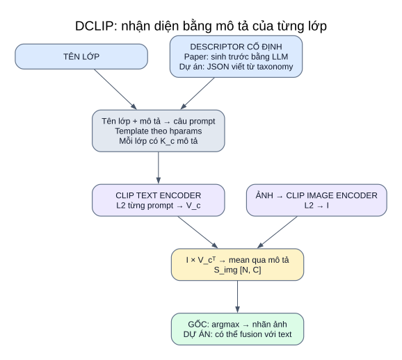

# 08 — DCLIP: lớp được biểu diễn bằng mô tả

**Ý tưởng thực thi:** CLIP so ảnh với nhiều câu mô tả đặc điểm của từng lớp, lấy trung bình điểm mô tả rồi chọn lớp. Descriptor được chuẩn bị trước, không tạo từ ảnh/text mẫu trong inference.



[Mở SVG](so_do/11_dclip.svg) · [Mục lục](README.md)

## Input → xử lý → output

| Bước | Input | Hàm/công cụ | Output |
|---|---|---|---|
| Chuẩn bị descriptor | Tên lớp | Paper/repo có bước hỏi LLM rồi lưu JSON; dự án dùng JSON cố định có provenance | Danh sách descriptor riêng mỗi lớp |
| Tạo câu | Tên lớp + descriptor + hparams | `load_gpt_descriptions`; `wordify`, `modify_descriptor`, template | `K_c` prompt/lớp |
| Encode câu | Các prompt | `compute_description_encodings`: CLIP tokenize → text encoder → L2 | `V_c [K_c,D]` |
| Encode ảnh | RGB/preprocess | CLIP image encoder → L2 | `I [N,D]` |
| Điểm lớp | I và V_c | `I @ V_c.T` → mean qua mô tả | `S_img [N,C]` |
| Nhãn | Điểm lớp | Argmax cho bài ảnh một nhãn; dự án có extension | Nhãn, log, metric |

```text
S_img[n,c] = mean_j(cosine(I_n, descriptor_embedding_cj))
y_hat[n]   = lớp có S_img[n,c] cao nhất       # ảnh một nhãn
```

Số descriptor `K_c` có thể khác giữa các lớp; mean chia theo số mô tả của từng lớp. Tổng điểm (`sum`) sẽ có hành vi khác khi số mô tả lệch; runner dự án luôn chọn mean.

## Template DCLIP upstream thật sự

`generate_prompts` đặt:

```text
category_name_inclusion = 'prepend'
before_text = ''
between_text = ', '
after_text = ''
apply_descriptor_modification = True
```

Ví dụ cấu trúc:

```text
vehicle damage, which has [mô tả cố định]
```

Không tự thêm `A photo of a ...` vào DCLIP upstream. Adapted của dự án dùng `render_descriptor` nên tạo dạng `A photo of a {class}, which ... .`; hai template khác nhau được ghi rõ trong plan/log.

## Baseline `dclip_labels`

Hàm gốc `compute_label_encodings` mã hóa tên lớp, với `label_before_text=''` và `label_after_text=''` trong adapter. Như vậy:

```text
dclip_labels: tên lớp → một vector lớp → cosine → argmax
dclip: tên lớp + từng mô tả → nhiều vector → mean cosine → argmax
```

Baseline `clip` của WaffleCLIP lại dùng `A photo of a {class}.`. Đây là lý do upstream giữ hai baseline riêng thay vì gộp chúng thành một hàng.

## Descriptor gốc và descriptor đang dùng

| Nguồn | Ý nghĩa và trạng thái |
|---|---|
| JSON trong `third_party/DCLIP/descriptors/` | Mô tả cho benchmark của tác giả; không phải taxonomy Fakeddit/CrisisMMD/MM-IMDb của dự án |
| `configs/research/descriptors/*.json` | Mô tả cố định từ định nghĩa lớp của dự án, có `provenance`; đủ năm task |
| `generate_descriptors.py` của tác giả | Bước tạo trước mô tả bằng LLM; không được upstream/adapted tự gọi |

Adapter chuyển khóa ID trong JSON của dự án sang **tên lớp** trước khi đưa vào loader tác giả; thứ tự lớp phải khớp prompt text và điểm ảnh. Không dùng nhãn/lỗi mẫu đánh giá để tự sửa descriptor giữa lượt.

## Gốc và extension của dự án

Repo gốc `main.py` nhận ảnh benchmark, tính cả baseline tên lớp và DCLIP, báo Top-1/Top-5. Các helper trong repo còn cho phép xem similarity từng mô tả để giải thích dự đoán.

Runner dự án gọi các hàm tạo/encode/aggregate của tác giả trên schema dự án. `original_image` một nhãn giữ argmax mean cosine. `multimodal` thêm nhánh text mẫu, scale/relative_z, fusion. MM-IMDb dùng ngưỡng multi-label của dự án. Log hiện ghi điểm **theo lớp**, không tự xuất đầy đủ lời giải thích hay điểm từng descriptor như helper gốc.

Adapted dùng encoder của bạn, template thích nghi và mean_sim cho nhánh ảnh. Hiện `dclip` chưa được bật trong `adapted.yaml`, dù code và descriptor đã hỗ trợ.

## Nguồn code

[loading_helpers.py](../../third_party/DCLIP/loading_helpers.py) · [load.py](../../third_party/DCLIP/load.py) · [main.py](../../third_party/DCLIP/main.py) · [README tác giả](../../third_party/DCLIP/README.md).

[upstream.py](../../src/research/upstream.py) · [adapted_methods.py](../../src/research/adapted_methods.py) · [Upstream](09_nghien_cuu_upstream.md) · [Adapted](10_nghien_cuu_adapted.md).
