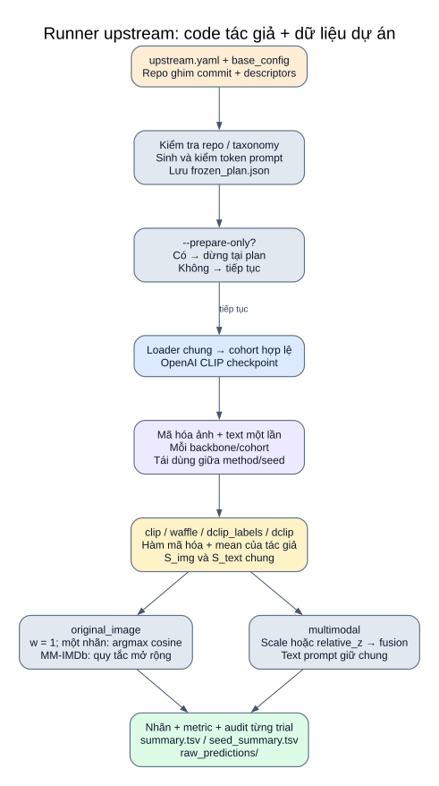

# 09 — Runner upstream: dùng hàm tác giả và OpenAI CLIP

**Điểm vào:** `src/research/run_upstream.py`. Runner gọi hàm gốc từ checkout tác giả, dùng OpenAI CLIP, thay loader benchmark bằng schema dữ liệu dự án. Kết quả ảnh gốc và ảnh + text được ghi riêng.



[Mở SVG](so_do/12_upstream.svg) · [Mục lục](README.md)

## Input và chuẩn bị trước inference

| Input | Vai trò |
|---|---|
| `configs/research/upstream.yaml` | Backbones, methods, outputs, seeds, giới hạn và dataset/task được bật |
| `base_config` | Schema/cột/ảnh, prompt nền, fusion, text scale, chunking và quy tắc MM-IMDb |
| `configs/research/sources.json` | URL và commit ba repo phải sạch/đúng phiên bản |
| Descriptor JSON riêng từng task | Taxonomy + provenance, nguồn cho DCLIP và alphabet Waffle gốc |
| Processed + ảnh | Mẫu để suy luận khi thực chạy |

Chuỗi chuẩn bị: kiểm tra cấu hình/commit → chọn task và tên lớp → kiểm tra đủ descriptor → chuyển khóa ID thành tên lớp → sinh prompt từng method/seed bằng hàm tác giả → kiểm token prompt → lưu `frozen_plan.json` và các JSON descriptor chuyển đổi.

`--prepare-only` dừng tại đây: **không mở dataset, tải checkpoint hay inference**. Code CLIP/helper được nạp để sinh/kiểm token prompt; trọng số chưa nạp. Không chạy lệnh chuẩn bị hoặc inference khi chỉ đọc bộ tài liệu này.

## Cách gọi code tác giả an toàn về luồng dữ liệu

`author_api` import module `clip` từ checkout OpenAI, kiểm nguồn module. `load_functions` dùng AST lấy **định nghĩa các hàm cần dùng** từ WaffleCLIP/DCLIP, không thực thi phần loader dataset ở top-level module. Thân hàm sinh prompt/encode/aggregate được giữ nguyên.

| Method | Tạo prompt ảnh | Mã hóa / chấm điểm |
|---|---|---|
| `clip` | Template tên lớp của WaffleCLIP | Hàm Waffle: encode một prompt/lớp, mean |
| `waffle` | Sinh random word/character của WaffleCLIP theo seed | Hàm Waffle: encode nhiều prompt, mean cosine |
| `dclip_labels` | Tên lớp theo template DCLIP | `compute_label_encodings`, một vector/lớp |
| `dclip` | Tên lớp + descriptor theo template DCLIP | `compute_description_encodings`, mean cosine |

Chỉ Waffle lặp seed. Prompt ảnh đã sinh được khóa và tái đưa vào hàm encode; không sinh lại một bộ khác sau khi khóa plan.

## Tái sử dụng embedding trong mỗi backbone/cohort

1. `load_cohort` lấy giới hạn sau lọc và loại ảnh lỗi; chuẩn hóa nhãn theo cùng taxonomy.
2. `OpenAIClipBackend` tải checkpoint theo backbone, chọn thiết bị thực tế.
3. `encode_inputs` mã hóa ảnh một lần, chuyển embedding về CPU; text score cũng tính một lần nếu cần `multimodal` và có text/weight phù hợp.
4. Với mỗi method/seed: encode prompt ảnh → `image_scores` → chạy các output yêu cầu.
5. Lưu kết quả mỗi trial; unload model sau cohort/backbone. Cuối nhóm ghi mean/std seed.

Nhánh text giữ cùng prompt, aggregation và score cache giữa các method ảnh. Đổi method ảnh không đổi nhánh text mẫu trong cùng backbone/cohort. Upstream vẫn encode ảnh khi chạy method/outputs, kể cả trọng số multimodal bằng 0.

## Hai output có ý nghĩa khác nhau

Flag `image_text_relation.enabled` trong upstream.yaml mặc định false và áp dụng mọi backbone/method/task đang chọn. Bật true tính quan hệ từ input cache; original_image chỉ diagnostic, còn multimodal dùng auto theo taxonomy. Override dataset ưu tiên hơn flag runner. Khi tắt, không encode thêm nhánh chỉ phục vụ quan hệ. Xem [công thức](13_quan_he_anh_text.md).

| Output | Nhánh mẫu | Một nhãn | MM-IMDb |
|---|---|---|---|
| `original_image` | Chỉ ảnh, w hiệu lực = 1 | Argmax cosine; softmax(scale=1) phục vụ log | Quy tắc relative_z hoặc fixed_threshold từ dự án; đánh dấu multi_label_extension |
| `multimodal` | Ảnh + text; text rỗng dùng ảnh | Softmax scale model/text riêng → fusion → argmax | Relative_z hoặc sigmoid → fusion → ngưỡng/fallback |

`classification_scope`: `paper_image` cho original_image một nhãn; `multimodal_extension` cho ảnh + text một nhãn; `multi_label_extension` cho MM-IMDb ở cả hai output. `original_image` MM-IMDb không phải phương pháp multi-label được paper gốc định nghĩa.

## Kết quả và kiểm soát đối chứng

```text
results/upstream_projects/<thư_mục_lượt_mới>/
├── frozen_plan.json
├── descriptors_<dataset>_<task>.json
├── summary.tsv
├── seed_summary.tsv
├── raw_predictions/<thư_mục_trial>/...
└── failure.json                         # chỉ khi lỗi
```

Summary giữ model/backbone/device/method/seed/output_variant/metric và cấu hình quyết định; thông tin cohort chi tiết nằm trong snapshot của từng trial. `seed_summary.tsv` nhóm theo model × dataset × task × method × output_variant, báo mean và std `ddof=0`; một lượt chưa có std có ý nghĩa. Với original_image, summary không dùng text Macro-F1 hay fusion gain như kết luận đa phương thức.

## Trạng thái hiện tại và giới hạn

YAML hiện chọn ViT-B/32, bốn method, seed `[0]`, hai output; chỉ bật CrisisMMD humanitarian 5 mẫu. Đây tạo 4 trial × 2 output = **8 hàng summary** khi một lượt hoàn tất. Hai dataset khác đang tắt; descriptor đã đủ cả năm task.

Báo cáo trước ghi đã chạy thử 5 mẫu cho cả năm task và đối chiếu scoring humanitarian; xem [báo cáo](../zeroshot_smoke_20261011.md). Tài liệu này không chạy lại hoặc mở dữ liệu để xác minh kết quả. Runner không tái lập toàn bộ benchmark/ablation trong paper và không sinh descriptor bằng GPT-3 cho taxonomy mới.

## Nguồn code

[run_upstream.py](../../src/research/run_upstream.py): `prepare_plan`, `load_cohort`, `encode_inputs`, `score_predictions`, `evaluate_trial`, `seed_summary`.

[upstream.py](../../src/research/upstream.py): `author_api`, `generate_prompts`, `description_encodings`, `image_scores`, `OpenAIClipBackend`.

[upstream.yaml](../../configs/research/upstream.yaml) · [OpenAI CLIP](06_openai_clip.md) · [WaffleCLIP](07_waffleclip.md) · [DCLIP](08_dclip.md).
