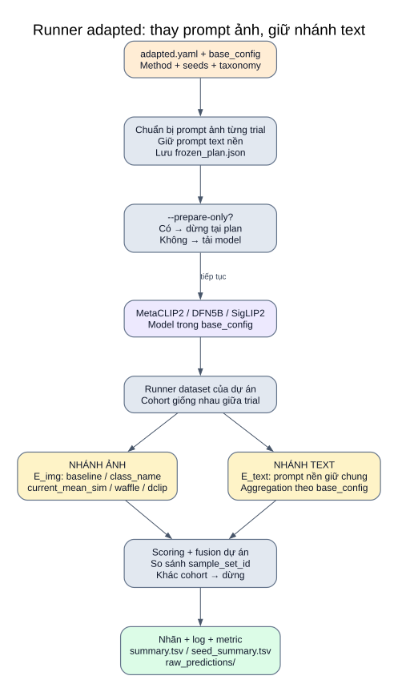

# 10 — Runner adapted: phương pháp prompt trên backbone của bạn

**Điểm vào:** `src/research/run_adapted_methods.py`. Luồng này giữ encoder và quy tắc phân loại của dự án, thay prompt **nhánh ảnh** theo method để đối chứng. Nó không nạp OpenAI CLIP chỉ vì method mang tên Waffle/DCLIP.



[Mở SVG](so_do/13_adapted.svg) · [Mục lục](README.md)

## Input và kế hoạch trước chạy

| Input | Nguồn / tác dụng |
|---|---|
| Dataset/task/method/seeds | `configs/research/adapted.yaml` |
| Backbone, schema, prompt nền, fusion, ngưỡng/chunking | `base_config`, hiện là `configs/experiment_config.yaml` |
| Waffle vocabulary | `third_party/WaffleCLIP/word_list.pkl`; loader giới hạn kiểu chuỗi, tính hash |
| Descriptor nếu chọn dclip | JSON cố định có provenance và đủ khóa lớp |
| Repo tác giả | Kiểm sạch và commit khớp `sources.json`, lưu thông tin nguồn |

`prepare_trials` chọn đúng một prompt variant và một aggregation làm nền. Danh sách nhiều variant/aggregation bị từ chối để không làm lẫn điều kiện đối chứng. Waffle có một trial cho mỗi seed; các method khác chỉ một trial.

`frozen_plan.json` ghi settings/base config/trial/prompt nền/hash source/git hash trước khi model hoặc dữ liệu được mở. `--prepare-only` chỉ tạo plan và dừng.

## Từng method thay gì?

| Method | Vector lớp cho ảnh `E_img` | Vector lớp cho text mẫu `E_text` |
|---|---|---|
| `baseline` | Giống E_text, aggregation theo cấu hình dataset | Prompt nền, aggregation dataset |
| `current_mean_sim` | Prompt nền nhưng bắt buộc mean_sim | Prompt nền, aggregation dataset |
| `class_name` | `A photo of a {class}.`; mean_sim | Prompt nền, aggregation dataset |
| `waffle` | Các prompt từ/ký tự sinh bởi bản thích nghi; mean_sim | Prompt nền, aggregation dataset |
| `dclip` | `A photo of a {class}, which ... .` từ JSON descriptor; mean_sim | Prompt nền, aggregation dataset |

Nếu nền đã chọn mean_sim, `baseline` và `current_mean_sim` có thể tương đương về vector lớp; nếu nền mean_embed thì chúng khác. Không mặc định coi mỗi tên method là một kiến trúc model khác nhau.

## Điểm nối với runner chính

```text
prepare_trials
  → task_config['_research_image_prompts'] + metadata
  → runner của dataset
  → build_class_embeddings(prompt_nền, aggregation_nền) = E_text
  → research_embeddings(prompt_ảnh, mean_sim) = E_img
  → predict_single_label / predict_multi_label(image_class_embeds=E_img)
  → S_img = I × E_imgᵀ; S_text = T × E_textᵀ
  → scoring/fusion/ngưỡng của dự án
```

`research_embeddings` từ chối thứ tự lớp khác hoặc prompt rỗng. Ma trận E_img/E_text phải cùng shape/thứ tự; inference kiểm tính hữu hạn. Không fuse embedding ảnh và text, cũng không thay prompt nhánh text thành prompt ngẫu nhiên của Waffle.

## Thực thi và kiểm bộ mẫu

Runner duyệt `base['models']`, tải một model rồi gọi runner dataset cho từng trial. **Khác upstream**, adapted không có cache chung `encode_inputs` qua trial; runner dataset mã hóa lại input theo từng lượt. Việc giữ điều kiện/cohort chung không có nghĩa tái dùng tensor embedding chung.

`evaluation.enabled=true` và `sample_lock_mode='off'` được đặt cho thí nghiệm; so sánh `sample_set_id` sau mỗi trial. Thiếu hoặc lệch ID bộ mẫu khiến runner dừng, giữ log đã có. Model được unload trong `finally`; nhóm lỗi ghi `failure.json` và không được coi là nhóm seed hoàn tất.

## Waffle adapted khác sinh prompt gốc

- `RandomState(seed)` cục bộ, không thay RNG toàn cục.
- Từ điển gốc được dùng làm nguồn từ; alphabet cố định `ascii_lowercase`.
- Suffix từ/ký tự sinh một bộ chung cho các lớp, ghép template dự án.
- 15 cặp tạo 30 prompt/lớp; mean_sim giữ trung bình cosine.
- Do khác alphabet/cách lấy RNG/sinh ký tự, cùng số seed không bảo đảm prompt trùng upstream.

## Output và cấu hình hiện tại

```text
results/paper_methods/<dataset>_<thư_mục_lượt_mới>/
├── frozen_plan.json
├── summary.tsv
├── seed_summary.tsv
├── raw_predictions/<trial>/...
└── failure.json                      # khi lỗi
```

Summary giữ model/image_method/image_prompt_aggregation/seed và metric. Seed summary nhóm model × image_method trong dataset/task đã chọn, báo mean/std `ddof=0`. Không chọn seed tốt nhất.

Hiện bật CrisisMMD humanitarian 1000 mẫu; model theo base config là MetaCLIP2. Các method baseline/current_mean_sim/class_name có 3 trial, Waffle 5 seed có 5 trial: **8 trial/model**. DCLIP hỗ trợ trong code nhưng chưa nằm trong danh sách method bật. Tài liệu chỉ mô tả cấu hình, không chạy các trial này.

Kết quả được gọi là **bản thích nghi** vì thay backbone/template/sinh ngẫu nhiên và thêm ảnh + text; không diễn giải là tái lập đầy đủ paper.

## Nguồn code

[run_adapted_methods.py](../../src/research/run_adapted_methods.py): `prepare_trials`, `baseline_prompt_set`, `main`, `aggregate_results`.

[adapted_methods.py](../../src/research/adapted_methods.py): `waffle_prompts`, `load_descriptors`, `research_embeddings`.

[inference.py](../../src/inference.py) · [adapted.yaml](../../configs/research/adapted.yaml) · [WaffleCLIP](07_waffleclip.md) · [DCLIP](08_dclip.md).
