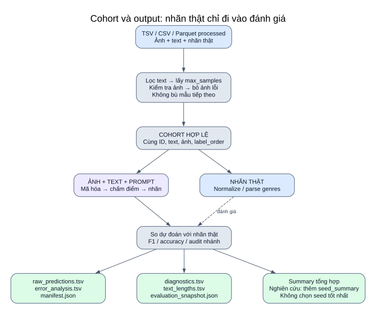
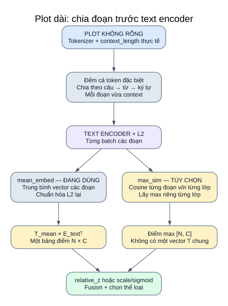

# 11 — Dataset, taxonomy, plot dài và file kết quả

**Một cohort hợp lệ được giữ đồng bộ theo ID/ảnh/text/nhãn. Nhãn thật từng mẫu dùng để đánh giá, không tham gia công thức dự đoán.** Cột dưới đây là cột code/config yêu cầu; không phải kết quả đọc schema trực tiếp từ dữ liệu.



[Mở SVG](so_do/14_du_lieu_output.svg) · [Mục lục](README.md)

## Input của cả năm task

| Dataset/task | ID | Text | Cột nhãn | C và kiểu output |
|---|---|---|---|---|
| Fakeddit 2way | `id` | `clean_title` | `2_way_label` | 2; một nhãn số |
| Fakeddit 6way | `id` | `clean_title` | `6_way_label` | 6; một nhãn số |
| CrisisMMD informativeness | `tweet_id` | `clean_text` | `label_informative` | 2; một nhãn chuỗi |
| CrisisMMD humanitarian | `tweet_id` | `clean_text` | `label_humanitarian` | 8; một nhãn chuỗi |
| MM-IMDb genres | `id` | `plot` | `genres` | 23; danh sách nhãn |

Processed paths và image_dir lấy từ [experiment_config.yaml](../../configs/experiment_config.yaml). Resolver thử đường dẫn cột ảnh, ghép image_dir/đường dẫn hoặc basename, rồi image_dir/ID với đuôi ảnh; `.jpg` mặc định và một số biến thể `.jpeg/.JPEG/.JPG` được thử.

## Chọn mẫu và lỗi ảnh

`load_dataframe` hỗ trợ TSV/CSV/Parquet. TSV/CSV không lọc text dùng `nrows`; khi lọc dùng chunks; Parquet dùng `iter_batches`. Giới hạn được áp dụng trước kiểm tra ảnh, sau lọc text.

Fakeddit có `min_text_length: 20`: fill text rỗng, bỏ ký tự dấu cách `" "`, chỉ giữ độ dài **> 20**. Không đánh đồng với số token tokenizer hoặc tự diễn giải thành mọi loại whitespace.

Ảnh không mở/giải mã được bị loại; các dòng tương ứng của text/nhãn cùng bị bỏ. Không bù bằng dòng tiếp theo. `ImagePathSequence` giữ đường dẫn, mở ảnh RGB khi lấy batch. Ngay cả text-only trong runner chính vẫn yêu cầu ảnh hợp lệ ở bước chọn cohort.

## Taxonomy cần giữ đúng

Fakeddit:

| ID | 2way | 6way |
|---|---|---|
| 0 | fake | True |
| 1 | real | Satire/Parody |
| 2 | — | False Connection |
| 3 | — | Imposter Content |
| 4 | — | Manipulated Content |
| 5 | — | Misleading Content |

**Nhãn real của 2way là 1, True của 6way là 0.** Không dùng chung ánh xạ nhị phân và sáu lớp. Prompt current có 24 câu/lớp ở 2way, 4 câu/lớp ở 6way. 6way hỗ trợ thêm `class_name` và `descriptors` từ JSON prompt, không bật mặc định.

CrisisMMD informativeness: `informative`, `not_informative`; prompt current lần lượt 27 và 24 câu. Humanitarian có 8 lớp, mỗi lớp 12 prompt current:

```text
not_humanitarian
other_relevant_information
rescue_volunteering_or_donation_effort
infrastructure_and_utility_damage
affected_individuals
vehicle_damage
injured_or_dead_people
missing_or_found_people
```

Các lớp thuộc danh sách cảnh báo cũ vẫn được giữ; danh sách cảnh báo không phải bằng chứng kiểm đếm dataset hiện tại.

MM-IMDb giữ đúng 23 lớp, mỗi lớp 4 prompt current:

```text
Action, Adventure, Animation, Biography, Comedy, Crime,
Documentary, Drama, Family, Fantasy, Film-Noir, History,
Horror, Music, Musical, Mystery, Short, Romance,
Sci-Fi, Sport, Thriller, War, Western
```

Có `Short`, không có `News`. `parse_multilabel` nhận list/tuple/set, JSON/list literal, chuỗi phân cách `|` hoặc `,`. Tên nhãn phải thuộc taxonomy; code đánh giá từ chối nhãn lạ.

## Plot dài: hai cách gộp các đoạn



[Mở SVG](so_do/08_chunking.svg)

Tokenizer đếm text bao gồm token đặc biệt. `split_text` giữ câu nếu vừa context; câu dài chia theo từ; từ quá dài chia theo ký tự Unicode; kiểm lại từng đoạn. Có thể chuẩn hóa khoảng trắng khi ghép, không chủ động bỏ nội dung. Text rỗng dùng fallback ảnh.

| Mode | Xử lý các đoạn | Output đưa vào scoring |
|---|---|---|
| `mean_embed` đang dùng | L2 từng embedding đoạn → trung bình → L2 lại; text một đoạn giữ cách nền | Một vector text/mẫu rồi so với từng lớp |
| `max_sim` tùy chọn | L2 từng đoạn → điểm với lớp → lấy max qua đoạn cho **từng lớp** | Bảng điểm text `[N,C]`; không có một vector text đại diện duy nhất |

Gộp đoạn text và gộp prompt lớp là hai lựa chọn khác nhau: `chunk_aggregation` tác động plot; `prompt_aggregation` tác động mô tả lớp. Bảng `text_lengths.tsv` có thể đánh dấu text gốc dài hơn context dù đoạn đã encode không bị cắt; xem `n_chunks`/`encoded_chunk_truncated` để phân biệt.

## Metric và audit

| Loại bài toán | Metric chính / báo cáo |
|---|---|
| Một nhãn | Accuracy, macro/micro-F1; audit thêm balanced accuracy và nhánh ảnh/text/fusion |
| Nhiều nhãn | Macro/micro-F1; audit thêm samples-F1, số nhãn trung bình, fallback rate |
| Binary với positive_label được cấu hình | Runner chính có thể gọi thêm evaluate_binary; upstream hiện gọi evaluate_single_label |
| Kiểm nhánh | Audit chỉ đánh giá nhánh đã encode và bộ mẫu của nhánh đó |

`fusion_macro_f1_gain` chỉ được dùng so với nhánh đơn tốt nhất khi các nhánh có cùng đầy đủ bộ mẫu. Text rỗng/nhánh bị bỏ có thể làm bộ mẫu metric nhánh khác nhau. Hamming accuracy tính trên từng ô nhãn, không dùng làm bằng chứng chính cho chất lượng nhiều nhãn.

`evaluation.enabled` điều khiển audit; YAML hiện bật. `split: val` là tên khai báo, code không tự xác minh nguồn split. Khóa mẫu hiện `off`; các mode create_or_verify/verify là tùy chọn.

## Output từng lượt

Các runner chính bổ sung cột cosine ảnh–text và, với single-label, JS/entropy/evidence. `relation_applied` đánh dấu mẫu được hiệu chỉnh; chi tiết [trang 13](13_quan_he_anh_text.md). Nhãn thật vẫn chỉ dùng kiểm tra/đánh giá.

| File | Bạn đọc được gì |
|---|---|
| `raw_predictions.tsv` | ID/text/path, nhãn thật/dự đoán, điểm từng lớp và nhánh, mask/fallback; là log inference theo mẫu |
| `error_analysis.tsv` | Mẫu sai; single-label xếp confidence giảm dần; multi-label xếp tổng nhãn thiếu + thừa giảm dần |
| `manifest.json` | Model/dataset/task/prompt/version/scale/weight/decision/seed/nguồn hiệu lực tùy runner |
| `diagnostics.tsv` | Metric và thống kê từng nhánh, độ dài text/chunking nếu audit bật |
| `text_lengths.tsv` | Số token text gốc, dài hơn context, số đoạn nếu có |
| `evaluation_snapshot.json` | Cấu hình/prompt/cohort, sample_set_id/prompt_id/config_id, git hash và hash source |

Single-label dùng `score_<label>` cho điểm fusion. Multi-label dùng `zscore_<label>` khi relative_z và `prob_<label>` khi fixed_threshold. Cả hai logger dùng `score_image_<label>`/`score_text_<label>` cho điểm nhánh sau biến đổi. Tên biến `sim_*` của logger không bảo đảm đó là cosine thô. `relative_z` chứa điểm z, các mode khác chứa điểm softmax/sigmoid của luồng đang dùng. Đọc manifest trước khi so giá trị giữa lượt.

```text
Chung:    results/<phương_pháp>/<dataset>/<task>/samples_N/<model>/<task>_<lượt>/
          ├── summary.tsv (Kaggle) hoặc summary_table_*.tsv (runner local)
          └── run_artifacts.zip / raw_predictions/<trial>/... tùy runner
Upstream: results/upstream_<method>/... hoặc results/upstream_suite/...
Adapted:  results/adapted_<method>/... hoặc results/adapted_suite/...
```

Main MM-IMDb log dùng task_name `multi_label` dù khóa YAML là `genres`; summary/task theo runner vẫn cần đọc trong ngữ cảnh. Các tên thư mục/path output có thể đổi trong YAML.

## Một ví dụ cấu trúc, không phải kết quả đo

```text
Input: poster + plot của một phim; taxonomy 23 thể loại
  → chunk plot theo context tokenizer
  → encode poster, encode các đoạn, encode prompt lớp
  → S_img và S_text: mỗi nhánh 23 điểm
  → relative_z từng nhánh → fusion w=0.5
  → chọn tất cả điểm > 1.0; không có thì top-1 dự phòng
Output: ['Drama', 'Romance'] (chỉ minh họa dạng dữ liệu)
  → so với genres thật để tính metric → lưu TSV/JSON
```

## Code đối chiếu

[common.py](../../src/run/common.py) · [Fakeddit runner](../../src/run/run_fakeddit.py) · [CrisisMMD runner](../../src/run/run_crisismmd.py) · [MM-IMDb runner](../../src/run/run_mmimdb.py).

[Fakeddit prompts](../../src/prompts/fakeddit_prompts.py) · [CrisisMMD prompts](../../src/prompts/crisismmd_prompts.py) · [MM-IMDb prompts](../../src/prompts/mmimdb_prompts.py).

[text_chunking.py](../../src/text_chunking.py) · [evaluate.py](../../src/evaluate.py) · [evaluation_audit.py](../../src/evaluation_audit.py) · [logging_utils.py](../../src/logging_utils.py).
