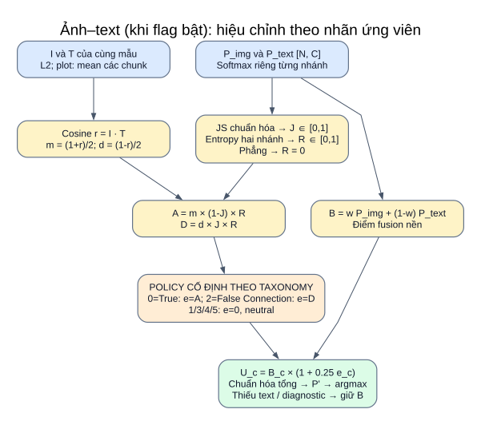

# 13 — Nhánh ảnh ↔ text và công thức theo nhãn

**Khi bật flag, hệ thống có ba phép so sánh:** ảnh–prompt, text–prompt và ảnh–text cùng mẫu. Nhánh quan hệ áp dụng cho backbone của bạn và OpenAI CLIP/WaffleCLIP/DCLIP, trên cả năm task. Mặc định flag tắt; code không nhận nhãn thật để chọn đường suy luận.



[Mở SVG](so_do/15_quan_he_anh_text.svg) · [Mục lục](README.md)

## Policy phụ thuộc ý nghĩa nhãn

Fakeddit định nghĩa False Connection là ảnh không hỗ trợ đúng chú thích, và gán nhãn theo chủ đề subreddit. Cùng đối tượng không bảo đảm đúng ngữ cảnh. Trong năm dòng đầu đã xem, `cv9kwi` có ảnh bản đồ marathon/title về chuyến đi học của bố; `7yas5i` có ảnh bấm kim/title nhân hóa bấm kim “excited”. Cả hai có nhãn 2, nhưng trường hợp thứ hai vẫn cùng đối tượng ảnh–text. [Paper Fakeddit](https://arxiv.org/html/1911.03854)

| Nhãn/task | Policy và hành vi |
|---|---|
| Fakeddit 6way `0=True` | `match`: ưu tiên nhẹ khi khớp và đồng thuận có thông tin; không suy ra “khớp = thật” |
| Fakeddit 6way `2=False Connection` | `mismatch`: ưu tiên nhẹ khi cosine thấp đi cùng bất đồng có thông tin |
| Fakeddit 6way 1/3/4/5 | `neutral`: giữ điểm nền; châm biếm/mạo danh/chỉnh sửa/gây hiểu lầm vẫn có thể rất khớp |
| Fakeddit 2way | Diagnostic; fake không đồng nhất với mismatch |
| CrisisMMD hai task | Diagnostic; nhãn nhân đạo/liên quan không phải nhãn khớp cặp |
| MM-IMDb | Diagnostic; poster không cần mô tả chính xác toàn bộ plot |

Paper CrisisMMD chú thích ảnh và text riêng; schema processed đang xem chỉ có cột nhãn task chung, không có annotation khớp cặp. Không quy cặp khác nội dung thành not_humanitarian/not_informative. [Paper CrisisMMD](https://arxiv.org/html/1805.00713)

## Công thức thật trong code

**Điểm nền single-label**, với I/T là vector L2, E là vector prompt lớp:

```text
P_img  = softmax(s_model × (I × E_imgᵀ) + b_model)
P_text = softmax(s_text × (T × E_textᵀ) + b_model)
B_c    = w P_img,c + (1-w) P_text,c
```

**Cosine cặp cùng mẫu** và phép đổi thang:

```text
r = clip((I · T) / (||I||₂ ||T||₂), -1, 1)
m = (1+r)/2; d = (1-r)/2
```

m/d không phải xác suất khớp hoặc phủ định. Không đặt ngưỡng “cosine thấp → fake”; không lấy text khác trong batch làm nhãn đúng/sai cho cặp này.

**JS đo bất đồng và entropy đo mức có thông tin**, C là số lớp:

```text
M = (P_img + P_text)/2
KL(P || M) = Σ_c P_c ln(P_c / M_c)           # 0 ln 0 = 0
J = [KL(P_img || M) + KL(P_text || M)] / (2 ln 2)
H(P) = -Σ_c P_c ln(P_c)
R = clip(1 - max(H(P_img), H(P_text))/ln(C), 0, 1)
```

J thuộc [0,1], cao khi hai nhánh bất đồng. R lấy độ tin cậy của nhánh yếu hơn: hai phân phối cùng phẳng không phải đồng thuận có thông tin; R≈0 thì tắt hiệu chỉnh. Entropy thấp vẫn có thể là tự tin sai; JS đo bất đồng **nhãn**, không phải entailment ảnh–câu.

**Evidence theo ứng viên lớp và điểm cuối**:

```text
A = m (1-J) R
D = d J R
e_c = A nếu match; D nếu mismatch; 0 nếu neutral/không khai báo
U_c = B_c (1 + λ e_c)
P'_c = U_c / Σ_k U_k
y_hat = label_order[argmax_c P'_c]
```

λ hiện cố định **0.25**. Hệ số tăng trước chuẩn hóa nằm trong [1,1.25]. Không ép lớp quan hệ thắng, không xóa lớp neutral; tỷ lệ điểm giữa hai lớp neutral giữ nguyên. B_c=0 thì không tự tạo lớp đó từ số 0. Đây là heuristic của dự án, không là công thức đã được paper Fakeddit kiểm chứng.

Text rỗng/vector zero, λ=0, chế độ chỉ ảnh/text: giữ quyết định nền. `diagnostic` giữ nguyên tất cả đầu ra phân loại. Các lớp được tính đồng thời theo taxonomy, không chọn policy bằng y_true của mẫu.

## Plot dài, batch và đầu ra

Ảnh–plot dùng mean vector các chunk đã L2, rồi L2 lại. `max_sim` tạo max riêng từng lớp nên không có một vector plot chung; code thu mean vector từ **cùng lượt encode**, không encode plot lần hai và không đổi điểm max_sim. MM-IMDb chỉ ghi cosine; không dùng JS của điểm z/sigmoid như phân phối single-label.

Các buffer quan hệ riêng giữ điểm nhánh phân loại không đổi kể cả khi phải encode thêm nhánh chỉ để diagnostic. Quan hệ là tích vô hướng theo từng cặp N mẫu, không tạo ma trận N×N.

Log có `image_text_similarity`, `image_text_js_divergence`, `image_text_reliability`, `image_text_match_evidence`, `image_text_mismatch_evidence`, `relation_applied` tùy task. Text rỗng ghi ô trống. Single-label `score_<label>` là P'; score_image/text vẫn là điểm nền. Manifest/summary ghi mode/weight/policy/thuật toán/biểu diễn text; tắt audit vẫn ghi cột quan hệ.

## Cấu hình và phạm vi runner

```yaml
inference:
  image_text_relation:
    enabled: false           # đổi true để bật mọi model/dataset của pipeline chính
    mode: auto
    weight: 0.25
```

Khối trên ở `configs/experiment_config.yaml`. `auto` chọn class_aware cho Fakeddit 6way với policy 0=match/2=mismatch; Fakeddit 2way, CrisisMMD hai task và MM-IMDb dùng diagnostic. Không phải sửa mode khi đổi task. Có thể đặt enabled/mode/weight riêng dưới `datasets.<tên>.image_text_relation`; giá trị riêng ưu tiên hơn giá trị chung.

Runner tổng/riêng/demo dùng cùng flag toàn cục và override dataset. Hai runner nghiên cứu có flag `image_text_relation.enabled: false` ở **cấp gốc** YAML riêng, ưu tiên hơn thiết lập dataset trong base_config. Upstream còn cho override riêng dưới datasets; thứ tự là base → flag runner → override dataset nghiên cứu.

Khi bật upstream, embedding quan hệ được cache cùng ảnh/text mẫu, tái dùng qua clip/waffle/dclip_labels/dclip và seed. Với original_image, relation_mode hiệu lực luôn diagnostic, nhãn ảnh giữ cách tác giả; multimodal dùng mode theo taxonomy. Khi tắt, không tạo buffer/điểm quan hệ, không thêm encode mẫu chỉ phục vụ nhánh này và không có cột cosine trong log.

## Thử nhỏ có kiểm soát

```bash
venv/bin/python -B src/research/run_relation_ablation.py --offline --device cpu
```

Giới hạn cứng **năm dòng đầu trước lọc**, encode một lần/model. Plan và hash source được lưu trước inference. So baseline, heuristic cũ chỉ cộng vào False Connection (λ=0.1), và class_aware (λ=0.25) từ cùng log; không chọn tham số theo F1 của năm mẫu. Xem [báo cáo thực chạy](../quan_he_anh_text_20261012.md).

Lệnh đối chứng này chủ động bật quan hệ riêng để so các phương án; nó không sửa flag mặc định của các YAML chạy thường.

[pair_relation.py](../../src/pair_relation.py) · [inference.py](../../src/inference.py) · [text_chunking.py](../../src/text_chunking.py) · [runner đối chứng](../../src/research/run_relation_ablation.py) · [kiểm thử](../../tests/test_pair_relation.py).
