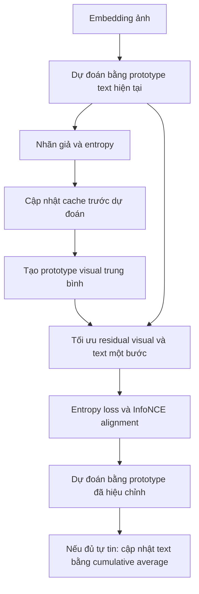

# DPE và kết hợp DPE + DN-unit

Đã hoàn tất ngày 29-10-2026 trên artifact train 3.000 và dev 2.219 ảnh,
MetaCLIP2 ViT-H/14, image-only. Không đọc raw/processed, không tải model,
không gửi Kaggle, không dùng test hoặc support có nhãn. Không đổi pipeline
mặc định hoặc frozen final protocol DN-unit v1.

## Nguồn nghiên cứu và lựa chọn

- [DPE, NeurIPS 2024](https://arxiv.org/abs/2410.12790),
  [repo tác giả](https://github.com/zhangce01/DPE-CLIP), commit
  `fecae5a50d7dc39fb944221be390201a56948416`.
- [Frolic, NeurIPS 2024](https://arxiv.org/abs/2410.19294),
  [repo tác giả](https://github.com/zhuhsingyuu/Frolic), commit
  `a42343948b7fa45dcf3a60602e5c894edaa956ff`.

DPE cập nhật cả prototype text và visual, tối ưu residual theo từng ảnh.
Khác DMN đã thử, có gradient cho các residual và loss căn chỉnh hai loại
prototype. Encoder CLIP giữ frozen; nhãn thật không được đưa vào core.

Đối chiếu `main_dpe.py`, các hàm entropy/get_clip_logits của `utils.py` và
`configs/imagenet.yaml`. Core tác giả có nhánh single-view; loader mười
cross-dataset dùng preprocess một view, còn ImageNet/OOD dùng AugMix 64
view. Bản dự án dùng một view thật đã cache, CPU FP32 thay CUDA/half, prompt
và backbone riêng. Vì vậy đây là **DPE single-view adaptation**, không phải
tái lập điểm benchmark gốc hoặc phiên bản ImageNet nhiều view.

Frolic README vẫn chỉ công bố core, thiếu các module dataset/utils được
import. Paper giả định prior đều cho công thức covariance thực nghiệm;
không mặc định giả định này đúng với CrisisMMD. Đợt này chỉ trích thành phần
confidence matching để kiểm tra fusion, không dựng lại pipeline Frolic đầy đủ.

## Cấu hình và giả thuyết

Giữ một cấu hình tác giả trước khi đo: cache 3 ảnh/lớp, alpha=6, beta=5,
lr text=image=0,0006, alignment weight=0,5, scale=100, một bước AdamW mỗi ảnh
(eps=1e-3, weight_decay=0,1). InfoNCE temperature=0,01. Ngưỡng cập nhật text
là entropy/log2(K) < 0,1, giữ cách chuẩn hóa của code gốc dù entropy dùng ln.



Memory giữ ba ảnh entropy thấp nhất mỗi lớp theo nhãn giả online. Prototype
visual ban đầu là mean chưa unit-normalize, rồi được chuẩn hóa ở bước cộng
residual như tác giả. Cumulative average giữ đúng bộ đếm và quy tắc code
gốc, không tự thay bằng EMA hoặc chuẩn hóa global text sau mỗi lần cộng.

Giả thuyết DPE: prototype thích nghi có thể sửa sai mà prompt cố định chưa
giải quyết được. Thử riêng cổng DPE + leaf gốc/DN, majority/InMaP + leaf DPE,
và DPE cả hai tầng. Các đối chứng giữ nguyên majority + DN, InMaP + DN.

Ba shuffle seed 0/1/2, reset cache/prototype/optimizer đúng phạm vi; mean
không chọn seed tốt nhất. Đây là ba thứ tự stream, không phải ba lần train
backbone. Nhãn dev binary không có, metric giữ null.

## Kết quả DPE

Macro-F1 (%); mỗi hàng DPE là mean ba shuffle:

| Phương án | Binary train | Human train | Human dev | Recall cứu trợ dev |
|---|---:|---:|---:|---:|
| Hai tầng gốc | 79,58 | 49,88 | 48,06 | 76,07 |
| Majority + DN-unit | 80,83 | 49,22 | 50,39 | 60,00 |
| InMaP + DN-unit | 81,75 | 50,36 | 49,75 | 70,36 |
| DPE gate + leaf gốc | 80,58 | 49,91 | 47,88 | 79,29 |
| DPE gate + DN-unit | 80,58 | 49,28 | 48,40 | 78,10 |
| Majority + DPE leaf | 80,83 | 48,81 | 49,92 | 58,69 |
| InMaP + DPE leaf | 81,75 | 50,05 | 49,47 | 69,29 |
| DPE cả hai tầng | 80,58 | 49,07 | 48,44 | 77,14 |

DPE cổng tăng binary train khoảng 0,99 điểm so với gốc, nhưng thấp hơn các
cổng đang giữ. DPE gate + DN tăng recall cứu trợ dev, đồng thời có điểm
train thấp hơn gốc và dev thấp hơn ứng viên majority + DN. DPE leaf chưa
vượt được DN-unit với cùng cổng majority hoặc InMaP. Không chọn DPE vì một
seed riêng đạt điểm cao hơn mean.

## Fusion dùng một thành phần Frolic

Giả thuyết bổ sung: DN chỉnh phần lệch chung, DPE điều chỉnh prototype theo
stream, nên hai head có thể bổ sung cho nhau. Khóa phép thử trước khi đo:

1. Đối chứng cộng đều `100 * DN_cosine + DPE_logits`.
2. Confidence matching giữ đúng `compute_confidence`/`search_T` của core
   Frolic: target là mean max-softmax DN ở scale 100, nhiệt độ DPE bắt đầu
   1, nhân/chia 1,1 đến relative error < 10%, rồi cộng hai logits với hệ số 1.
3. Giữ hai cổng majority/InMaP có sẵn; không fit weight hoặc threshold bằng GT.

Tìm nhiệt độ chỉ dùng score không nhãn, không phải dò nhiệt độ theo F1. Giữ
giới hạn 1.000 bước để báo input không hội tụ, không thay bằng kết quả tốt
nhất đã đo. Confidence matching không bảo đảm xác suất được hiệu chuẩn đúng.
Nhiệt độ dùng toàn cohort nên fusion là transductive, không còn nhân quả
theo prefix, dù core DPE riêng chạy theo stream.

| Phương án | Binary train | Human train | Human dev | Recall cứu trợ dev |
|---|---:|---:|---:|---:|
| Majority + DN-unit | 80,83 | 49,22 | 50,39 | 60,00 |
| Majority + DPE/DN cộng đều | 80,83 | 48,89 | 50,28 | 59,29 |
| Majority + DPE/DN confidence matching | 80,83 | 49,04 | 50,29 | 59,29 |
| InMaP + DN-unit | 81,75 | 50,36 | 49,75 | 70,36 |
| InMaP + DPE/DN cộng đều | 81,75 | 50,17 | 49,70 | 70,00 |
| InMaP + DPE/DN confidence matching | 81,75 | 50,30 | 49,71 | 70,00 |

Fusion cải thiện so với DPE leaf riêng, nhưng chưa thắng DN-unit cùng cổng.
Không chuyển mặc định hoặc quảng bá mức tăng so với baseline yếu hơn là
đã vượt ứng viên mạnh nhất. Dev đã được dùng nhiều lần; đây là thăm dò,
chưa có kết luận test độc lập hoặc về DPE nhiều view trên CrisisMMD.

## Artifact và kiểm chứng

- DPE chính thức dùng trong báo cáo:
  `results/analysis/clip_dpe/6c5efeb4da87/`.
- Fusion:
  `results/analysis/clip_dpe_fusion/e1f3284c8605/`.
- Mỗi artifact có frozen plan, manifest, input/code/output hash, logits,
  trace, prediction theo ID, metric từng lớp, mean và audit passed.
- Sáu unittest: causal prefix/reset, cache entropy, coverage/order, input
  rejection, InfoNCE một lớp, runner dùng nhãn chỉ tính metric, và fusion.
- `reference_verification.json`: hai ca tổng hợp và đủ 12 stream task thật
  (2 split × 2 task × 3 seed). Vòng lặp DPE được trích AST, tắt model/dataset,
  CUDA/half chuyển CPU/FP32, accuracy/logging thay bằng observer. InfoNCE
  mặc định viết bằng normalized dot / 0,01 và cross entropy. Mọi logits,
  prediction, final cache và số cập nhật text đều khớp; max logit error 0.
- Audit kiểm tra lại mọi sự kiện ghi/thay cache, entropy/điều kiện update,
  ID/GT/order, prediction, metric và mean. Fusion đối chiếu trực tiếp hai
  hàm confidence matching tác giả trên cả sáu input thật, khớp nhiệt độ và
  mọi logits/prediction. Đối chiếu CPU không chứng minh tương đương CUDA FP16.
- Đã sửa layout tensor để cùng thứ tự phép tính FP32 trước khi khóa lượt
  báo cáo; artifact sơ bộ `cf917a0837db` không dùng làm kết quả cuối.
- Frozen final protocol DN-unit v1 vẫn xác thực thành công, chưa mở test.

## Tái lập

Các lượt trên đã chạy xong, không cần gửi job mới. Tại thư mục gốc:

```bash
venv/bin/python -B -m unittest experiments.clip_dpe.test_dpe -b -q
venv/bin/python -B experiments/clip_dpe/run.py --config experiments/clip_dpe/config.json
venv/bin/python -B experiments/clip_dpe/fusion.py \
  --dpe-run results/analysis/clip_dpe/6c5efeb4da87
venv/bin/python -B experiments/clip_dpe/audit.py \
  --dpe-run results/analysis/clip_dpe/6c5efeb4da87 \
  --fusion-run results/analysis/clip_dpe_fusion/e1f3284c8605 \
  --frolic-dir /private/tmp/vlm-frolic-reference
```

Chạy lại runner tạo output mới. Lệnh fusion ở trên trỏ artifact đã khóa;
nếu muốn đánh giá một lượt mới phải truyền đúng output mới, không ghi đè
artifact cũ. Reference audit cần checkout tác giả đúng commit nêu trên.
