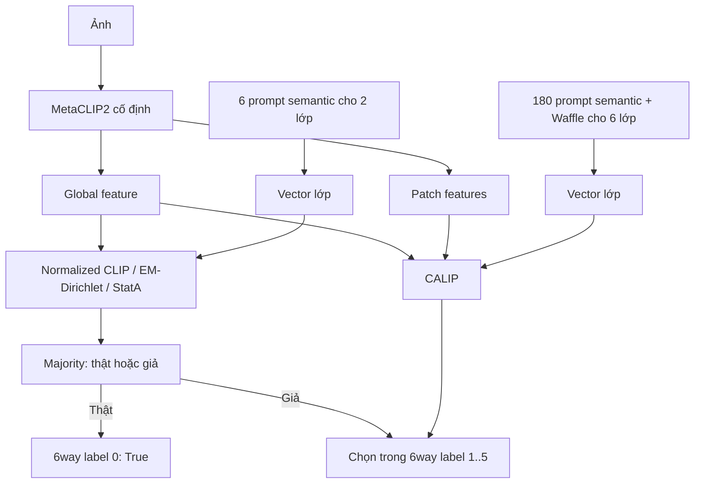

# Fakeddit: majority + CALIP

Một lượt MetaCLIP2 ViT-H/14 cho 3.000 ảnh đã có baseline, xuất kết quả cả task 2 lớp và 6 lớp. Không huấn luyện trọng số, không dùng nhãn để thích nghi, không chạy inference cục bộ khi triển khai. Chỉ dùng ảnh cho các phương pháp mới; kết quả baseline ảnh + text được giữ riêng để tham khảo.

## Prompt đã rà soát

Giữ nguyên prompt và kết quả baseline. Prompt mới nằm ở `configs/prompts/fakeddit_calip_semantic.json`, được viết theo định nghĩa lớp, không dựa vào mẫu hoặc lỗi validation:

- Tầng 2 lớp: 3 mô tả/lớp, tổng 6 prompt semantic. Bớt các khẳng định về quan hệ với caption không có trong đầu vào ảnh.
- Tầng 6 lớp: 3 mô tả/lớp; sau Waffle có 30 prompt/lớp, tổng 180 prompt. Sinh từ bộ sinh chính thức của WaffleCLIP, 15 cặp từ/ký tự, prompt seed 0; các lớp chia sẻ hậu tố theo phương pháp gốc.
- Lớp True không bị đồng nhất với ảnh đời thường; ảnh khác thường cũng có thể thật. Satire không đồng nhất với mọi ảnh hài hước. Manipulated không phải mọi ảnh giả: ảnh thật vẫn có thể nằm trong false connection hoặc misleading.
- False Connection cần ảnh–caption; Imposter và Misleading cũng thường cần nguồn/ngữ cảnh. Giữ đúng nghĩa nhãn, không đổi nghĩa để biến thành các lớp dễ nhận biết bằng ảnh. Prompt ảnh chỉ cung cấp dấu hiệu giả thuyết; sửa prompt không thể khôi phục ngữ cảnh bị thiếu.

Nguồn taxonomy: https://github.com/entitize/Fakeddit/issues/14#issuecomment-815355653
Paper: https://arxiv.org/abs/1911.03854

## Luồng và đối chứng



Ánh xạ khác nhau giữa hai task: 2way `1=real`, `0=fake`; 6way `0=True`, `1=Satire`, `2=False Connection`, `3=Imposter`, `4=Manipulated`, `5=Misleading`. Cổng dùng prompt semantic; tầng chi tiết dùng semantic_waffle và CALIP. CALIP dùng cả sáu lớp trong attention, rồi cổng giả mới giới hạn argmax vào năm lớp giả.

Các dòng kết quả quan trọng:

| Dòng | Mục đích |
|---|---|
| cached_multimodal_baseline | Baseline ảnh + text đã chạy, không suy luận lại |
| legacy_mean_cosine | Nhánh ảnh với chính prompt baseline, đối chiếu xác suất ảnh đã lưu |
| semantic_unit | Tác động của prompt semantic với prototype chuẩn hóa |
| semantic_waffle_unit | Đối chứng cùng prompt với CALIP, chỉ dùng global CLIP |
| calip_flat | CALIP phân loại trực tiếp 2 hoặc 6 lớp |
| majority_mean (2way) | Trung bình chỉ số của cổng ba thuật toán qua ba grouping seed |
| majority_unit_mean (6way) | Cổng majority + tầng chi tiết global CLIP |
| majority_calip_mean (6way) | Cổng majority + tầng chi tiết CALIP |

Ngoài ra lưu mean cosine/unit cho từng bộ prompt để tách tác động chuẩn hóa. Không chọn seed tốt nhất. Nhóm truy vấn tối đa 75 ảnh, seed 0/1/2; EM/StatA dùng cùng nhóm, không có nhãn. StatA giữ normalized prior nếu nhóm cuối <=3. CALIP giữ attention scale 2 và beta [1,1.12,0.02] như nhánh CrisisMMD, không tìm hệ số trên nhãn Fakeddit.

## Chạy

Bộ prompt và reference đã được đóng băng từ hai baseline 3.000 mẫu trong `configs/prompts/fakeddit_calip_reference.json`. Không cần chạy lại baseline hoặc prepare. Một job xuất cả hai task:

```bash
venv/bin/python -B scripts/launch_runs.py \
  --launcher-config experiments/fakeddit_calip/launcher.yaml \
  --job fakeddit_calip \
  --use-kaggle true
```

Chạy trên GPU máy cá nhân: đổi `--use-kaggle true` thành `--use-kaggle false`. Smoke GPU tùy chọn thêm `--max-samples 5`; không dùng kết quả smoke để kết luận. Nếu lượt đã được gửi nhưng mất kết nối, dùng `--resume-stage <đường dẫn staging được in ra>`; không gửi lại job đang chạy.

Output nằm dưới `results/fakeddit_calip/fakeddit/6way/samples_3000/metaclip2_vith14/` và chứa cả hai task: summary.tsv, analysis.json, predictions_2way.tsv, predictions_6way.tsv, scores.npz, frozen_prompts.json, cohort.json, extraction.json và run_manifest.json.

Runner lấy thứ tự ID, nhãn, đường dẫn và kích thước ảnh từ snapshot baseline, không quét lại TSV. Trước khi báo kết quả, runner so xác suất nhánh ảnh với baseline (atol/rtol 2e-4); sai sẽ dừng. Baseline cũ không lưu hash nội dung ảnh nên không tuyên bố chứng minh ảnh giống từng byte; lượt mới lưu SHA256 ảnh và kiểm tra kích thước cùng khả năng tái tạo điểm baseline.

Các thí nghiệm dùng cùng validate cohort, mang tính thăm dò. Sẽ đánh giá Macro-F1, Accuracy và từng lớp; không có cam kết cải thiện trước khi chạy. Baseline đa phương thức và phương pháp chỉ dùng ảnh khác đầu vào, vì vậy kết luận về thuật toán phải dựa thêm vào các đối chứng ảnh.

## Kiểm tra cục bộ

```bash
venv/bin/python -B -m unittest experiments.fakeddit_calip.test_fakeddit_calip -q
```

Test dùng ảnh và mô hình nhỏ giả lập, kiểm tra ánh xạ nhãn hai task, majority thực trên embedding tổng hợp, luồng chạy đầy đủ và từ chối kết quả nếu không tái tạo được xác suất baseline. Không đọc dataset thực hoặc tải checkpoint.

## Kết quả đã kiểm tra — lượt a3f7a8a3a561

Cùng 3.000 mẫu validate, MetaCLIP2 ViT-H/14; các hàng majority là trung bình ba grouping seed, không chọn seed tốt nhất.

| Task | Phương án | Accuracy | Macro-F1 |
|---|---|---:|---:|
| 2way | Baseline ảnh + text đã có | 54,20% | 50,36% |
| 2way | Baseline chỉ ảnh, prompt cũ | 55,73% | 52,93% |
| 2way | Semantic, prototype unit | 61,73% | 61,73% |
| 2way | CALIP trực tiếp, semantic_waffle | 61,87% | 61,86% |
| 2way | Majority, semantic | 62,63% | 62,59% |
| 6way | Baseline ảnh + text đã có | 34,87% | 25,20% |
| 6way | Baseline chỉ ảnh, prompt cũ | 35,70% | 25,61% |
| 6way | CALIP trực tiếp, semantic_waffle | 25,00% | 21,58% |
| 6way | Majority + semantic_waffle unit | 44,17% | 27,17% |
| 6way | Majority + CALIP | 44,22% | 27,53% |
| 6way | Majority + prompt baseline, mean cosine (đối chứng offline bổ sung) | 49,37% | 30,04% |

Nhận xét: prompt semantic cải thiện rõ cổng 2way. Ở 6way, prompt mới làm tầng chi tiết yếu đi; CALIP chỉ giúp nhẹ khi giữ nguyên cổng và bộ prompt mới (+0,36 điểm phần trăm Macro-F1 so với majority_unit). Tăng Accuracy của hệ hai tầng chủ yếu nhờ nhận diện True tốt hơn; F1 False Connection của majority + CALIP seed 0 chỉ 10,94%, so với 36,03% của baseline chỉ ảnh. Vì vậy chưa thể coi CALIP hoặc prompt mới là cải tiến đồng đều trên mọi lớp.

Đối chứng offline được tính sau khi xem kết quả, sử dụng embedding và prototype đã lưu, cùng cổng majority và quy tắc hai tầng, chỉ đổi tầng chi tiết về prompt baseline với mean cosine. Không chạy lại encoder/GPU hoặc thay tham số theo nhãn. Đây là ứng viên thăm dò tốt hơn trong các tổ hợp đã đối chiếu, chưa phải kết luận test độc lập; chưa chuyển mặc định runner sang tổ hợp này.

Audit: `results/analysis/fakeddit_calip_review/a3f7a8a3a561/audit.json`. Đã kiểm tra hash 8 artifact và 30 file nguồn, tái tính Accuracy/Macro-F1/F1 từng lớp từ mọi cột dự đoán, kiểm tra ID/nhãn/thứ tự và seed, tái tạo cổng EM/StatA cả ba seed từ embedding. Xác suất nhánh ảnh khớp baseline, sai số tối đa 2,05e-5 (2way) và 8,34e-5 (6way); global feature đối chiếu forward chuẩn sai số 0. Receipt và gói mã staging khớp các hash nguồn.

Một argmax ở đối chứng `6way semantic_mean_cosine` thay đổi khi nhân ma trận lại trên máy khác, chênh hai điểm chỉ 4,47e-8: ghi nhận như gần hòa do float32. Chỉ số báo cáo được tái tính từ dự đoán đã lưu; không sửa dự đoán gốc. Patch features không được lưu nên audit không chạy lại toàn bộ attention CALIP; kiểm tra hash/logit/argmax và dùng phần CALIP đã có kiểm tra riêng.

Lệnh audit chỉ dùng artifact, không truy cập dataset hoặc checkpoint:

```bash
venv/bin/python -B experiments/fakeddit_calip/analyze.py \
  results/fakeddit_calip/fakeddit/6way/samples_3000/metaclip2_vith14/6way_a3f7a8a3a561 \
  --replay \
  --output results/analysis/fakeddit_calip_review/a3f7a8a3a561/audit.json
```

## Bổ sung tiêu đề Reddit — fusion từ điểm lưu sẵn

Đã triển khai `multimodal.py` và chạy đủ 3.000 mẫu của cả hai task. Không cần GPU: baseline đã lưu xác suất text từ MetaCLIP2 với đúng ID/thứ tự, hash tiêu đề, prompt và nhãn; lượt ảnh đã có embedding/prototype/CALIP logits. Script không mở ảnh, TSV processed, raw data hoặc checkpoint.

Giữ image_weight=0.75 và text_scale=25 từ baseline, không tìm hệ số theo nhãn. Kết hợp ở tầng xác suất: `p_mix = 0.75 * p_image + 0.25 * p_text`. CLIP global dùng scale 100; CALIP logits đã có scale nên chỉ softmax một lần. Text vẫn dùng bộ prompt legacy của baseline; chưa sinh bộ prompt text mới. Kết quả baseline ảnh + text được tái tạo đúng mọi dự đoán trước khi đánh giá các tổ hợp mới.

Hai vị trí bổ sung text được kiểm tra độc lập:

- Tầng chi tiết: trộn xác suất ảnh (legacy hoặc CALIP) với xác suất text 6way trước khi chọn lớp giả.
- Cổng majority: thay duy nhất lá phiếu normalized CLIP bằng lá phiếu từ ảnh semantic + text legacy. Hai phiếu EM/StatA giữ nguyên từ ảnh. Đây là majority có một voter đa phương thức, không phải cả ba thuật toán được chuyển thành đa phương thức. Cổng và tầng chi tiết có đủ đối chứng chỉ thay một vị trí.

Kết quả, trung bình ba grouping seed:

| Task | Phương án | Accuracy | Macro-F1 |
|---|---|---:|---:|
| 2way | Majority chỉ ảnh | 62,63% | 62,59% |
| 2way | Majority, thêm text vào voter CLIP | 62,62% | 62,55% |
| 6way | Majority ảnh + legacy ảnh ở tầng chi tiết | 49,37% | 30,04% |
| 6way | Thêm text vào voter CLIP; tầng chi tiết legacy ảnh | 49,57% | 30,06% |
| 6way | Thêm text vào voter CLIP và tầng chi tiết legacy | 49,51% | 30,06% |
| 6way | Giữ cổng ảnh, chỉ thêm text vào tầng chi tiết legacy | 49,31% | 30,04% |
| 6way | Giữ cổng ảnh, CALIP chỉ ảnh ở tầng chi tiết | 44,22% | 27,53% |
| 6way | Giữ cổng ảnh, thêm text vào tầng chi tiết CALIP | 44,06% | 27,37% |

Nhận xét: fusion text hiện tại chưa cho thấy cải thiện rõ. 6way thêm text ở voter CLIP tăng Accuracy 0,20 điểm phần trăm nhưng Macro-F1 chỉ tăng khoảng 0,016 điểm phần trăm. Từng seed sửa đúng 15/12/13 mẫu, đồng thời làm sai 7/9/6 mẫu so với tổ hợp chỉ ảnh. 2way gần như không đổi. Text-only với prompt legacy đạt 47,27% Accuracy / 38,51% Macro-F1 ở 2way và 15,60% / 10,26% ở 6way, cho thấy nhánh text đang dùng còn yếu. Không suy rộng thành kết luận rằng text không hữu ích cho Fakeddit.

Thí nghiệm này trộn điểm lớp; chưa tính trực tiếp cosine giữa embedding ảnh và tiêu đề, chưa kiểm tra cặp khớp/sai hoặc thay prompt text. False Connection vẫn cần nghiên cứu tương tác ảnh–tiêu đề. Không chọn lại seed hoặc tối ưu trọng số trên validation; mọi kết quả vẫn mang tính thăm dò trên cohort đã xem.

Output thực: `results/fakeddit_multimodal/fakeddit/paired/samples_3000/metaclip2_vith14/f127102348e4/`. Đã đối chiếu 46 cột dự đoán, Accuracy/Macro-F1 bằng sklearn độc lập, trung bình/độ lệch chuẩn, tính nhất quán nhãn hai tầng, hash artifact và mã nguồn. `audit.json` ghi kết quả kiểm tra; `summary.tsv` chứa cả đối chứng flat và hai tầng.

Chạy lại bằng CPU nếu cần (tạo thư mục kết quả mới, không gửi Kaggle):

```bash
venv/bin/python -B experiments/fakeddit_calip/multimodal.py
```

Kiểm tra logic fusion và cổng:

```bash
venv/bin/python -B -m unittest experiments.fakeddit_calip.test_multimodal -q
```
