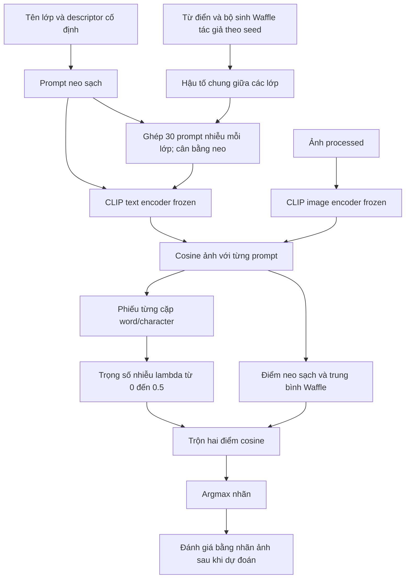

# Waffle lab — thử cải tiến trên CrisisMMD

## Cập nhật 28/10/2026: đối chứng MetaCLIP2

Lab hỗ trợ thêm `--backbone metaclip2_vith14` qua `VLMWrapper` hiện có.
Checkpoint, preprocess và tokenizer lấy từ model registry; model eval, không gradient,
chỉ ảnh và mean cosine. Kết quả lưu dưới model `metaclip2_vith14`; analysis nhận
`metaclip2_real` và vẫn từ chối gộp khác model/cohort/protocol. Không đổi mặc định
OpenAI CLIP hoặc tự gửi job. Đã kiểm tra chuẩn bị prompt; chưa chạy MetaCLIP2 thật.

Chạy thử 5 mẫu trước, rồi 3.000 mẫu; mỗi lần một lệnh và đợi hoàn tất:

```sh
venv/bin/python -B scripts/launch_runs.py --launcher-config experiments/waffle_lab/launcher.yaml --job waffle_info --method waffle --backbone metaclip2_vith14 --seed 0 --max-samples 5 --use-kaggle true
venv/bin/python -B scripts/launch_runs.py --launcher-config experiments/waffle_lab/launcher.yaml --job waffle_info --method clip --backbone metaclip2_vith14 --seed 0 --max-samples 3000 --use-kaggle true
venv/bin/python -B scripts/launch_runs.py --launcher-config experiments/waffle_lab/launcher.yaml --job waffle_info --method waffle --backbone metaclip2_vith14 --seed 0 --max-samples 3000 --use-kaggle true
venv/bin/python -B scripts/launch_runs.py --launcher-config experiments/waffle_lab/launcher.yaml --job waffle_humanitarian --method clip --backbone metaclip2_vith14 --seed 0 --max-samples 3000 --use-kaggle true
venv/bin/python -B scripts/launch_runs.py --launcher-config experiments/waffle_lab/launcher.yaml --job waffle_humanitarian --method waffle --backbone metaclip2_vith14 --seed 0 --max-samples 3000 --use-kaggle true
```

`clip` ở đây là tên phép đối chứng một prompt, vẫn chạy bằng MetaCLIP2.
Chưa cần lặp seed đến khi có kết quả ban đầu. Thay code runner làm đổi protocol
fingerprint; không gộp các lượt OpenAI cũ với lượt mới như cùng phiên bản giao thức.
Các mục trạng thái 22/10 bên dưới là lịch sử trước các lượt Waffle gốc đã chạy thật.

Trạng thái ngày 22/10/2026: đã triển khai runner và đối chứng riêng. Kiểm thử kỹ thuật
dùng dữ liệu giả; chuẩn bị prompt không cần checkpoint. **Chưa có kết quả phân loại
model thật cho các biến thể mới.** Không lấy số liệu giả hoặc phép kiểm tra năm mẫu
làm bằng chứng phương pháp tốt hơn.

## 1. Dữ liệu dẫn tới thiết kế này

Đã xem schema và tối đa **năm dòng đầu mỗi TSV** của CrisisMMD, Fakeddit, MM-IMDb;
xem ba ảnh processed đầu của CrisisMMD. Không truy cập `dataraw/` hoặc `data/raw/`.
Phần kiểm tra có giới hạn được lưu ở `checks/data_review.json`; nó không mô tả phân
bố toàn bộ dataset.

- CrisisMMD có nhãn ảnh và text riêng, có cặp không đồng ý. Nhãn đích hiện tại là
  **nhãn ảnh**; tweet về thiên tai không tự làm ảnh thành informative. Lab không đọc
  caption để tính điểm, không lọc mẫu dựa vào độ dài tweet hay độ khớp ảnh–tweet.
- Lớp `Not Informative`/`Not Humanitarian` diễn đạt trừu tượng và phủ định. Waffle
  quanh tên lớp không tự giải quyết được vấn đề ngữ nghĩa đó. Vì vậy cần đối chứng
  diễn đạt bằng nội dung thị giác, rồi mới đo phần lợi ích thêm từ nhiễu.
- Theo [tài liệu cohort](../../docs/experiments/du_lieu_chinh_3000.md), bộ chính có
  3.000 cặp từ train chung hai task. Humanitarian có lớp chỉ hai mẫu; phải giữ đủ
  tám lớp và xem support/F1 từng lớp. Không suy ra điều này từ năm dòng được đọc.
- Fakeddit 2way/6way có ID lớp khác nghĩa, nhãn giả kết nối cần hai modality;
  MM-IMDb nhiều nhãn và plot dài. Chưa áp nguyên quyết định argmax của lab lên hai
  bộ này. Bước đầu giới hạn CrisisMMD để tách được nguyên nhân thay đổi.

Nguồn chính thức: [CrisisMMD](https://crisisnlp.qcri.org/crisismmd.html) giải thích
việc ảnh và text có thể có nhãn khác nhau. Danh sách support của bộ local lấy từ
tài liệu cohort đã có, chưa kiểm đếm lại toàn bộ ở lần làm việc này.

## 2. Kế thừa gì và đề xuất gì?

- **Từ tác giả Waffle:** dùng trực tiếp bộ sinh `waffle`, từ điển, alphabet từ JSON,
  các cặp word/character, hậu tố chia sẻ giữa lớp và RNG của checkout đã ghim.
  Không sửa `third_party/`. Mốc `waffle` giữ nguyên prompt và mean cosine.
- **Từ dự án:** OpenAI CLIP backend, tên/thứ tự lớp, ba descriptor thị giác mỗi lớp,
  launcher/Kaggle worker và quy ước thư mục kết quả. Descriptor là nội dung đã cố
  định từ định nghĩa lớp, do assistant viết; **không phải đầu ra GPT-3 của paper**.
- **Đề xuất để thử:** đặt hậu tố Waffle sau neo ngữ nghĩa, sau đó trộn với điểm neo
  sạch theo mức đồng thuận giữa các cặp prompt. Đây là heuristic không dùng nhãn
  để fit. Chưa chứng minh tăng điểm và chưa xác minh tính mới trong toàn bộ tài liệu.

Waffle kết hợp descriptor/concept đã tồn tại trong nghiên cứu gốc. Không nhận việc
ghép chúng đơn thuần là đóng góp mới. Giá trị cần kiểm chứng ở đây là cách kiểm soát
nhiễu và hiệu quả trên nhãn khủng hoảng. Nguồn: [paper WaffleCLIP](https://arxiv.org/html/2306.07282v2),
[repo tác giả](https://github.com/ExplainableML/WaffleCLIP),
[OpenAI CLIP và prompt ensembling](https://github.com/openai/CLIP).

## 3. Danh mục bảy phép thử

| `--method` | Cách làm | Mục đích |
|---|---|---|
| `clip` | Một prompt tên lớp theo tác giả | Mốc gốc |
| `waffle` | 15 cặp = 30 prompt/lớp, trung bình cosine | Đo Waffle gốc |
| `waffle_unit` | Cùng prompt Waffle, chuẩn hóa lại prototype trung bình | Tách ảnh hưởng norm prototype |
| `semantic` | Ba neo cố định từ descriptor thị giác hiện có | Tách lợi ích diễn đạt lớp |
| `semantic_waffle` | 30 prompt/lớp: 10 cho mỗi neo, cặp word/character giữ cùng neo | Đo nhiễu quanh neo |
| `anchor_mix` | 50% điểm neo sạch + 50% điểm semantic Waffle | Đối chứng trộn cố định |
| `stable_anchor` | Giảm trọng số semantic Waffle khi các cặp prompt bất đồng | Kiểm tra kiểm soát nhiễu không dùng nhãn |

`semantic_waffle` có 30 prompt khác nhau/lớp, không phải 30 prompt cho từng neo.
`anchor_mix`/`stable_anchor` dùng thêm ba prompt sạch, tổng 33/lớp. Tất cả prompt
được kiểm tra 77 token và lưu trước khi đọc cohort. Không khử prompt trùng.
Với số neo hiện tại, `waffle_pairs` phải chia hết cho 3 để cân bằng mỗi neo.

Các cặp so sánh chính:

1. `waffle` so `clip`: hiệu ứng Waffle trên dữ liệu này.
2. `waffle_unit` so `waffle`: ảnh hưởng chuẩn hóa prototype, không gọi là thêm kiến thức.
3. `semantic` so `clip`: lợi ích diễn đạt có nghĩa.
4. `semantic_waffle` so `semantic`: nhiễu còn giúp khi đã có neo hay không.
5. `anchor_mix` so `semantic_waffle`: ảnh hưởng thêm điểm sạch.
6. `stable_anchor` so `anchor_mix`: trọng số thích nghi có hơn trọng số cố định không.

## 4. Pipeline và công thức của biến thể đề xuất



Ảnh và từng prompt đều được chuẩn hóa unit. Gọi $a_c(x)$ là mean cosine của ba
neo sạch, $n_{r,c}(x)$ là điểm prompt nhiễu thứ $r$, $K=15$ là số cặp, $C$ là số lớp.

$$
w_c(x) = \frac{1}{2K}\sum_{r=1}^{2K} n_{r,c}(x), \qquad
v_{j,c}(x) = \frac{n_{2j-1,c}(x) + n_{2j,c}(x)}{2}
$$

Lấy lớp $\hat c_w = \arg\max_c w_c(x)$. Đếm cặp có **một lớp đứng đầu duy nhất**
và lớp đó bằng $\hat c_w$; cặp hòa không tính là phiếu đồng thuận:

$$
g(x) = \frac{1}{K}\sum_{j=1}^{K}
\mathbf{1}\{\arg\max_c v_{j,c}(x)=\hat c_w\text{ và không hòa}\}
$$

$$
r(x) = \mathrm{clip}\left(\frac{g(x)-1/C}{1-1/C}, 0, 1\right), \qquad
\lambda(x) = 0.5\,r(x)
$$

$$
S_c(x) = (1-\lambda(x))a_c(x) + \lambda(x)w_c(x), \qquad
\hat y(x) = \arg\max_c S_c(x)
$$

`anchor_mix` đặt $\lambda=0.5$ cho mọi ảnh; `stable_anchor` dùng $\lambda(x)$.
Khi nhiễu bất đồng, dự đoán co về neo sạch; nó **có thể đổi nhãn**, không chỉ tạo cờ
review. Khi nhiễu đồng thuận sai, vẫn có thể kéo kết quả sai. Mốc $1/C$ chỉ là tham
chiếu đều để chuẩn hóa heuristic, không phải kiểm định thống kê hoặc xác suất đúng.
Cặp prompt có tương quan, vì vậy không coi 15 phiếu là 15 model độc lập.

Không thay đổi margin bằng nhân scale để gọi là cải tiến. Quyết định dùng cosine;
softmax theo scale checkpoint chỉ để log, chưa hiệu chỉnh xác suất. Lưu riêng
`margin_cosine`, `margin_probability`, `prompt_agreement`, `noise_weight`.

## 5. Chạy thử và mở rộng từng bước

Chạy từ thư mục gốc trong venv. Chuẩn bị prompt cho hai task, không đọc dataset/tải model:

```sh
python -B experiments/waffle_lab/run.py --task informativeness --prepare-only
python -B experiments/waffle_lab/run.py --task humanitarian --prepare-only
```

Smoke test Kaggle **5 mẫu**, một biến thể:

```sh
python -B scripts/launch_runs.py --launcher-config experiments/waffle_lab/launcher.yaml --job waffle_info --method stable_anchor --seed 0 --max-samples 5 --use-kaggle true
```

Một lượt 3.000 mẫu:

```sh
python -B scripts/launch_runs.py --launcher-config experiments/waffle_lab/launcher.yaml --job waffle_info --method waffle --seed 0 --max-samples 3000 --use-kaggle true
```

Đổi `--method` theo bảng, đổi `--job waffle_humanitarian` để chạy task còn lại.
Mỗi lệnh chỉ một phương pháp/model/seed. Không dùng `--model`; muốn đổi OpenAI
backbone dùng `--backbone ViT-L/14` hoặc `--backbone RN50` ở giai đoạn sau.
Chạy local bằng `--use-kaggle false` vẫn có thể tải/nạp model; prepare-only mới
không tải model. `--dry-run` của launcher có đóng gói dữ liệu, không chỉ sinh prompt.

In đầy đủ lệnh rồi tự chọn từng dòng, chương trình này **không gửi job**:

```sh
python -B experiments/waffle_lab/commands.py --max-samples 3000 --seeds 0
python -B experiments/waffle_lab/commands.py --max-samples 3000 --seeds 0 1 2 3 4 5 6
```

Seed 0 cho cả bảy phép thử × hai task là **14 lượt**. Đủ bảy seed cho năm biến thể
ngẫu nhiên, hai đối chứng xác định chạy một lần/task là **74 lượt**; không cần gửi
tất cả ngay. Lượt 5 mẫu chỉ xác nhận pipeline, không chọn phương pháp thắng.
Seed chỉ thay các hậu tố prompt ngẫu nhiên; các ID và ảnh trong cohort giữ nguyên.

Profile lab mặc định `data_mode: bounded` để smoke test không quét cả bộ. Khi dùng
cohort chính đã sync, có thể đổi sang `full_dataset` theo launcher có sẵn; worker
vẫn kiểm tra nội dung mount. Không chạy nhiều lệnh đồng thời vào cùng kernel slug.
Lượt đã gửi có thể tiếp tục bằng `--resume-stage` theo lệnh launcher in ra.

## 6. Kết quả và đánh giá

```text
experiments/waffle_lab/
  core.py              công thức và ghép neo; không nhận nhãn thật
  run.py               runner và khóa cohort
  config.yaml          số cặp, noise_cap, batch_size, descriptor
  launcher.yaml        hai task, mặc định 5 mẫu
  commands.py          in lệnh, không tự chạy
  analyze.py           so ghép cặp và mean/std seed
  tests/               kiểm tra giả nhỏ
  checks/              chứng cứ kiểm tra, không phải kết quả nghiên cứu

results/waffle_lab_<method>/crisismmd/<task>/samples_N/<model>/<task>_<run>/
  frozen_plan.json
  cohort.json
  run_manifest.json
  predictions.tsv
  metrics.json
  summary.tsv

results/analysis/waffle_lab/crisismmd/<task>/samples_N/<model>/<analysis>/
  analysis.json
```

Model được nạp một lần/lượt và giải phóng cả khi lỗi. Mỗi ảnh chỉ encode một lần.
Không dùng ảnh đen thay thế hoặc bỏ mẫu âm thầm. Cohort khóa ở
`results/_system/sample_locks/waffle_lab/`; nếu ID/nhãn/ảnh/thứ tự đổi thì dừng.
So sánh khác cohort hoặc khác protocol/code bị từ chối; muốn nghiên cứu phiên bản
mới phải chạy lại đối chứng cùng phiên bản. Lab không sửa hoặc nhập các số liệu cũ.
Kaggle tải về `summary.tsv`, `run_receipt.json` và `run_artifacts.zip` chứa các file
chi tiết trên. Công cụ phân tích đọc được cả ZIP đó và folder local, không cần tự
giải nén hoặc di chuyển kết quả.

So sánh sau khi có hai run thật; thay đường dẫn bằng hai folder chứa `summary.tsv`:

```sh
python -B experiments/waffle_lab/analyze.py compare --baseline PATH_BASELINE --candidate PATH_CANDIDATE --bootstraps 2000
python -B experiments/waffle_lab/analyze.py seed-summary PATH_SEED0 PATH_SEED1 PATH_SEED2
```

Metric chính: Macro-F1 đủ tám/hai lớp, kèm Accuracy, AUROC informative là lớp dương,
F1/support mỗi lớp, confusion matrix. Phân tích có sai→đúng/đúng→sai, theo event,
bootstrap ghép cặp cho ΔMacro-F1 và McNemar chính xác. P-value là **danh nghĩa thăm
dò**, chưa hiệu chỉnh nhiều phép thử. Mean/std seed gồm Accuracy và Macro-F1,
không chọn seed cao nhất. Một seed không có std đáng diễn giải.

Vòng nghiên cứu: cố định cấu hình → chạy đối chứng → phân tích cặp → ghi kết quả
và giới hạn → sửa đúng một yếu tố → chạy lại đối chứng. Không tự tối ưu liên tục
trên nhãn của một cohort rồi gọi điểm cao nhất là kết quả test độc lập. Cohort hiện
tại là nguồn train để thăm dò; bằng chứng cuối cần dữ liệu đánh giá chưa dùng để
chọn phương pháp. Zero-shot ở đây nghĩa là không huấn luyện trọng số hoặc fit nhãn.

## 7. Kiểm tra kỹ thuật

```sh
python -B -m unittest discover -s experiments/waffle_lab/tests -p 'test_*.py' -q
```

Kiểm tra gồm prompt gốc, chia đều neo/cặp, xử lý bất đồng/hòa, trường hợp thật sự
đổi argmax, AUROC đúng lớp, đọc giới hạn, khóa cohort, ảnh lỗi, giải phóng model,
đường chạy cả bảy biến thể và tích hợp launcher. Embedding trong test là giả;
`analyze.py` mặc định từ chối đưa đầu ra giả/custom vào phân tích model thật.

Đã chạy: **18 test lab + 67 test liên quan đạt**; gói Kaggle dry-run có đúng năm
dòng/năm ảnh, chưa gửi API. Đã kiểm tra **4.480 prompt** của hai task qua bảy seed,
dài tối đa **35/77 token**, không nạp model. Chứng cứ: [validation.json](checks/validation.json),
[prompt_audit.json](checks/prompt_audit.json), [data_review.json](checks/data_review.json).
Các lệnh seed 0 có sẵn ở [commands_seed0.txt](checks/commands_seed0.txt).
